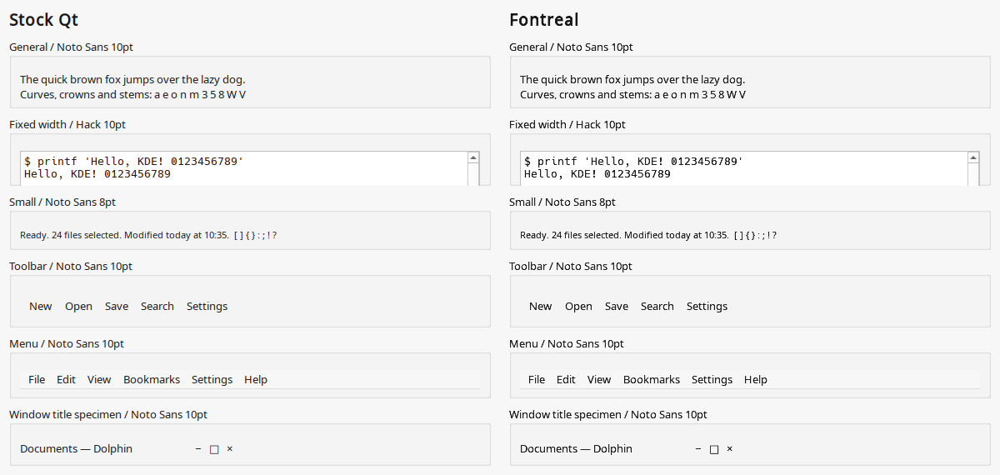
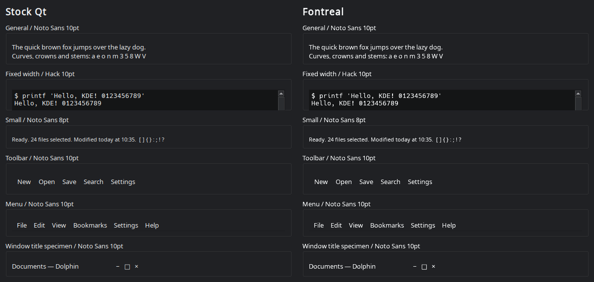

# Fontreal

Fontreal makes small text easier to read with clear strokes and gently softened edges. It is an experimental Linux rendering project. Font choice, size, display scale, and background still affect the result.

## Why this project exists

A stroke split across neighboring pixels can look fuzzy. Curves can have pale gaps, while nearby straight strokes look solid. Fontreal strengthens those weak areas and gives thin stems a clear pixel center.

The selected method uses the font’s native hints to preserve its shape. It then adjusts grayscale coverage, the amount of ink in each pixel. The same rules apply to every font and character. They preserve details at corners and intersections and use nearby strong strokes to set the final stem intensity.

## Suggested fonts

Start with **Noto Sans Display Regular at 10pt** for general UI text, menus and toolbars. This is the preferred starting point with the selected Fontreal profile at 96 DPI and 100% scale. The [font analysis](docs/research/noto-sans-display.md) explains the measured stroke alignment, compares whole-point sizes from 8pt through 16pt, and separates this recommendation from a universal claim about readability.

For terminals, start with **Liberation Mono Regular at 11pt**, or **LiterationMono Nerd Font Regular at 11pt** for the Nerd Font version. These are preferred terminal choices based on their crisp, clean appearance with Fontreal. The terminal recommendation reflects visual use. The linked measurements cover the UI font, not these terminal faces.

## Compare stock Qt and Fontreal

Stock Qt is on the left. Fontreal is on the right. These are real Qt captures at 96 DPI and 100% scale, using the supplied KDE defaults:

| Role | Font | Size |
| --- | --- | --- |
| General | Noto Sans | 10pt |
| Fixed width | Hack | 10pt |
| Small | Noto Sans | 8pt |
| Toolbar | Noto Sans | 10pt |
| Menu | Noto Sans | 10pt |
| Window title | Noto Sans | 10pt |





Open the original PNG at one image pixel per display pixel. Your font renderer does not redraw the text in these images. Browser zoom and image previews can resize it.

The controls use Qt Widgets with Fusion styling. The window-title row is a font specimen, not a KWin decoration capture. The [capture record](docs/images/kde-selected/manifest.json) identifies the fonts, libraries, and image hashes. The sheets preserve the captured pixels without sharpening or resizing.

The [earlier KDE gallery](docs/images/comparison/manifest.json) records the older automatic-hint and linear-blend treatment. It does not represent this selected method. The [8–16pt font study](docs/images/browser-common-ground/weighted-size-captures.json) covers more families and regular/bold weights.

## What the repository does

Fontreal contains a comparison viewer, rendering patches, and tools that build matching libraries on demand. The selected renderer combines native normal hinting, grayscale coverage correction, whole-pixel placement, and encoded blending.

[Firefox and Floorp support](docs/experiments/browser-masks.md) applies this method to your existing working profile. Accounts, bookmarks, history, sessions, and unrelated preferences stay in place. Re-enabling upgrades an older Fontreal activation. Disable restores the original rendering preferences and removes the owned launch hooks.

The private FreeType builder supports pinned Debian 13 and Ubuntu 26.04 sources on amd64. It builds the original and modified libraries together. Saved browser builds remain enabled across browser updates.

The [native KDE workflow](docs/build-system.md) builds matching FreeType and Qt packages with the same selected method. It preserves chosen fonts and sizes. The [Teams and Bitwarden workflow](docs/experiments/chromium-flatpak.md#enable-teams-or-bitwarden-for-daily-use) supplies separate selected engines inside their native Flatpak sandboxes. Both retain original working data and support independent reversal. Telegram remains uncovered. See the [roadmap](docs/roadmap.md).

Chromium-based browsers, including Chrome, Edge, Brave and Vivaldi, are not supported by Fontreal. They draw page text inside their own browser engine. Fontreal has no supported way to apply its stroke adjustments inside that engine. Desktop font settings and browser extensions cannot add that access. See [why Chromium browsers are unsupported](docs/experiments/chromium-flatpak.md#chromium-based-browsers-are-not-supported).

## Try it

For a supported Firefox or Floorp installation, follow the [browser guide](docs/experiments/browser-masks.md). Build requirements include Python 3, C and C++17 compilers, make, pkg-config, patch, dpkg-source, and APT download access.

The [app-specific scenarios](docs/app-scenarios.md) link the requirements, build commands, activation, update behavior and recovery steps for each integration. Follow the [test policy](CONTRIBUTING.md#when-to-run-tests) when Fontreal changes. Routine builds and deployments use the existing supported recipes.

```sh
python3 tools/browser.py enable firefox
python3 tools/browser.py enable floorp
```

Fully quit and reopen each browser. An existing process keeps its loaded renderer until that restart. Use `status` to inspect activation or `disable` to restore the original configuration.

The comparison viewer needs CMake 3.22+, Ninja, Qt 6.6+ Widgets development files, and FreeType development files:

```sh
cmake -S . -B build -G Ninja
cmake --build build
./build/fontreal
```

The viewer retains the earlier experimental controls. It does not select the new browser method automatically. For native KDE packages, use the [system build and recovery guide](docs/build-system.md). The [rendering research](docs/research/native-font-rendering.md) explains the background.

## Feedback welcome

[Open an issue](https://github.com/calculatetech/fontreal/issues/new) with the application, desktop, font family and style, point size, display scale, and background. Include original lossless captures when possible. Cases where stock looks better are useful too.

See the [contribution guide](CONTRIBUTING.md) before adding documentation or captures.

## License

Fontreal’s original code and documentation use [MIT](LICENSE). Qt-derived patches retain their upstream LGPL/GPL alternatives. FreeType-derived patches use the FreeType Project License. The Skia and Chromium patches retain their upstream BSD licenses. See the [third-party notices](THIRD_PARTY_NOTICES.md).
