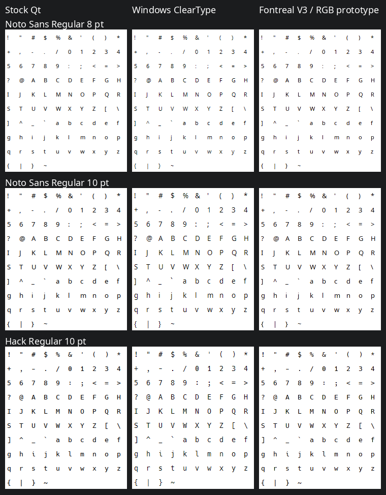
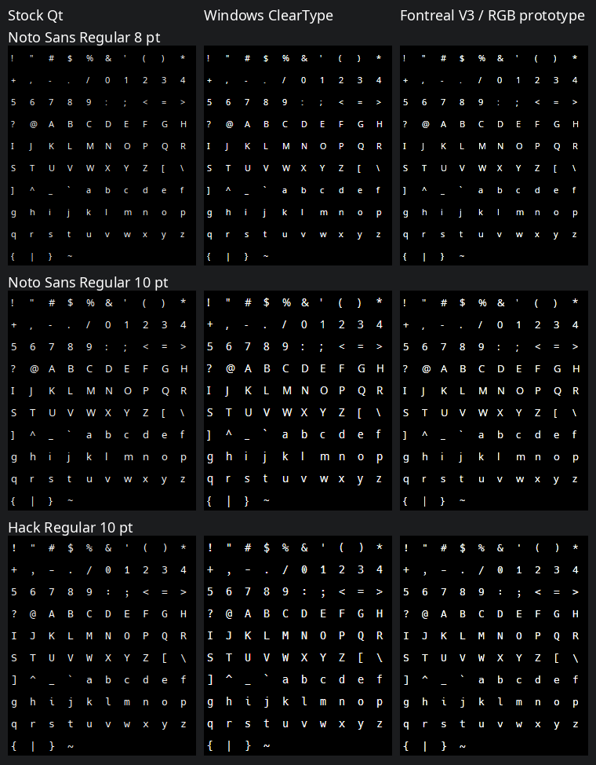

# Fontreal

Fontreal V3 improves text rendering in Qt 6 applications and Plasma. It installs a Qt helper and a Plasma session script. Qt, FreeType, and KWin stay under your distro's package manager. Browsers and Flatpaks keep their original rendering. The comparison images come from a separate Qt build of the V3 reference.

## Why this project exists

A straight stroke can look fuzzy when it falls across two pixels. A curve can look weak when its coverage drops at a join. Fontreal keeps the shape from the font’s hints and uses a four-times-resolution reference for coverage. It balances stroke strength and edge softness for light and dark text.

## Compare stock Qt, ClearType, and V3

These captures use Noto Sans at KDE’s 8pt and 10pt defaults and Hack at 10pt. The columns show stock Qt, Windows ClearType, and Fontreal V3. Open the PNG at 100% image zoom to see each captured pixel at its original size.

See the [capture record](docs/images/kde-v3/capture-sources.json) for renderer and font details.

## Install V3 with stock Qt

Download the package for your x86-64 distro and follow the [installation guide](docs/build-system.md#install-the-stock-qt-helper). Sign out and back in to Plasma.

Open **Fonts** in Plasma System Settings to choose the subpixel layout for your display. Choose **None** for grayscale. The same helper covers direct Qt Quick text with OpenGL and software rendering. The selected layout also covers partially opaque Widgets text on opaque backgrounds and direct Qt Quick text placed between pixels. These extra paths require a direct draw on one unrotated Wayland display. Offscreen images, Qt Quick layers, and scaled or rotated text can still use grayscale. An app that first loads Qt Quick into an offscreen widget can keep stock rendering for that panel.

To recreate the comparison build, follow the [patched Qt reference guide](docs/build-system.md#patched-qt-visual-reference).

### Breeze title bars

Opaque Breeze captions can use the selected subpixel layout on one unrotated display when KWin's output interface is compatible. The helper checks the interface before using color and uses grayscale for captions if the check fails. Rotating a display while Plasma is running can leave the previous color edges visible until KWin redraws the caption. Mirrored displays can show color edges when the displays use different orientations, scales, or subpixel layouts. Qt can report a flipped Wayland output as unrotated, which can also produce color edges.

The updated Debian package supports RGB Breeze captions on Debian 13. The published openSUSE Leap 16.0 package uses grayscale for captions and the selected layout for eligible app text.

## Other applications

If you enabled Fontreal for Firefox, Floorp, Teams or Bitwarden, quit the app and disable its launch hooks before updating the old checkout. Run the disable commands from a `v2.0.0` checkout. You can use a separate worktree if you already updated. The archived tool handles both Teams launch-record formats. [Archived app guide](https://github.com/calculatetech/fontreal/blob/v2.0.0/docs/app-scenarios.md)

The [roadmap](docs/roadmap.md) describes future work for browsers, Flatpaks, and GNOME apps.

## Feedback welcome

[Open an issue](https://github.com/calculatetech/fontreal/issues/new) with the application, font family and style, point size, display scale, and background. Include a lossless screenshot when possible. Cases where you prefer stock rendering are welcome.

See the [contribution guide](CONTRIBUTING.md) for development and capture requirements.

## License

Fontreal’s original code and documentation use [MIT](LICENSE). Qt-derived patches retain their upstream licenses. See the [third-party notices](THIRD_PARTY_NOTICES.md).
