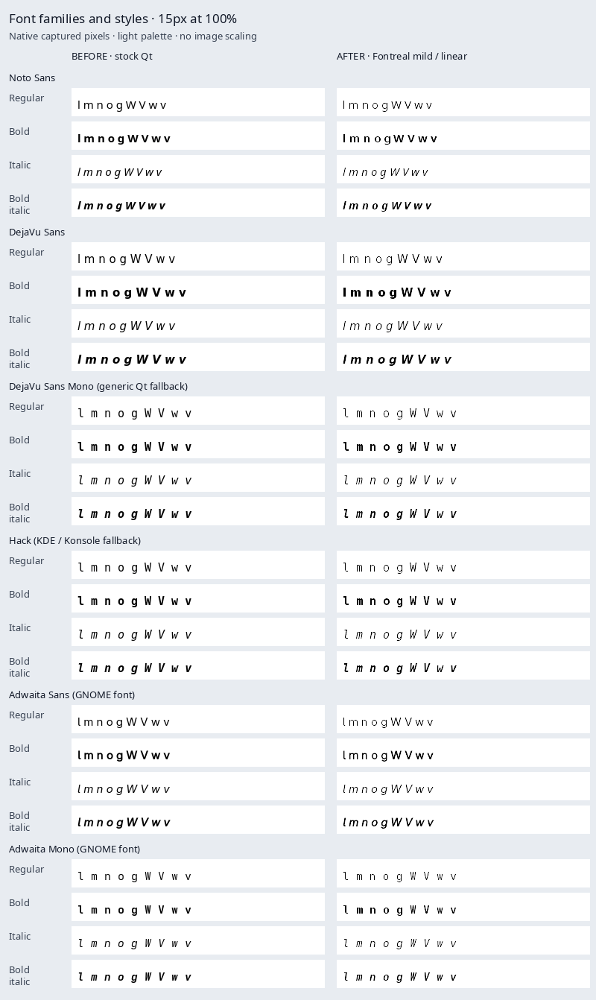
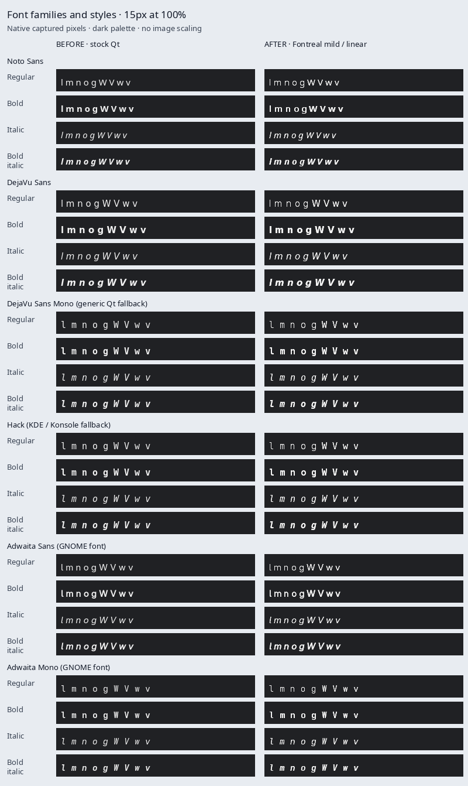
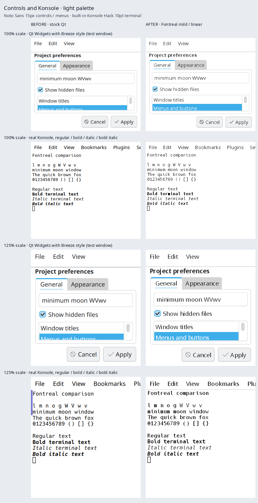
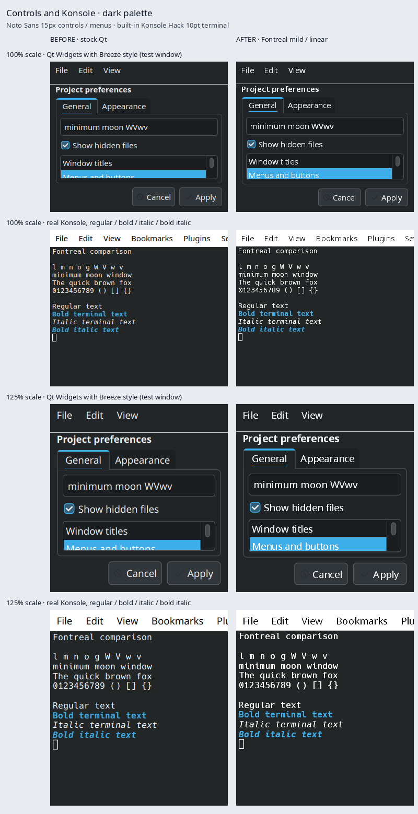
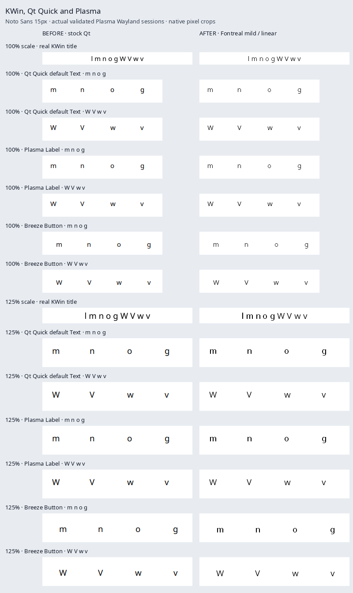

# Fontreal

Fontreal is an experimental text-rendering project for people who prefer crisp, steady strokes with gently softened edges. The first desktop implementation targets KDE and applications that use the system Qt 6 libraries on Linux.

## Why this project exists

Small text can look fuzzy when strokes spread across neighboring pixels or curves carry too much visual weight. Fontreal favors pixel alignment and consistent strokes, even when that means adjusting the original outline.

The aim is the clean presentation associated with older screen fonts, with softer curves and diagonals. Font choice, size, scaling, and background still matter. The pictures below let you judge the result yourself.

## Compare the pixels

Every comparison puts official stock Qt on the left and Fontreal on the right. The after preset uses automatic monochrome hints, grayscale edges, mild contrast, and linear-light blending. That same preset is used at every size, including sizes where you might prefer stock rendering.

These are lossless PNG captures. Your font renderer does not redraw their text. Open an original PNG at **one image pixel per display pixel** to assess crispness. README previews, browser zoom, and display scaling can resample the image.

### Fonts and styles

Regular, bold, italic/oblique, and bold italic/oblique are shown for all six fonts. These overview samples use 15px at 100% scale.



<details>
<summary>Show the same fonts and styles on a dark background</summary>



</details>

Hack is the clean KDE/Konsole built-in fixed-width choice in this capture environment. Generic Qt “monospace” resolves to DejaVu Sans Mono here. Defaults can vary by distro and configuration. Adwaita Sans and Adwaita Mono are GNOME font families; these samples use Qt rendering and do not demonstrate GTK integration.

### Menus, controls, and real Konsole text

The controls are real Qt Widgets with Breeze styling in a test window. The terminal is Konsole's built-in profile, using Hack at 10pt. Its bold text uses the terminal color scheme's intense foreground color. Menus and controls use Noto Sans at 15px.

Each image includes 100% and 125% scale. The terminal examples include regular, bold, italic, and bold italic.



<details>
<summary>Show dark controls and the dark Konsole color scheme</summary>



</details>

### KWin, Qt Quick, and Plasma

These details come from actual Plasma Wayland sessions with official packages and with Fontreal enabled. They show KWin titles, default Qt Quick text, Plasma labels, and Breeze buttons at 100% and 125%. The font is Noto Sans at 15px. Crops retain the original captured pixels.



<details>
<summary>Explore every font, size, scale, style, and background</summary>

Each linked sheet contains **10, 11, 12, 15, 16, and 20px** at **100%, 125%, and 150%** scale. Size is the requested Qt pixel size. Scale changes the raster size before drawing, rather than enlarging a finished bitmap. For example, 10px at 150% produces 15 raster pixels.

| Font | Regular | Bold | Italic / oblique | Bold italic / oblique |
| --- | --- | --- | --- | --- |
| Noto Sans | [Light](docs/images/comparison/noto-sans-regular-light.png) / [Dark](docs/images/comparison/noto-sans-regular-dark.png) | [Light](docs/images/comparison/noto-sans-bold-light.png) / [Dark](docs/images/comparison/noto-sans-bold-dark.png) | [Light](docs/images/comparison/noto-sans-italic-light.png) / [Dark](docs/images/comparison/noto-sans-italic-dark.png) | [Light](docs/images/comparison/noto-sans-bold-italic-light.png) / [Dark](docs/images/comparison/noto-sans-bold-italic-dark.png) |
| DejaVu Sans | [Light](docs/images/comparison/dejavu-sans-regular-light.png) / [Dark](docs/images/comparison/dejavu-sans-regular-dark.png) | [Light](docs/images/comparison/dejavu-sans-bold-light.png) / [Dark](docs/images/comparison/dejavu-sans-bold-dark.png) | [Light](docs/images/comparison/dejavu-sans-italic-light.png) / [Dark](docs/images/comparison/dejavu-sans-italic-dark.png) | [Light](docs/images/comparison/dejavu-sans-bold-italic-light.png) / [Dark](docs/images/comparison/dejavu-sans-bold-italic-dark.png) |
| DejaVu Sans Mono | [Light](docs/images/comparison/dejavu-mono-regular-light.png) / [Dark](docs/images/comparison/dejavu-mono-regular-dark.png) | [Light](docs/images/comparison/dejavu-mono-bold-light.png) / [Dark](docs/images/comparison/dejavu-mono-bold-dark.png) | [Light](docs/images/comparison/dejavu-mono-italic-light.png) / [Dark](docs/images/comparison/dejavu-mono-italic-dark.png) | [Light](docs/images/comparison/dejavu-mono-bold-italic-light.png) / [Dark](docs/images/comparison/dejavu-mono-bold-italic-dark.png) |
| Hack | [Light](docs/images/comparison/hack-regular-light.png) / [Dark](docs/images/comparison/hack-regular-dark.png) | [Light](docs/images/comparison/hack-bold-light.png) / [Dark](docs/images/comparison/hack-bold-dark.png) | [Light](docs/images/comparison/hack-italic-light.png) / [Dark](docs/images/comparison/hack-italic-dark.png) | [Light](docs/images/comparison/hack-bold-italic-light.png) / [Dark](docs/images/comparison/hack-bold-italic-dark.png) |
| Adwaita Sans | [Light](docs/images/comparison/adwaita-sans-regular-light.png) / [Dark](docs/images/comparison/adwaita-sans-regular-dark.png) | [Light](docs/images/comparison/adwaita-sans-bold-light.png) / [Dark](docs/images/comparison/adwaita-sans-bold-dark.png) | [Light](docs/images/comparison/adwaita-sans-italic-light.png) / [Dark](docs/images/comparison/adwaita-sans-italic-dark.png) | [Light](docs/images/comparison/adwaita-sans-bold-italic-light.png) / [Dark](docs/images/comparison/adwaita-sans-bold-italic-dark.png) |
| Adwaita Mono | [Light](docs/images/comparison/adwaita-mono-regular-light.png) / [Dark](docs/images/comparison/adwaita-mono-regular-dark.png) | [Light](docs/images/comparison/adwaita-mono-bold-light.png) / [Dark](docs/images/comparison/adwaita-mono-bold-dark.png) | [Light](docs/images/comparison/adwaita-mono-italic-light.png) / [Dark](docs/images/comparison/adwaita-mono-italic-dark.png) | [Light](docs/images/comparison/adwaita-mono-bold-italic-light.png) / [Dark](docs/images/comparison/adwaita-mono-bold-italic-dark.png) |

The full gallery contains 864 paired font conditions. The [capture metadata](docs/images/comparison/manifest.json) records font files and hashes, styles, sizes, scales, palettes, Qt library hashes, and source crop coordinates. Only cropping and placement were used to assemble these sheets. There is no sharpening, recoloring, or image interpolation.

</details>

## What the repository does

Fontreal contains an interactive FreeType comparison viewer, Qt rendering patches, and tools that build matching distro packages on demand. The desktop preset aligns eligible TrueType text to the pixel grid and changes how its edges blend with the background.

The current pilot supports **Debian 13 with Qt 6.8.2** and **Ubuntu 26.04 with Qt 6.10.2**, on amd64. It covers tested system-Qt paths in widgets, Konsole, KWin, Plasma, and OpenGL Qt Quick. The builder detects exact installed source revisions and keeps the original packages for rollback. Activation is separate and starts disabled.

GTK/GNOME application integration, Wine, Windows 11, Qt 5, and applications with bundled rendering libraries remain separate work. See the [roadmap](docs/roadmap.md).

[Firefox and Floorp activation](docs/experiments/browser-masks.md) applies the approved masks and Mozilla sRGB preblend to existing working profiles on the supported Ubuntu build. Accounts and unrelated settings stay in place. Enable the per-user launch integration, then fully quit and reopen the browser. Disable restores the original rendering settings. Mozilla's preblend estimates the background; full background-aware browser blending, Electron, and Flatpak remain separate work.

## Try it

Start with the comparison viewer to explore font files, sizes, scales, backgrounds, and blending. It needs CMake 3.22+, Ninja, a C++17 compiler, Qt 6.6+ with Widgets development files, and FreeType development files.

```sh
cmake -S . -B build -G Ninja
cmake --build build
./build/fontreal
```

For a real application comparison, use the [isolated Konsole preview](docs/experiments/kde-preview.md). For desktop deployment, follow the [system build and recovery guide](docs/build-system.md). That workflow builds native packages, prepares activation, validates them in a disposable session, and checks the transaction before applying it. It requires Docker for builds and sudo for installation. Enable the treatment, then log out and back in.

The [rendering research](docs/research/native-font-rendering.md) and [KDE path checks](docs/experiments/kde-paths.md) explain the choices and the measured behavior.

## Feedback welcome

Tell us what you prefer, including cases where stock looks better. Reports about heavy curves, fuzzy diagonals, cramped spacing, or an uncomfortable weight are useful.

[Open an issue](https://github.com/calculatetech/fontreal/issues/new) with the application and desktop, font family and style, size, display scale, light/dark background, and the result you prefer. Include lossless before/after captures at their original pixel dimensions when possible.

See the [contribution guide](CONTRIBUTING.md) before adding documentation or captures.

## License

Fontreal's original code and documentation use [MIT](LICENSE). The Qt-derived patches retain their upstream LGPL/GPL alternatives. The FreeType-derived patch uses the FreeType Project License. Built libraries retain their upstream licenses and distribution obligations. See [licensing and third-party notices](THIRD_PARTY_NOTICES.md).
