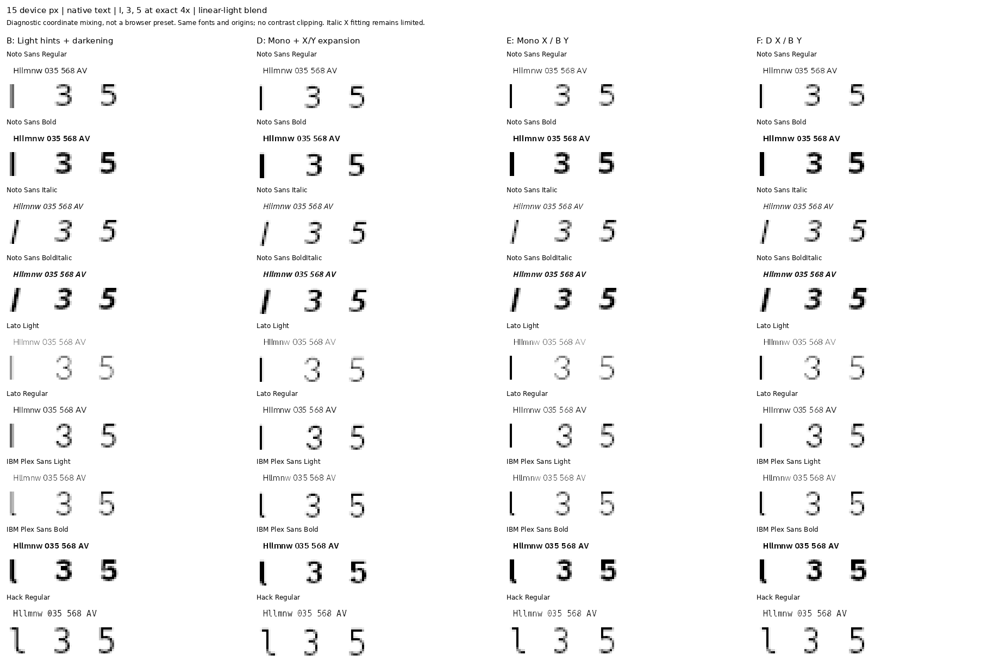
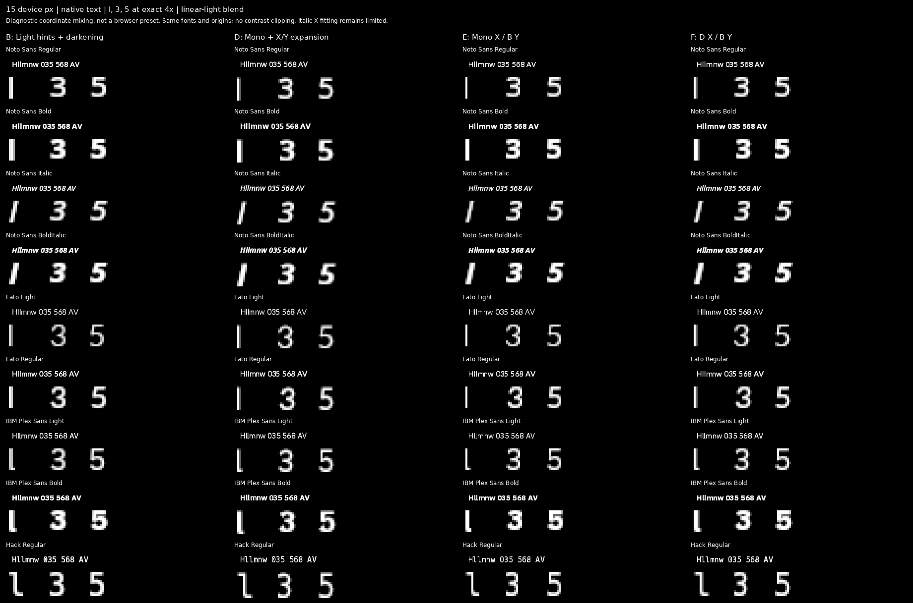

# Compare B geometry and horizontal fitting

This native study tests whether B's preferred stroke balance can gain clearer vertical stems. B and D remain the controls. E and F combine coordinates from the existing native outlines. No browser preset changes.

## Run the study

Build the original native viewer first. See the [native experiment guide](freetype-comparison.md). The study also uses the existing [private FreeType builder](browser-masks.md#requirements-and-build), with its exact source-version and platform restrictions. It needs the existing Python, Pillow, C++ compiler, and Qt Core development tools.

From the repository root, run:

```sh
python3 tests/browser_stroke_axis_test.py
```

The command builds a private test probe and writes verified images to `results/browser-stroke-axis/`. Build scratch files stay under `build/freetype-native/stroke-axis/`. Both directories follow the checkout's configured storage locations. It does not launch a browser or install a library.

## Read the columns

X coordinates determine horizontal positions, including the sides of vertical strokes. Y coordinates determine vertical positions, including the top and bottom of horizontal strokes.

| Column | Treatment |
| --- | --- |
| B | Automatic light hints with native stem darkening |
| D | Automatic monochrome hints with the earlier X/Y outline expansion |
| E | Monochrome-fitted X coordinates with B's Y coordinates |
| F | D's X coordinates with B's Y coordinates |

All columns use grayscale, no coverage clipping, the same font files, and the same integral glyph origins. The white and black sheets use explicit linear-light blending. Small text stays at native size. The enlarged l, 3, and 5 repeat each source pixel exactly 4x.

Open the PNGs at 100% image zoom. A fitted image preview can hide the difference.





The [18.75px light](../images/browser-common-ground/axis-18.75-light.png) and [dark](../images/browser-common-ground/axis-18.75-dark.png) sheets show another effective pixel size. The command also exports 12px and 22.5px sheets. These sizes are device pixels, not a claim about an actual browser's display scaling.

## What the checks establish

The study covers nine faces at four effective sizes. It includes light, regular, bold, italic, and bold italic. It checks every expected font/size key and every saved sheet.

E and F require matching point counts, contour endpoints, and curve tags. Every candidate X coordinate must equal its specified source. Every Y coordinate, metric, and advance must equal B. An independent native outline oracle verifies expansion, coordinate assembly, and final glyph masks. Ordinary A and B first calibrate that oracle against the existing probe.

Checks also cover fractional translation, repeated rendering, a later glyph load, repeated characters, spaces, overlapping ink, complete canvas bounds, and saved image pixels. The [capture record](../images/browser-common-ground/axis-captures.json) identifies the font files, hashes, source version, operations, and public images. Complete raw word and glyph records remain in the generated result directory.

The shared probe retains its earlier regression check:

```sh
python3 tests/browser_masks_test.py --case freetype
```

Run these commands sequentially. They use the existing native build artifacts.

## Limits

This is a coordinate-mixing diagnostic. It does not select a complete font engine or establish browser layout, shaping, performance, or final composition. Combining coordinates can change curves and apparent weight even when each axis has exact provenance.

Monochrome hinting does not guarantee horizontal fitting for italic faces. Their rows remain visible as controls. Do not interpret sharper upright stems as universal snapping.

The user chooses D over the earlier controls and prefers B's line widths. E and F test the next question. Human comparison and actual browser qualification remain necessary before a working preset changes. See the [investigation](../research/browser-common-ground.md) and [study specification](../plans/FR-018-axis-study.md).
