# Geometry and stroke contrast at 16pt

The latest [Firefox Home comparison](#matched-firefox-home-reference) first matches actual application text before testing weak crowns. The earlier [raw curve-weight comparison](#curve-weight-with-raw-coverage) remains component evidence.

Qt defaults are closer to the source outlines than the original Auto mono + 242 benchmark in this test. That benchmark gives stronger stroke contrast and crisp pixel placement. The current goal retains clarity while making pixel rounding respect the source proportions.

Current comparison sizes are integer requests from 8pt through 16pt. Earlier fractional-point studies below are historical evidence. Device-pixel values describe internal measurements, not current font-size selections. The user now selects fully raw coverage for every tested face and condition, with nearest-50% geometry and encoded blending. This supersedes the earlier continuous ramp and native support floor in the normal browser preset. The earlier trials below remain evidence for explicit diagnostic modes. The inner-hole geometry trials offered no useful improvement.

The comparison covers the same 22 faces and text as the [point-size charts](browser-common-ground.md#selected-benchmark-and-816pt-charts). The desktop uses 96 logical DPI and 100% scale. Both paths rasterize the 16pt request at 21 device pixels. The nominal conversion is 21.333 pixels, but Qt resolves this request to 21. This rounding is shared by both columns.

## Noto Sans explains the visible difference

Noto Sans Regular contains modest stroke contrast in its original design. For the lowercase n, the source upright is thicker than the crown. The table measures the upright at mid-height and the crown at mid-width. Values describe the outline before pixel coverage or blending.

| Geometry | Upright thickness | Crown thickness | Upright/crown ratio |
| --- | --- | --- | --- |
| Original design, scaled to 21px | 1.848px | 1.523px | 1.21 |
| Qt defaults, traced before rasterization | 1.859px | 1.562px | 1.19 |
| Benchmark automatic mono hinting | 2.000px | 0.981px | 2.04 |


The benchmark amplifies the contrast in this example. It does not simply restore contrast that Qt removed. The thicker upright and thinner crown explain the more expressive appearance. The default outline retains the source design's more moderate relationship. The final raster and blending can alter how uniform either result appears.

The 242 floor does not move contour points. It raises selected pixel coverage after rasterization. This changes apparent weight and edge strength. It cannot restore geometry that the hinting step already changed.

## What the geometry measurements show

The reference consists of the font's original unhinted coordinates, scaled exactly to the common 21px raster size. A local trace captures Qt's actual outlines immediately before rasterization. Native reproduction matches every captured nonempty glyph. The benchmark outlines match the existing point-chart samples.

The metric measures movement of corresponding contour points. For each glyph, it removes the best-fit translation, then calculates root-mean-square displacement. This separates shape deformation from moving the entire letter. The table averages that value equally across the 20 nonempty glyphs in each face. Lower values mean closer contour geometry under this metric.

| Face | Qt default error, px | Benchmark error, px |
| --- | --- | --- |
| Noto Sans Regular | 0.262 | 0.435 |
| DejaVu Sans Book | 0.323 | 0.403 |
| Lato Light | 0.163 | 0.187 |
| Lato Regular | 0.197 | 0.226 |
| IBM Plex Sans Light | 0.148 | 0.212 |
| IBM Plex Sans Regular | 0.248 | 0.276 |
| Liberation Sans Regular | 0.197 | 0.230 |
| Noto Serif Regular | 0.261 | 0.351 |
| DejaVu Serif Book | 0.304 | 0.314 |
| Liberation Serif Regular | 0.105 | 0.201 |
| Hack Regular | 0.202 | 0.437 |
| DejaVu Sans Mono Book | 0.359 | 0.449 |
| Liberation Mono Regular | 0.104 | 0.319 |
| Noto Sans Bold | 0.123 | 0.248 |
| Noto Sans Italic | 0.259 | 0.410 |
| Noto Sans Bold Italic | 0.122 | 0.201 |
| Noto Serif Bold | 0.273 | 0.422 |
| Noto Serif Italic | 0.258 | 0.289 |
| Noto Serif Bold Italic | 0.240 | 0.455 |
| Hack Bold | 0.193 | 0.373 |
| Hack Italic | 0.193 | 0.408 |
| Hack Bold Italic | 0.206 | 0.333 |

Qt defaults have the lower mean error for every tested face. Across individual glyphs, defaults are closer in 344 cases, the benchmark in 93, with three ties. The same face-level conclusion holds when the measurement retains whole-glyph translation. This does not make defaults the better visual result.

## Why the results differ

The observed Qt path loads glyphs with normal hinting and uses grayscale rasterization. The benchmark forces automatic monochrome hinting, then also uses grayscale rasterization. FreeType documents that the mono target applies stronger grid fitting, and that selecting different targets can change outlines. Its default loading path prefers a font's native hinter when available. See the [FreeType hinting target and loading contracts](https://freetype.org/freetype2/docs/reference/ft2-glyph_retrieval.html#ft_load_target_xxx).

Stronger fitting can give solid pixel strokes while changing proportions and stroke contrast. This fits the project's preference for crisp low-density text. The measurements show that the resulting character comes with a geometric tradeoff.

## A nearest-pixel rounding experiment

The user identifies the next requirement: a source crown of about 1.52px must snap to two pixels. Preserve the font's proportions through predictable pixel rounding. The more expressive benchmark shape is a comparison control, rather than the final geometry target.

The FreeType strong-hinting branch rounds horizontal-stroke thickness in the vertical dimension with `(dist + 16) & ~63`. One pixel is 64 units. This changes to the next pixel at a 75% remainder. The monochrome branch for vertical-stem widths uses a 50% threshold. Both branches first apply FreeType's standard-width matching. See [the pinned FreeType source](https://raw.githubusercontent.com/freetype/freetype/VER-2-14-2/src/autofit/aflatin.c).

A private test changes only the vertical-dimension rounding bias from 16 to 32. This uses the same 50% threshold for that branch. It preserves the benchmark's 242 floor, cutoffs, blending, layout, and horizontal fitting. It does not replace the standard-width matcher or fit individual glyphs by hand.

For Noto Sans Regular n at 16pt, the measured crown grows from 0.981px to 1.953px. The upright remains approximately 2px. At the same crown pixel column, raw coverage changes from `[250, 9, 0, 0]` to `[246, 255, 8, 0]`. The test therefore has two strong rows before the floor, with a faint curved edge below. A curved cross-section is not necessarily identical to the detected stem width that the hinter rounds.


The Noto Sans n upright/crown ratio becomes about 1.02. This is close to the nearest-pixel target of two pixels for each stroke. Its original ratio is 1.21. Pixel rounding still changes geometry, but it removes the earlier ratio of about 2.04.

The point sweep covers 220 conditions from 8 through 16pt, including the 11.25pt reference. Every horizontal control coordinate, contour topology, and Qt layout position remains unchanged. The previously tested 15px Noto Sans i remains byte-identical to the benchmark. At 16pt, the original font-unit, unhinted, and normal-hinting controls also remain unchanged.

On the same 16pt contour metric, the new test improves 12 face averages, leaves nine unchanged, and slightly worsens one. Noto Sans Regular improves from 0.435px to 0.291px. Noto Sans Bold Italic changes from 0.201px to 0.208px. This is a bounded experiment, not a complete solution for font proportions.

| Comparison | White background | Black background |
| --- | --- | --- |
| Six faces at 16pt: defaults, benchmark, and nearest-Y test | [Image](../images/browser-common-ground/nearest-y-16pt-contrast-light.png) | [Image](../images/browser-common-ground/nearest-y-16pt-contrast-dark.png) |
| Noto Sans Regular at 8–16pt: benchmark and nearest-Y test | [Image](../images/browser-common-ground/nearest-y-noto-sans-8-16pt-light.png) | [Image](../images/browser-common-ground/nearest-y-noto-sans-8-16pt-dark.png) |

The [experiment record](../images/browser-common-ground/nearest-y-captures.json) includes the exact parameter change, library hashes, numeric results, image hashes, and checks. The private library retains the original exported API and dependency features. Native raster, floor, overlap, blend, and saved-image checks cover the comparisons. No installed library or application setting changes.

## Smaller points and explicit italic comparisons

The user finds 50% fitting more accurate in more cases, but no candidate meets the full visual target. Keep the earlier 16pt result as a geometry reference. Each sheet shows actual Qt point sizes from 8 through 16pt, plus the 11.25pt reference. Italic and bold italic have dedicated sheets.

The left column uses the original 75% horizontal-stroke fitting rule. The middle uses the 50% rule. Both candidates retain the same 242 floor, coverage cutoffs, and linear blending. The right column is stock Qt with Fontreal disabled. It retains Qt's own coverage, origins, and blending. All three use the same font and Qt layout. The percentage describes width fitting before rasterization. It does not describe a coverage cutoff.

For Noto Sans Regular, the 75% and 50% columns are pixel-identical at every tested size below 16pt, on both backgrounds. Returning to 75% cannot improve those rows. Other faces enter the affected range at different sizes. Noto Sans Bold Italic changes at 9, 10, 11, 11.25, and 16pt. Noto Serif Italic changes at 14 and 15pt. These differences require visual judgment rather than a single size boundary for all fonts.

The user requires stock Qt as the control. These sheets replace the earlier normal-hinting-plus-242 diagnostic sheets. That diagnostic was another treatment, not stock output. Its historical images and record remain in commit `073b8e4de0ac446850f21a30bd47306a811e7cce`.

| Face | White background | Black background |
| --- | --- | --- |
| Noto Sans Regular | [Image](../images/browser-common-ground/stockqt-smallpt-noto-sans-regular-light.png) | [Image](../images/browser-common-ground/stockqt-smallpt-noto-sans-regular-dark.png) |
| Noto Serif Regular | [Image](../images/browser-common-ground/stockqt-smallpt-noto-serif-regular-light.png) | [Image](../images/browser-common-ground/stockqt-smallpt-noto-serif-regular-dark.png) |
| Lato Light | [Image](../images/browser-common-ground/stockqt-smallpt-lato-light-light.png) | [Image](../images/browser-common-ground/stockqt-smallpt-lato-light-dark.png) |
| Hack Regular | [Image](../images/browser-common-ground/stockqt-smallpt-hack-regular-light.png) | [Image](../images/browser-common-ground/stockqt-smallpt-hack-regular-dark.png) |
| Noto Sans Italic | [Image](../images/browser-common-ground/stockqt-smallpt-noto-sans-italic-light.png) | [Image](../images/browser-common-ground/stockqt-smallpt-noto-sans-italic-dark.png) |
| Noto Sans Bold Italic | [Image](../images/browser-common-ground/stockqt-smallpt-noto-sans-bolditalic-light.png) | [Image](../images/browser-common-ground/stockqt-smallpt-noto-sans-bolditalic-dark.png) |
| Noto Serif Italic | [Image](../images/browser-common-ground/stockqt-smallpt-noto-serif-italic-light.png) | [Image](../images/browser-common-ground/stockqt-smallpt-noto-serif-italic-dark.png) |
| Noto Serif Bold Italic | [Image](../images/browser-common-ground/stockqt-smallpt-noto-serif-bolditalic-light.png) | [Image](../images/browser-common-ground/stockqt-smallpt-noto-serif-bolditalic-dark.png) |
| Hack Italic | [Image](../images/browser-common-ground/stockqt-smallpt-hack-italic-light.png) | [Image](../images/browser-common-ground/stockqt-smallpt-hack-italic-dark.png) |
| Hack Bold Italic | [Image](../images/browser-common-ground/stockqt-smallpt-hack-bolditalic-light.png) | [Image](../images/browser-common-ground/stockqt-smallpt-hack-bolditalic-dark.png) |

The [capture record](../images/browser-common-ground/stockqt-smallpt-captures.json) covers 220 matched layouts and 100 displayed conditions across these 20 sheets. Every saved crop matches its original stock Qt or candidate strip. The preserved native fixture reproduces all earlier stock, 75%, and 50% outputs on the capture system. The earlier 16pt reference images remain unchanged. The charts cover 96 DPI at 100% scale. They do not establish a new application default. The [handoff](handoff.md) retains source, rebuild instructions, limits, and the next investigation.

## Rounded-edge optical expansion

The next diagnostic strengthens rounded horizontal strokes with a fixed 1/8px expansion. It leaves the 50% control intact. The trial adds eight FreeType units after standard-width matching and nearest-pixel Y rounding, only when both linked edges carry `AF_EDGE_ROUND`. It changes no X-width rule, coverage threshold, or blend. Its fractional expansion is an optical treatment, separate from integer fitting. The [private patch](../../patches/freetype-2.14.2-round-y-experiment.patch) applies to clean pinned FreeType 2.14.2. Do not stack it on the nearest-Y patch.

This capture uses a fresh local Qt 6.8.2 baseline, rather than the earlier Qt 6.10.2 environment. It uses the offscreen Qt platform at 96 logical DPI and 100% scale. The four Hack font hashes differ from the earlier capture. Noto Sans, Noto Serif, and Lato Light match their earlier font identities. These are new component comparisons, not a reproduction of every earlier desktop pixel. The 21px Noto Sans n reference does reproduce its earlier raw crown profiles.

The matrix covers 130 conditions. It includes all ten point sizes, four styles each of Noto Sans, Noto Serif, and Hack, plus Lato Light. Every sheet shows the original 75% treatment, the 50% control, the rounded-edge trial, and actual stock Qt. Both candidates and the trial retain floor 242, the weight cutoffs, whole-pixel origins, and linear blending. Native text retains full-word context. Enlarged details copy strip pixels exactly and can include neighboring italic ink.

The experiment changes 488 of 520 measured n/3/5/8 glyph conditions. It leaves every X coordinate unchanged. All uppercase V/W and lowercase w outlines and masks remain identical to the 50% control. Lowercase v changes in 19 conditions: all ten Noto Serif Bold Italic sizes and nine Noto Serif Italic sizes. Those v shapes contain rounded terminals. Native Y fitting of those terminals also moves other outline points through interpolation. A rounded-edge flag therefore does not guarantee isolation from diagonal glyphs.

For Noto Serif Italic v at 15px, a rounded linked width grows from 64 to 72 units. The top anchor stays at 512. Several inner points move down eight units. At the baseline raster row, summed raw coverage grows from 115 to 165. The center row also changes, from 554 to 550. The operation changes diagonal geometry and pixel distribution even where it does not add weight. This trial does not meet the full isolation target.

The light-face bypass is a separate cause of weak crowns. At 15px, Lato Light's standard Y width is about 0.59px. FreeType marks an axis extra-light below 0.625px and returns its original widths before the strong rounding branch. Its n crown link remains about 0.59px, and this trial never reaches that width. This explains why changing the 50% threshold or adding expansion after it cannot help that condition. At 21px the trial does affect Lato Light.

Noto Sans n at 15px follows a different path. Its crown is linked, the incoming width is about 1.08px, and fitting rounds it to one pixel. The trial increases that fitted width to 1.125px. The central raw crown column changes from `[248, 6, 0]` to `[247, 38, 0]`. Much of the added coverage appears in the fringe below the crown. At 21px, `[246, 255, 8]` becomes `[246, 255, 40]`. More coverage alone does not establish a stronger-looking crown core.

| Requested size | White background | Black background |
| --- | --- | --- |
| 8pt | [Four-column sheet](../images/browser-common-ground/round-y-8pt-light.png) | [Four-column sheet](../images/browser-common-ground/round-y-8pt-dark.png) |
| 11.25pt | [Four-column sheet](../images/browser-common-ground/round-y-11.25pt-light.png) | [Four-column sheet](../images/browser-common-ground/round-y-11.25pt-dark.png) |
| 16pt | [Four-column sheet](../images/browser-common-ground/round-y-16pt-light.png) | [Four-column sheet](../images/browser-common-ground/round-y-16pt-dark.png) |

The [capture record](../images/browser-common-ground/round-y-captures.json) retains the build and font identities, paired native trace samples, profiles, and image hashes. The checker independently rasterizes 12,870 native glyph masks. It also checks per-glyph floors, overlapping composition, both sRGB palettes, all 130 condition keys, and saved native/enlarged pixels. Its 6,608 width decisions include both-round, one-round, and neither-round contrasts. The one-round cases receive no expansion. These checks establish faithful examples, not a visual winner.

Keep this trial as a diagnostic. The next geometry investigation needs a narrower distinction between a rounded stroke and a curved terminal on a diagonal. It must also account for the extra-light bypass before selecting another width change. Preserve all four controls while investigating those two paths. Do not add a font-name or italic exclusion to conceal the v result.

## Mutual segment pairs preserve the tested diagonals

The next preview uses actual linked segments, rather than their aggregate edge flags. An edge groups several nearby segments. In the 15px Noto Serif Italic v, a rounded segment shares an edge with a straight linked segment. The old rule treats that whole edge as round. Its actual mutual stem pair contains one round segment and one straight segment. Noto Sans n instead has a mutual pair with two round segments.

The [segment-pair patch](../../patches/freetype-2.14.2-segment-y-experiment.patch) retains the 50% width function. A private wrapper receives the actual edges at all four width call sites. It adds signed eight units once when two mutually linked round segments connect those edges. It requires strong Y fitting and native stem adjustment. The original fitting, blue-zone placement, and interpolation still run. There are no font-name, italic, or character exclusions.

For extra-light axes, the same expansion follows the original fractional-width return. It does not force the curve to one pixel. At 15px, Lato Light n's central raw crown column changes from `[158, 0, 0]` to `[189, 0, 0]`. At 11px, `[113, 0, 0]` becomes `[144, 0, 0]`. These are increases in the first crown row. They differ from the fringe growth in Noto Sans. The fixed 128 cutoff can amplify their final visible effect.

Across the same 130 conditions, all 520 measured n/3/5/8 cases change. All 520 V/v/W/w cases retain exactly the 50% outlines, bearings, raw masks, and placement. Every X coordinate and contour topology remains unchanged. This includes the nineteen serif italic v conditions that the previous trial changed. This establishes isolation for the measured glyph set. It does not establish isolation for every diagonal in every font.

The native trace contains 6,977 width decisions. It expands 4,626 decisions, including 272 extra-light decisions. In 271 accepted decisions, the first segment does not qualify and a later segment does. The verifier follows the complete segment ring for rejected decisions. It independently checks raw flags, mutual links, edge membership, and signed expansion. A round/straight mutual pair receives no expansion.

Read-only traces also identify how the earlier v change spreads. At 15px, five v points first differ during edge alignment, two during strong-point alignment, and twenty during weak interpolation. Six points remain unchanged. The native strong-point tables retain edge references. The verifier reconstructs weak contour references from touched points and matches the native fixed-point interpolation. Eight traced cases reproduce their original outlines and masks exactly. Their final traced coordinates match the public probe. The [trace header](../../tests/freetype_curve_trace.h) and [instrumentation patch](../../tests/freetype_curve_trace.patch) preserve this observation method.

Use the compact [white-background preview](../images/browser-common-ground/segment-y-preview-light.png) and [black-background preview](../images/browser-common-ground/segment-y-preview-dark.png) to compare the third column with the 50% second column. They show Noto Sans Regular, Noto Serif Italic, and Lato Light at 8pt and 11.25pt. Native text and exact 4x excerpts retain the same pixels as the complete sheets.

| Requested size | White background | Black background |
| --- | --- | --- |
| 8pt | [Complete sheet](../images/browser-common-ground/segment-y-8pt-light.png) | [Complete sheet](../images/browser-common-ground/segment-y-8pt-dark.png) |
| 11.25pt | [Complete sheet](../images/browser-common-ground/segment-y-11.25pt-light.png) | [Complete sheet](../images/browser-common-ground/segment-y-11.25pt-dark.png) |
| 16pt | [Complete sheet](../images/browser-common-ground/segment-y-16pt-light.png) | [Complete sheet](../images/browser-common-ground/segment-y-16pt-dark.png) |

The [segment-pair record](../images/browser-common-ground/segment-y-captures.json) retains profiles, stage ownership, native traces, hashes, and eight image identities. The checker verifies 12,870 native masks independently, along with fixed floors, overlap, high-precision blending, and saved pixels. The original edge-level trial still passes its own checks. Both trials remain available.

This is a preview for visual judgment. The adjustment reaches small light-face crowns and preserves the tested diagonals. Noto Sans still gains much of its coverage below the crown core. Judge the apparent curve weight at native resolution before increasing the amount or selecting a policy. The environment remains the same fresh Qt 6.8.2 component baseline described above. No working application treatment changes.

## Integer-point middle-stroke diagnostics

The user's middle-stroke observation exposes a limit of the segment-pair trial. For Noto Serif Italic at 8pt, two waist rows of 8 lose cutoff-reaching pixels even as the crowns gain coverage. Their counts change from two to one and from three to two. At 11pt, both Noto Sans and Noto Serif Italic also lose some middle coverage. The native traces show changes during edge alignment, strong alignment, and weak interpolation. More total ink and zero changed v masks do not establish a successful repair.

The new study uses thirteen faces and nine actual integer point requests, for 117 conditions. The main previews show the same three faces at 8pt and 11pt. They contain native text and exact 6x excerpts of 8, 3, 5, and v. Larger pages show all nine integer sizes. Font identity, source layout, coverage floors, cutoffs, and original comparison controls remain fixed.

The primary diagnostic applies the existing public outline-expansion API after unchanged 50% hinting. It avoids another round-pair fitting change. The operation uses strengths 8 and 16 in FreeType's internal units. These are expansion parameters, not point-size requests. Expected coordinates come from an independent call on the original 50% outline. The stock raster API then supplies the expected masks and bearings.

For Noto Serif Italic at 11pt, the two measured waist rows gain cutoff-reaching pixels from one to two and from two to three. At 8pt, the first measured row retains two; the next row has two rather than the 50% control's three. This operation can strengthen one region while leaving another wrong. It also adds diagonal weight. The preview must be judged against stock Qt before acceptance.

The composition diagnostic changes no geometry or mask. It uses encoded black/white blending for the 50% masks. A treated coverage of 242 produces a level of about 64 on white under the retained linear-light treatment, versus 13 under encoded blending. The same coverage therefore looks darker without adding a filled pixel. On black, encoded blending gives less brightness for partial coverage. This is a separate diagnostic, not a proposed polarity policy or a combined treatment.

| Diagnostic | White background | Black background |
| --- | --- | --- |
| Post-hint native expansion | [Main preview](../images/browser-common-ground/core-expanded-preview-light.png) | [Main preview](../images/browser-common-ground/core-expanded-preview-dark.png) |
| Same 50% masks, encoded blend | [Main preview](../images/browser-common-ground/core-encoded-preview-light.png) | [Main preview](../images/browser-common-ground/core-encoded-preview-dark.png) |

| Primary geometry comparison at every integer 8–16pt | White background | Black background |
| --- | --- | --- |
| Noto Sans Regular | [All nine sizes](../images/browser-common-ground/core-noto-sans-regular-8-16pt-light.png) | [All nine sizes](../images/browser-common-ground/core-noto-sans-regular-8-16pt-dark.png) |
| Noto Serif Italic | [All nine sizes](../images/browser-common-ground/core-noto-serif-italic-8-16pt-light.png) | [All nine sizes](../images/browser-common-ground/core-noto-serif-italic-8-16pt-dark.png) |
| Lato Light | [All nine sizes](../images/browser-common-ground/core-lato-light-8-16pt-light.png) | [All nine sizes](../images/browser-common-ground/core-lato-light-8-16pt-dark.png) |
| Thirteen-face 16pt reference | [Reference](../images/browser-common-ground/core-expanded-16pt-light.png) | [Reference](../images/browser-common-ground/core-expanded-16pt-dark.png) |

The [capture record](../images/browser-common-ground/core-contrast-captures.json) retains the profiles, native identities, and twelve image hashes. The checker verifies 11,583 independent native masks and all expanded coordinates. It also checks exact condition keys, duplicate/missing/fractional input contrasts, all 33 occurrences, per-glyph floor, overlap, blending, and saved crops. Twenty-four paired ownership observations reproduce the rejected/control glyphs at actual integer points. The final side-bearing translation is checked separately from hint-save coordinates. The source stock chart, private FreeType libraries, and working applications remain unchanged.

Keep both diagnostics available for visual comparison. Neither restores every missing middle pixel under the recorded metric. The user prefers the encoded-blend diagnostic and finds it nearly perfect. The next study retains that reference while addressing light coverage and weak counter bridges separately.

## Encoded light weights and counter bridges

The hard light-weight floor maps raw coverage 127 to 127, then 128 to 242. Under encoded blending this abrupt jump is directly visible. The user reported unreadable white-on-black text at 8pt and excessive darkness on white. The light trial compared no floor with a mild smooth lift, `a + round(a*(255-a)/1020)`, before per-glyph composition. The smooth table maps 127 to 143 and 128 to 144. Its largest adjacent step is two; zero and full coverage remain unchanged. Both trials preserve regular-weight pixels exactly. Neither changes outlines, glyph positions, or raw masks. The user selects no floor: nearly stock Qt weight, with consistent readability in every assessed case. This is the accepted light reference for later research.

| Light coverage, upright and italic | White background | Black background |
| --- | --- | --- |
| Noto Sans, 8pt and 11pt | [Main panel](../images/browser-common-ground/encoded-light-noto-sans-light.png) | [Main panel](../images/browser-common-ground/encoded-light-noto-sans-dark.png) |
| Noto Serif, 8pt and 11pt | [Main panel](../images/browser-common-ground/encoded-light-noto-serif-light.png) | [Main panel](../images/browser-common-ground/encoded-light-noto-serif-dark.png) |
| Lato, 8pt and 11pt | [Main panel](../images/browser-common-ground/encoded-light-lato-light.png) | [Main panel](../images/browser-common-ground/encoded-light-lato-dark.png) |
| Noto Sans, all integer 8–16pt | [Nine sizes](../images/browser-common-ground/encoded-light-noto-sans-8-16pt-light.png) | [Nine sizes](../images/browser-common-ground/encoded-light-noto-sans-8-16pt-dark.png) |
| Noto Serif, all integer 8–16pt | [Nine sizes](../images/browser-common-ground/encoded-light-noto-serif-8-16pt-light.png) | [Nine sizes](../images/browser-common-ground/encoded-light-noto-serif-8-16pt-dark.png) |
| Lato, all integer 8–16pt | [Nine sizes](../images/browser-common-ground/encoded-light-lato-8-16pt-light.png) | [Nine sizes](../images/browser-common-ground/encoded-light-lato-8-16pt-dark.png) |

The geometry trial keeps the preferred encoded coverage treatment. FreeType identifies contour direction; the trial requires at least two contours wound opposite to the whole outline. A native vertical expansion on a copy supplies new inner-hole coordinates. Only inner-hole Y coordinates are copied back, centered by half the expansion. Every X coordinate and outer point stays fixed. The mild and stronger settings use eight and sixteen internal units. They are geometry parameters, not font sizes. Noto and Lato order their contours differently, so the selector follows direction rather than contour position. Actual Qt `B g O` layouts exercise eligible and ineligible shapes without a character gate.

For Noto Sans Regular at 11pt, one measured 8 waist row changes from raw `[55,233,147,98,192,232,47]` to `[55,235,162,114,206,232,47]` under the mild trial. The 147 sample crosses the regular cutoff of 160. The stronger trial produces `[55,237,175,129,217,232,47]`. This is a local bridge gain; it does not prove that every other part improves. The selector preserves v, 3, 5, and single-hole outlines in the current text. Small holes can close, and native expansion can still lose coverage elsewhere.

| Separate counter geometry trial | White background | Black background |
| --- | --- | --- |
| Main 8pt and 11pt panel | [Main panel](../images/browser-common-ground/encoded-waist-light.png) | [Main panel](../images/browser-common-ground/encoded-waist-dark.png) |
| Noto Sans Regular, all integer 8–16pt | [Nine sizes](../images/browser-common-ground/encoded-waist-noto-sans-regular-8-16pt-light.png) | [Nine sizes](../images/browser-common-ground/encoded-waist-noto-sans-regular-8-16pt-dark.png) |
| Noto Serif Italic, all integer 8–16pt | [Nine sizes](../images/browser-common-ground/encoded-waist-noto-serif-italic-8-16pt-light.png) | [Nine sizes](../images/browser-common-ground/encoded-waist-noto-serif-italic-8-16pt-dark.png) |

The [capture record](../images/browser-common-ground/encoded-refinement-captures.json) contains nineteen faces at nine integer requests, coverage tables, profiles, and eighteen image hashes. The checker verifies 17,034 native masks, every expected outline coordinate, and saved native/enlarged crops. An independent scalar exporter verifies the real light canvases through final RGB. Two overlapping raw-64 samples distinguish per-glyph smoothing (129) from smoothing after composition (128). Original chart, font, source, and library hashes remain protected. The user rejects both inner-hole strengths as too subtle and ineffective. Keep them as negative evidence. These results do not change working presets or qualify real browser output.

## Regular-weight coverage shoulder

The user proposes raising coverage near 128 to about 192 below the existing 160-to-242 treatment. This study compares two coverage-only candidates. It retains the accepted raw-light result in every column. Regular and heavier faces use the previous encoded result as the reference. No outline point, raster mask, glyph identity, position, or blend changes.

The shoulder raises values 128–159 to 192. The continuous ramp joins 96→96, 128→192, and 160→242 with straight segments, rounded to the nearest integer with halves up. It leaves lower values unchanged and retains the old treatment at and above 160. This extends the transition below 128 to avoid creating another abrupt entry jump. It is a fixed research choice, not a selected production curve.

| Original coverage | Old reference | Shoulder | Continuous ramp |
| --- | --- | --- | --- |
| 96 | 96 | 96 | 96 |
| 112 | 112 | 112 | 144 |
| 127 | 127 | 127 | 189 |
| 128 | 128 | 192 | 192 |
| 144 | 144 | 192 | 217 |
| 159 | 159 | 192 | 240 |
| 160 | 242 | 242 | 242 |
| 242 | 242 | 242 | 242 |

The ramp's largest adjacent step is three. The shoulder has a 65-level jump at 128 and a 50-level jump at 160. A Noto Sans Regular 11pt waist row changes from treated `[55,242,147,98,242,242,47]` to `[55,242,192,98,242,242,47]` under the shoulder and `[55,242,222,102,242,242,47]` under the ramp. These are stronger middle samples without added geometry. A raw 94 in a weak Noto Serif Italic 8pt waist remains unchanged under both candidates. The user selects the continuous ramp: the displayed missing-pixel cases are resolved, with improved white-on-black readability. The next target is Noto Serif Regular 2 at 11pt.

The same coverage range also occurs on diagonals. Across all conditions and both occurrences of 8 in the text, the shoulder changes 1,230 treated samples of 8 and the ramp changes 2,352. For v/V/W/w combined, the respective counts are 2,948 and 5,719. These counts describe where coverage changes, not optical quality. Both candidates therefore need visual judgment of collateral weight. All fifty-four light-face/point conditions remain byte-identical to the accepted raw-light reference on both palettes.

| Coverage-only comparison | White background | Black background |
| --- | --- | --- |
| Main 8pt and 11pt preview | [Main panel](../images/browser-common-ground/shoulder-preview-light.png) | [Main panel](../images/browser-common-ground/shoulder-preview-dark.png) |
| Noto Sans Regular, all integer 8–16pt | [Nine sizes](../images/browser-common-ground/shoulder-noto-sans-regular-8-16pt-light.png) | [Nine sizes](../images/browser-common-ground/shoulder-noto-sans-regular-8-16pt-dark.png) |
| Noto Serif Italic, all integer 8–16pt | [Nine sizes](../images/browser-common-ground/shoulder-noto-serif-italic-8-16pt-light.png) | [Nine sizes](../images/browser-common-ground/shoulder-noto-serif-italic-8-16pt-dark.png) |
| Accepted Lato Light, all integer 8–16pt | [Nine sizes](../images/browser-common-ground/shoulder-lato-light-8-16pt-light.png) | [Nine sizes](../images/browser-common-ground/shoulder-lato-light-8-16pt-dark.png) |

The [capture record](../images/browser-common-ground/shoulder-captures.json) contains exact coverage tables, source identities, registered middle/crown profiles, changes for every occurrence, and eight image hashes. Independent Decimal interpolation checks every table value. Scalar per-glyph alpha-over and encoded RGB predict every actual exported canvas. Two overlapping raw-128 pixels produce 239 with either candidate per glyph, versus 242 with incorrect post-composition treatment. All 5,643 original native masks reproduce independently, and saved native/enlarged crops match their verified source pixels. Original source, font, library, helper, and stock-image hashes remain unchanged. This study changes no working preset and does not qualify real browser output.

## Native dropout continuity

The remaining target is Noto Serif Regular 2 at 11pt. Its grayscale middle rows contain raw pairs such as `[82,69]` and `[80,75]`. Both samples in each pair remain below the accepted ramp's entry point. Their horizontal coverage sums are 151/255 and 155/255, about 0.6 pixels. These are coverage sums, not perpendicular geometric widths.

Native stage tracing attributes substantial narrowing to weak X interpolation. Two recorded diagonal boundary points have an X separation of 73 internal units before weak interpolation and 45 afterward. One moves right by 18 units; the other moves left by ten. Their final Y coordinates differ by six units. These are source-identified point relationships, not a general stroke-width metric. Normal grayscale and light hinting retain more coverage in this diagonal, but changing the whole hinting target would affect the accepted strokes elsewhere.

FreeType's [outline flags](https://freetype.org/freetype2/docs/reference/ft2-outline_processing.html#ft_outline_xxx) provide native dropout correction for the black-and-white rasterizer. The smooth rasterizer ignores these flags. The bounded trial renders the same original hinted outline twice: flags zero enable simple dropout correction without stubs; flags eight disable it. Every contour-start scanmode tag is checked, so it cannot override the selected flag. The added pixels give a native line-continuity signal without a new geometric, font, or character classifier.

The reported 2 has exactly four added pixels, at baseline-relative `(y,x)` coordinates `(-5,4)`, `(-4,3)`, `(-3,2)`, and `(-2,1)`. Its gray bitmap origin supplies the registration. The trial raises only these selected weak samples to opacity 192 or 217 after applying the accepted ramp. Stronger samples retain their opacity. The raw `[82,69]` pair becomes `[192,69]` or `[217,69]`; `[80,75]` becomes `[192,75]` or `[217,75]`. This makes the selected line more visible without moving its outline. The user prefers 217 over 192. Carry 217 forward with the accepted ramp and raw-light bypass; it does not establish a physical minimum width.

| Native dropout comparison | White background | Black background |
| --- | --- | --- |
| Main 8pt and 11pt preview, exact 6x 2/v/W | [Main panel](../images/browser-common-ground/dropout-preview-light.png) | [Main panel](../images/browser-common-ground/dropout-preview-dark.png) |
| Noto Serif Regular, all integer 8–16pt | [Nine sizes](../images/browser-common-ground/dropout-noto-serif-regular-8-16pt-light.png) | [Nine sizes](../images/browser-common-ground/dropout-noto-serif-regular-8-16pt-dark.png) |
| Noto Sans Regular, all integer 8–16pt | [Nine sizes](../images/browser-common-ground/dropout-noto-sans-regular-8-16pt-light.png) | [Nine sizes](../images/browser-common-ground/dropout-noto-sans-regular-8-16pt-dark.png) |
| Accepted Lato Light, all integer 8–16pt | [Nine sizes](../images/browser-common-ground/dropout-lato-light-8-16pt-light.png) | [Nine sizes](../images/browser-common-ground/dropout-lato-light-8-16pt-dark.png) |

The 192 trial changes four samples of the target Serif 2 at 11pt. In that same row, it changes one sample each of 8, v, and W; V stays unchanged. Noto Sans Regular at 11pt keeps its 2, v, and W pixels, but one pixel in 6 changes under both guards. Across the complete matrix, the 192 trial changes thirteen samples of 2, ten of v, nine of V, twenty of W, and one of l. These counts include all occurrences. Other narrow features can therefore change too; the signal is not unique to the reported defect. Every light condition bypasses the guard exactly.

The [capture record](../images/browser-common-ground/dropout-captures.json) retains full registered raw/treated profiles, changes for all 33 occurrences, native provider flags, source/library hashes, and eight image hashes. A private chart copy captures the native one-bit pair before unchanged gray rendering. An independent original-outline Oracle predicts both bitmaps and all gray masks: 16,929 rasters across 171 actual point/font conditions. Independent packed-bit decoding and scalar alpha-over predict final RGB through the real exported branch. The saved native and exact 6x 2 crops are reopened and verified. Two selected raw-64 glyphs produce 239 or 249 after the per-glyph guard, unlike incorrectly guarding after composition (192 or 217). Existing helpers, accepted input captures, fonts, native libraries, and application settings remain unchanged. Visual acceptance and later browser qualification remain necessary.

## Limits and decision

Contour-point displacement is a measure of geometric proximity. It is not a readability, beauty, or optical-quality score. Different placement of control points can affect this metric, so comparisons use matching points from the same font. The reference also excludes the designer's size-specific hinting instructions. It measures fidelity to the outline, rather than every aspect of design intent.

The stroke ratios describe one cross-section of one letter. They are not a contrast score for the whole font. The broader measurements cover 440 nonempty glyphs at one resolved size. They do not establish results for other sizes, scripts, variable fonts, or displays.

Keep Auto mono + 242 as the visual comparison control. The current target is crisp text with source-based stroke proportions and predictable nearest-pixel rounding. Judge the nearest-Y test against both that control and the original design. The remaining FreeType width matching and alignment stages still need qualification. This analysis does not change application settings.

The [capture record](../images/browser-common-ground/geometry16-captures.json) contains font hashes, versions, measured values, method limits, and the figure hash. The traced Qt run reproduces all 44 original stock strips exactly. Native and benchmark outlines match their respective captures. Contour topology matches throughout. The n measurements converge within 0.001px when curve sampling doubles.

## Curve weight with raw coverage

The user reports that the raw profile softens jaggies but leaves curved strokes and crowns too light in real use. Preserve raw coverage and encoded blending while testing a small change to curve thickness. This experiment reuses the mutual round-segment mechanism from S6. It adds zero, 1/16, or 1/8 device pixel to the fitted Y width. It does not add a coverage floor, ramp, clipping, or a new curve classifier.

The four columns are current raw, raw with 1/16-pixel curve expansion, raw with 1/8-pixel expansion, and actual stock Qt. Every outline still uses the native grayscale rasterizer. A geometry change can move an edge or change its coverage. Unchanged rasterization does not prove that edge appearance remains equally good. Visual judgment must include the soft edges as well as the stronger crowns.

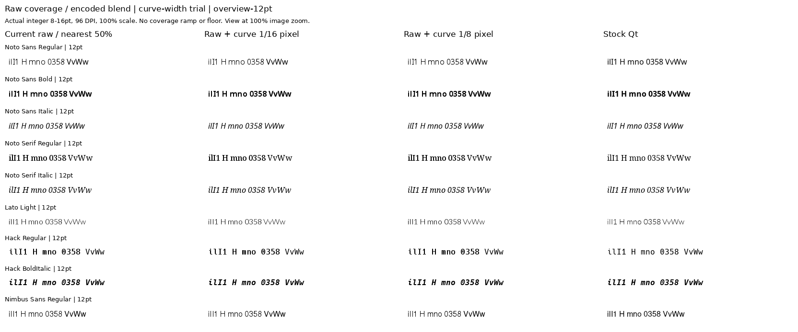

[The same overview on black](../images/browser-common-ground/raw-curves-overview-12pt-dark.png) retains all four columns. The complete matrix covers nine faces at every actual integer size from 8 through 16pt, at 96 DPI and 100% scale. Requested sizes remain point labels. The expansion strengths describe device-space stroke width, not font sizes.

| Face | White background | Black background |
| --- | --- | --- |
| Noto Sans Regular | [Image](../images/browser-common-ground/raw-curves-noto-sans-regular-light.png) | [Image](../images/browser-common-ground/raw-curves-noto-sans-regular-dark.png) |
| Noto Sans Bold | [Image](../images/browser-common-ground/raw-curves-noto-sans-bold-light.png) | [Image](../images/browser-common-ground/raw-curves-noto-sans-bold-dark.png) |
| Noto Sans Italic | [Image](../images/browser-common-ground/raw-curves-noto-sans-italic-light.png) | [Image](../images/browser-common-ground/raw-curves-noto-sans-italic-dark.png) |
| Noto Serif Regular | [Image](../images/browser-common-ground/raw-curves-noto-serif-regular-light.png) | [Image](../images/browser-common-ground/raw-curves-noto-serif-regular-dark.png) |
| Noto Serif Italic | [Image](../images/browser-common-ground/raw-curves-noto-serif-italic-light.png) | [Image](../images/browser-common-ground/raw-curves-noto-serif-italic-dark.png) |
| Lato Light | [Image](../images/browser-common-ground/raw-curves-lato-light-light.png) | [Image](../images/browser-common-ground/raw-curves-lato-light-dark.png) |
| Hack Regular | [Image](../images/browser-common-ground/raw-curves-hack-regular-light.png) | [Image](../images/browser-common-ground/raw-curves-hack-regular-dark.png) |
| Hack BoldItalic | [Image](../images/browser-common-ground/raw-curves-hack-bolditalic-light.png) | [Image](../images/browser-common-ground/raw-curves-hack-bolditalic-dark.png) |
| Nimbus Sans Regular | [Image](../images/browser-common-ground/raw-curves-nimbus-sans-regular-light.png) | [Image](../images/browser-common-ground/raw-curves-nimbus-sans-regular-dark.png) |

Both strengths preserve every tested V/v/W/w occurrence and every X contour coordinate. The rule also changes i in seven faces at all nine sizes, and l in Noto Serif Italic. Those 72 occurrences include rounded dots or terminals. H, I, and 1 remain unchanged throughout this matrix. The selector follows native rounded segments, rather than letter names. Do not describe it as changing only crowns.

The [capture record](../images/browser-common-ground/raw-curves-captures.json) includes font and library hashes, all 81 conditions, native pair decisions, changed-occurrence counts, and twenty image hashes. Zero expansion reproduces the earlier nearest reference exactly. For each strength, 1,883 traced decisions include 1,223 eligible round pairs. Independent rasterization reproduces every glyph. Scalar identity-coverage composition predicts each raw mask and encoded final canvas. Saved crops reproduce the source pixels. These checks establish faithful evidence, not a visual winner.

Run `tests/raw_curve_darkening_test.py --stock-build RECORD --nearest-library LIBRARY --label-font FONT` from the repository root. The stock record must identify the existing pinned FreeType 2.14.2 source and private headers. The script keeps build output and images under their configured storage roots. It records and checks cached source/library identities. The experiment has no installed-library or application-profile writes. CFF coverage includes static Nimbus Sans here. Variable CFF2, other scripts, fractional display scales, and real-application curve treatment need later qualification.

## Matched Firefox Home reference

The user reports that the earlier samples look darker than normal application text. Their requested reference is Firefox Home's light-on-dark text, especially its soft crowns. The earlier 12pt, pure black/white chart is not a qualified optical reference for those conditions. It remains a valid component comparison. Matching a custom page to that chart alone does not establish a match to Firefox Home.

The native Home capture supplies two generic text runs: a shortcut label and the recent-activity heading. The shortcut uses the system caption font, Noto Sans at 10pt. Its native size is about 13.333 device units, rather than Qt's rounded 13-unit result for the same point request. The heading uses the installed Noto Sans Bold face. The packaged Home style requests 600 weight and a 1.133rem heading at a 15px root. Its native raster size rounds to 17 units. These device values describe the diagnostic, not new synthetic comparison-size labels.

The measured capture background is RGB 19,18,21 and the opaque text color is RGB 242,240,248. The first comparison assumed pure black and white. Both size and color must stay fixed when judging the actual Home condition. Source stylesheet and Fontconfig observations identify candidate settings. Matching the complete captured text verifies the selected font and native size.

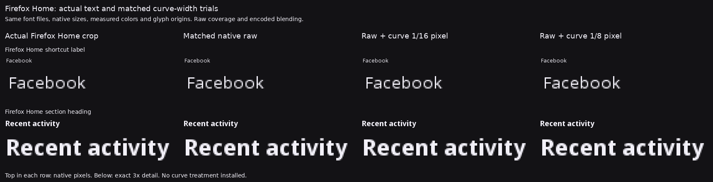

The first column contains actual Home text crops. The second reconstructs those same pixels with the native raw profile. Every one of the 22 nonempty glyph occurrences and both complete crops agree within one RGB level per channel. Mean absolute error is about 0.04 per channel over each full crop. A wrong-size control differs by up to 227 levels. Linear-light composition differs by up to 57. The matching raw/encoded baseline therefore distinguishes the earlier mismatched size and blend conditions.

Columns three and four retain the measured fonts, native sizes, colors, and glyph origins. They replay the existing round-segment rule at 1/16 and 1/8 device pixel, with raw coverage and encoded blending. Native pixels appear above exact 3x details. The displayed 1720×440 figure matches its saved PNG at actual 100% zoom. Neither strength is installed or selected by this evidence. Home is a measured fixture, not a page-specific rendering rule.

The [source record](../images/browser-common-ground/home-source-captures.json) binds the two tight generic-text crops, font hashes, measured colors, native sizes, and occurrence origins. It contains no full window, browsing history, bookmarks, or account data. The [comparison record](../images/browser-common-ground/home-curves-captures.json) binds native library and checker hashes, six result images, the figure, and the baseline/error contrasts. Earlier 12pt charts retain their distinct capture identity.

Use `tests/firefox_home_curve_test.py --probe PROBE --libraries RAW SMALL LARGER --stock-library STOCK --label-font FONT`. The two curve libraries retain S17's private build records and source files. The checker binds their actual strengths, patch hashes, source hashes, and library hashes before calling the probe. It rasterizes pre-render outlines independently, checks repeated renders and X coordinates, reconstructs raw alpha-over composition by two methods, and reopens every native/detail crop. FreeType can clear outline storage after rasterization, so the Oracle consumes the separately captured pre-render outline.

The matched reference covers two Home runs on one recorded desktop. It does not establish optical quality for every face, weight, application, or scale. Continue judging the actual weak crowns and preserved edge softness before choosing a curve rule.

## Nimbus Sans format bypass

The user identifies weak t, f, e, o, and s strokes in a Facebook text bubble and requests Nimbus Sans as the reference. Its lowercase o matches untreated native Nimbus Sans at a 15-unit device size. Native CFF and Type 1 masks agree for this condition, so the image alone cannot identify the file format.

A controlled page in the working Firefox profile separates an embedded Nimbus Sans CFF file, ordinary Nimbus Sans, and Helvetica. The embedded CFF run matches the active raw profile exactly. Both ordinary family requests match untreated native masks exactly. Each result covers all five letters with zero RGB error. The browser also maps legacy Nimbus Sans Type 1 files.

Two disposable Firefox profiles use the same raw library and rendering preferences. The default font list reproduces the bypass. A Fontconfig rule that excludes the Type 1 Nimbus Sans copies makes all three routes match the treated CFF masks exactly. All four CFF styles remain available. The tested selections for Inconsolata Nerd Font, Noto Sans, Noto Serif, Arial, and Nimbus Roman remain unchanged.

The CFF patch therefore works on this system. Duplicate legacy font selection can hide its effect during ordinary browsing. The [narrow Fontconfig rule](../experiments/browser-masks.md#when-nimbus-sans-looks-untreated) preserves the requested family and keeps Type 1 outside the raw profile. Resolve this selection difference before judging a stronger curve rule. The controlled test does not establish the result on the user's Facebook page after a normal browser restart.

## Numbered raw coverage grids

After restart, the new supplied Nimbus Sans crop matches the current raw masks for o, s, e, a, f and t exactly. The Type 1 bypass no longer explains those weak crowns. The user finds no reliable difference between raw and the 1/8-pixel curve trial in a same-position comparison. The earlier side-by-side preference also favored identical controls, so it does not establish a treatment preference.

Here, raw means unchanged native coverage after the current hinting. Coverage is the fraction of a pixel filled by the glyph. It occupies the alpha channel, from 0 for empty to 255 for fully covered. The raw preset bypasses the earlier contrast ramp and dropout floor. It retains the selected hinting and whole-pixel placement. Coverage is not physical display brightness.

The user requests exact pixel values before choosing a limited range to darken. These grids expose every native pixel for the measured Nimbus Sans condition. Row 1 is the top bitmap row. Column 1 is the left bitmap column. Each cell prints its unchanged coverage. Tiny native glyphs above the grids show white on black and on the measured teal background.

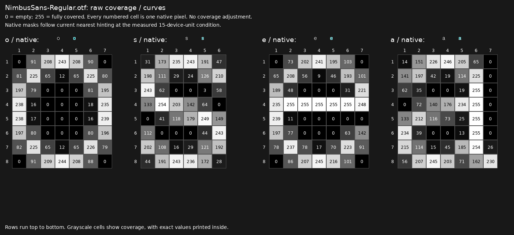

The top row of o reads `0, 91, 208, 243, 208, 90, 0`. Its second row reads `81, 225, 65, 12, 65, 225, 80`. The crown center is already close to full coverage. The shoulders and neighboring pixels span several lower ranges. A cutoff changes some of these values and leaves others untouched.

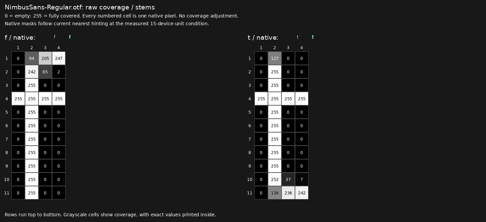

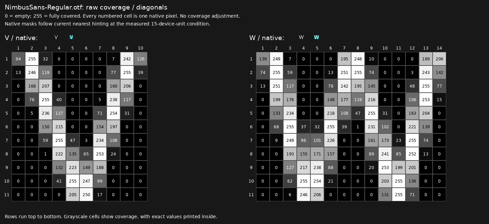

The f/t stems reach 255, while their curved terminals retain gray pixels. V/W also contain many values between 160 and 241. A table that changes only that numerical range cannot identify curves separately from diagonals. No range, floor or curve selector is selected by these images.

Run `tests/raw_coverage_grid_test.py --probe PROBE --library RAW --stock-library STOCK --font FONT --label-font LABELFONT`. Use the existing native probe, matching raw and stock FreeType libraries, and installed Nimbus Sans Regular CFF font. The checker independently rasterizes each loaded outline, checks repeat renders and saves every value. It reopens the PNGs to compare all cell intensities and native crops. Results stay under `results/raw-coverage-grids`, with temporary native probe records under `build/raw-coverage-grids`.

The [capture record](../images/browser-common-ground/raw-coverage-grid-captures.json) binds the eight masks, complete coverage arrays, input hashes, checker and three images. All six source-matched glyph hashes agree with the current grids. These are raw diagnostic values for one measured font and size. The experiment does not change the working browser preset.

## Strong-neighbor averages from coverage 173

The user identifies 173 as the lowest coverage that needs strengthening. They request an average from nearby original pixels at 230 or above. They also identify a gap in direct averaging: three eligible pixels around an o corner leave the middle pixel without a strong neighbor. Keep this as a coverage-only experiment on the matched Nimbus masks before broad qualification.

The direct candidate changes only original values from 173 through 229. It replaces each with the mean of its original 230+ eight-neighbors, rounded to the nearest integer with halves upward. A pixel without such a neighbor stays unchanged. Every reference comes from the untouched source mask.

The connected candidate first groups 173–229 pixels that touch along a side or corner. It averages the unique original 230+ pixels touching each group. Every eligible pixel in that group receives the same target. A group without a strong neighbor stays unchanged. Each reference pixel contributes once, even when it touches several weak pixels. Boosted pixels never become new references. The target remains between the weakest and strongest reference values.

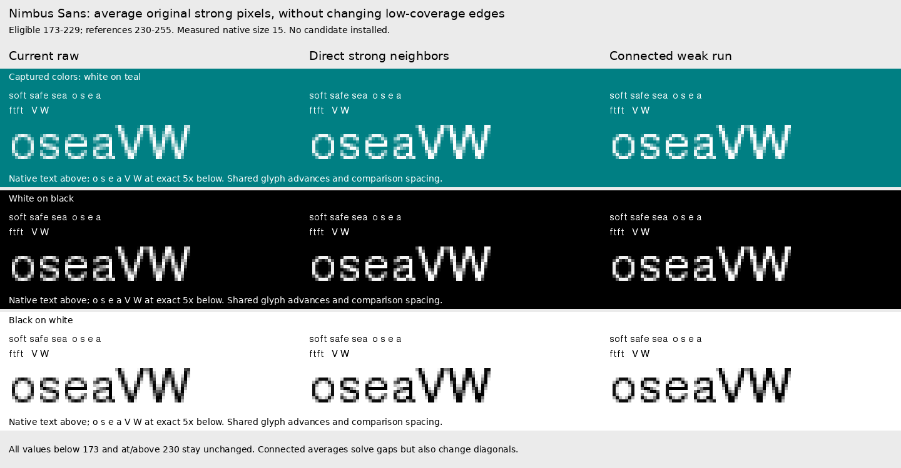

For o, the connected method strengthens all twelve eligible pixels. Direct averaging changes eight and strands four middle pixels. In the upper-left corner, raw 225 stays 225 under direct averaging and becomes 241 under the shared reference. All original values below 173 and at or above 230 remain identical. Outlines, bitmap bounds and glyph advances stay fixed. Native words share whole-pixel advances and fixed comparison spaces.

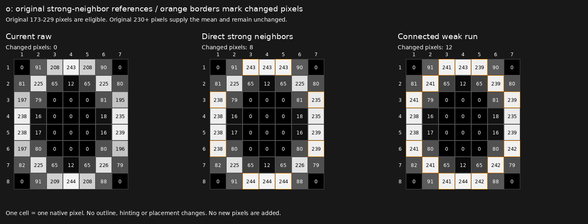

| Glyph | Direct changes | Connected changes | Numbered grid |
| --- | --- | --- | --- |
| o | 8 | 12 | [Grid](../images/browser-common-ground/neighbor-coverage-o.png) |
| s | 7 | 9 | [Grid](../images/browser-common-ground/neighbor-coverage-s.png) |
| e | 7 | 10 | [Grid](../images/browser-common-ground/neighbor-coverage-e.png) |
| a | 9 | 10 | [Grid](../images/browser-common-ground/neighbor-coverage-a.png) |
| f | 1 | 1 | [Grid](../images/browser-common-ground/neighbor-coverage-f.png) |
| t | 0 | 0 | [Grid](../images/browser-common-ground/neighbor-coverage-t.png) |
| V | 8 | 8 | [Grid](../images/browser-common-ground/neighbor-coverage-V.png) |
| W | 19 | 19 | [Grid](../images/browser-common-ground/neighbor-coverage-W.png) |

Orange borders mark every changed cell. V and W change, so this method does not establish diagonal preservation. It leaves the low-coverage edges unchanged but can increase apparent weight. Eight-neighbor adjacency can combine weak pixels at touching branches. A light face without a qualifying strong reference receives no correction in that group.

The [capture record](../images/browser-common-ground/neighbor-coverage-captures.json) contains every source group, unique reference index, target and transformed value. It binds S20's native source, checker and nine images. The raw record now includes native advances for shared placement. Its original coverage and three image hashes remain unchanged.

Run `tests/neighbor_coverage_test.py --label-font FONT` after generating the raw grids. The checker consumes their portable record. Hand-calculated cases cover the 173/230 boundaries, three-pixel gaps, missing references, diagonal adjacency, row wrapping, duplicate reference contacts and half-up means. Mirrored and transposed actual masks produce the same spatial result. The connected result also stays unchanged on a repeated pass. Two independent compositors reproduce the per-glyph treatment and final encoded pixels. Saved native strips, exact enlarged details and numbered cells match their source values.

The bounded choice is a shared mean for a weak connected group. [ImageJ's reconstruction documentation](https://imagej.github.io/plugins/morpholibj) supplies background on propagation constrained by a mask. This experiment uses an average instead of maximum-based dilation. It imports no ImageJ code. Harmonic interpolation can supply a varying reference along longer runs, but adds a solver before the simpler mean is judged.

This preview covers eight glyphs from one font at one measured size. The user requires a broad check after Nimbus visual acceptance. That check must include more characters, font families, integer 8–16pt sizes, weights, italic styles and backgrounds. Keep V/v/W/w, digits and straight-stroke controls visible. Neither synthetic correctness nor the local reference bound establishes acceptable optical weight. No new treatment is installed.

## Cutoff 170 and guarded bridges

The user selects the connected-run method. They lower the main cutoff to 170 for s's 172 pixel and identify a's skipped 140 pixel. They require W to retain its accepted balance and explicitly request colon and exclamation tests. The new comparison retains the 173 connected result as its first column. Cutoff 170 is second. Cutoff 170 with a proposed bridge rule is third.

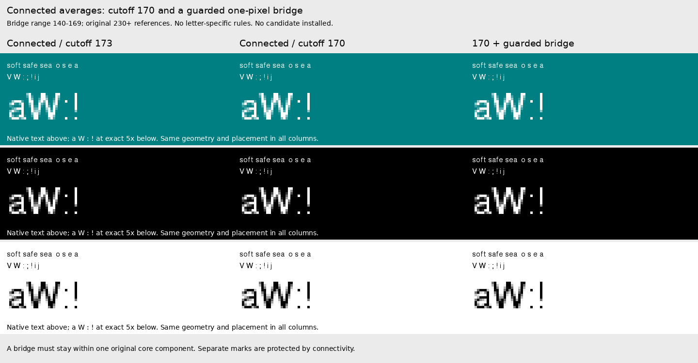

A bridge candidate has original coverage 140–169. Remove its center from the surrounding eight-neighbor ring. Require exactly two disconnected groups of original 170+ neighbors. Those groups must already connect elsewhere in the original 170+ mask. This last condition rejects a faint pixel between separate colon dots or between an exclamation stem and dot. It permits a shortcut inside a's existing bowl component.

Adjacent bridge candidates also need a collective check. Reject a candidate cluster when its members refer to different original components. Otherwise two individually permitted bridges can join separate marks through each other. Classification uses only original pixels. Add accepted candidates to the connected weak-run mask and keep the unique original 230+ reference mean. No letter names or font-specific exceptions select pixels.

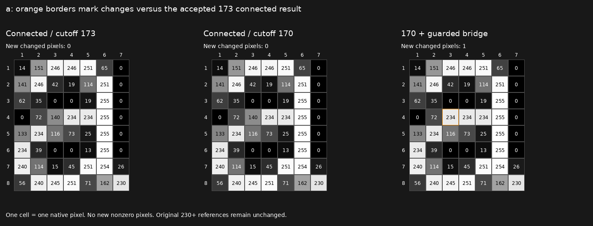

In the matched a, row 4/column 3 changes from 140 to 234. The rest of that a stays identical to the 170 result. In s, row 8/column 5 changes from 172 to 240. Lowering the cutoff changes two s pixels and four W pixels relative to 173. Joining weak runs can change the shared reference for existing eligible pixels too. The bridge adds no further W changes beyond cutoff 170 alone. See the [s grid](../images/browser-common-ground/bridge-coverage-s.png) and [W grid](../images/browser-common-ground/bridge-coverage-W.png).

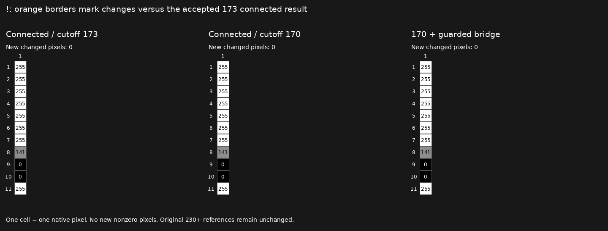

At the displayed size, ! keeps its 141-valued stem tip, two zero rows and 255-valued dot. The [colon](../images/browser-common-ground/bridge-coverage-u003a.png) and [semicolon](../images/browser-common-ground/bridge-coverage-u003b.png) also receive no extra bridge treatment. Actual native checks cover `:;ij!.…` at every integer 8–16pt size, at 96 DPI and 100% scale. All 63 cases produce no bridge selections. Requested points resolve to whole device-unit sizes as in the earlier native comparison.

Another 117 native cases cover `CcGgQO0(){}[]` over those sizes. C and c produce no bridge selections in this font. Two O pixels at 14pt are selected. Those selections need optical judgment in the broader check. The 180 native cases all reproduce independent rasterization and repeat renders. Original 170+ component identities and zero pixels remain unchanged after treatment. These are bounded results for Nimbus, not proof for other fonts.

Synthetic cases include a permitted loop gap, a colon-like gray gap, an exclamation-like gray gap, horizontal separated dots and two adjacent bridges assigned to different components. The latter cases reject the proposed joins. Mirroring and transposing actual masks preserves the spatial result. Each updated run stays within its original strong reference range. Separate alpha compositors and saved-pixel comparisons verify native text, full enlarged glyphs and numbered grids.

Run `tests/bridge_coverage_test.py --probe PROBE --library RAW --stock-library STOCK --font FONT --label-font FONT`. The [capture record](../images/browser-common-ground/bridge-coverage-captures.json) binds the source masks, native libraries, font, two checkers, 180 native control cases and seven images. Default S21 output still reproduces all original masks and nine image hashes exactly. Its capture record refreshes only the checker identity after the helper gains explicit experimental inputs.

This guard deliberately leaves a disconnected main-stroke break alone when its shape cannot be separated from independent marks. It preserves component identity, not every counter shape or optical weight. Broad family, weight, italic and character coverage remains open after the local visual decision. The installed raw preset stays unchanged.

## Broad font gallery with cutoff 170 and guarded bridges

The user requests this candidate alone across common fonts and weights. This gallery therefore omits comparison columns. The earlier stock Qt requirement still applies to other comparison studies. The installed raw preset remains unchanged.

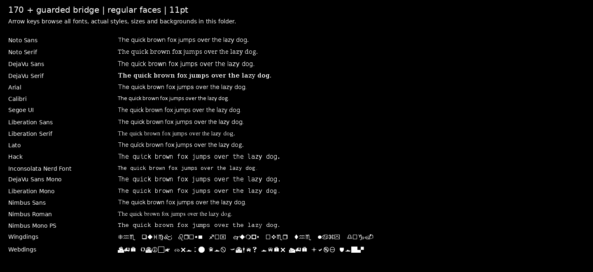

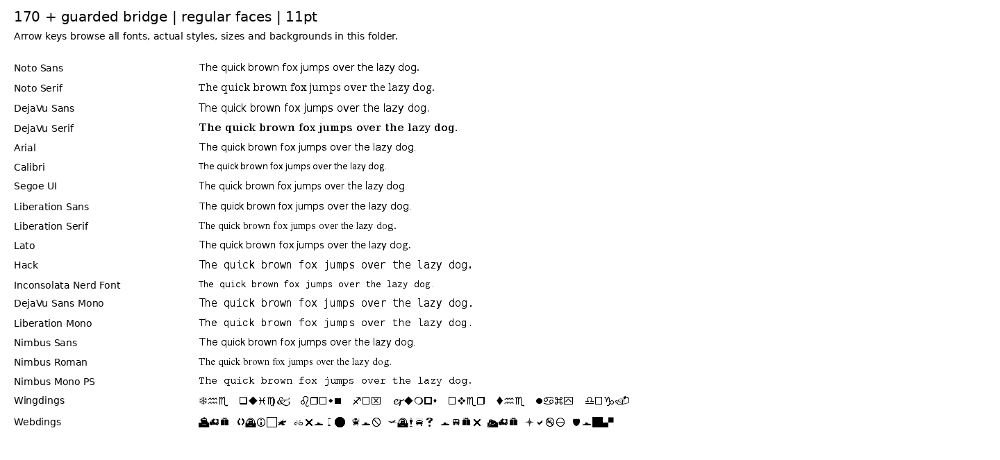

The matrix contains 19 families and 94 actual faces. Each face has all nine integer sizes from 8pt through 16pt, at 96 DPI and 100% scale. Dark and light pages contain identical coverage with opposite foreground and background colors. The full gallery has 764 native-size PNG pages in one folder.

Families include Noto Sans/Serif, DejaVu Sans/Serif/Mono, Arial, Calibri, Segoe UI, Liberation Sans/Serif/Mono, Lato and Hack. Inconsolata Nerd Font, Nimbus Sans/Roman/Mono PS CFF, Wingdings and Webdings complete the matrix. All available weights and italic styles are actual installed faces. Width variants and duplicate copies are excluded. Inconsolata supplies regular and bold only. Wingdings and Webdings supply regular only. No synthetic styles or font files are distributed.

Every size includes the complete quick-brown-fox phrase in both cases, the alphabet, digits, common punctuation, currency and mathematical symbols. Further rows cover accented Latin, combining marks, ligatures, kerning pairs, Greek and Cyrillic. Controls include `:;!ij.…`, `0358`, `a/e/o/s`, and `V/v/W/w`. Inconsolata includes five Nerd Font icons. The symbol fonts also include their U+F020–F0FF bank. Their letters naturally display pictures.

Red boxes identify glyphs absent from the exact selected face. Font fallback is disabled. Qt shapes the text and provides glyph indexes and positions. Exact font-table checks prevent substitution, including Arial Black's different family naming. The probe then captures raw native masks and applies the unchanged 170 + guarded bridge treatment before composition. No new letter-specific rule or coverage threshold enters this study.

Representative full pages cover [Arial regular](../images/browser-common-ground/bridge-matrix-0141_Arial_Regular_11-12pt_Light.png), [Inconsolata bold](../images/browser-common-ground/bridge-matrix-0572_Inconsolata-Nerd-Font_Bold_11-12pt_Dark.png), [Nimbus regular](../images/browser-common-ground/bridge-matrix-0644_Nimbus-Sans_Regular_11-12pt_Dark.png), [Nimbus bold italic](../images/browser-common-ground/bridge-matrix-0669_Nimbus-Sans_Bold-Italic_11-12pt_Light.png), [Lato light](../images/browser-common-ground/bridge-matrix-0452_Lato_Light_11-12pt_Dark.png), and [Wingdings](../images/browser-common-ground/bridge-matrix-0740_Wingdings_Regular_10-11pt_Dark.png). View the original PNG files at 100% for pixel judgment.

Generate the complete folder with the existing CFF-capable raw FreeType library, its matching stock library and an installed label font:

```sh
PYTHONDONTWRITEBYTECODE=1 python3 tests/bridge_font_matrix_test.py \
  --library RAW_LIBRARY --stock-library STOCK_LIBRARY --label-font LABEL_FONT
gwenview results/bridge-font-matrix/gallery/0000_Overview_Dark.png
```

The generator needs Qt6Gui and FreeType development files, a C++17 compiler, Fontconfig and Pillow. It captures the selected families available on the running system. Missing families appear in the unavailable-style record. Other machines can produce different face counts. Keep the viewer at 100% and use Left/Right to browse the single folder. The default 1440-pixel page width requires enough screen space at native size.

The [capture record](../images/browser-common-ground/bridge-matrix-captures.json) binds all 846 font/point conditions, font basenames and hashes, source identities and 764 image hashes. Eight representative images are published here. The full generated folder stays in `results/bridge-font-matrix/gallery`. Native raw masks remain internal controls. All 126,225 captured glyph masks reproduce independent outline rasterization and repeat rendering. Two compositors agree across 357,687 placed occurrences. Every saved body crop preserves its exact source pixels. The first overview also matches the actual Gwenview image at 100% pixel for pixel.

These checks establish faithful component output, complete placement and the existing bridge invariants. They do not establish acceptable optical weight across the matrix. The gallery is scientific output rather than installed application output. Complex scripts beyond the displayed corpus, other scales and runtime integration remain outside this gallery.

## Focused crown and diagonal cases at 11–12pt

The user reports weak crowns in Hack, Inconsolata Nerd Font and Nimbus Roman at 11pt. DejaVu Sans has poor S/A/Y and diagonal balance on black at 11pt. Arial diagonals are too thick on black at 11–12pt. Most other tested sizes look good. These findings narrow the next studies to 11–12pt without retuning the remaining sizes.

The focused gallery preserves the current treatment. It contains five native sheets and twenty numbered pixel sheets in one folder. Native sheets show both backgrounds and all available regular, italic, bold and bold italic faces. Inconsolata has only regular and bold. Every native strip reproduces its corresponding broad-gallery pixels exactly. Numerical details cover four regular glyphs per family at each point size. No new treatment is installed or selected.

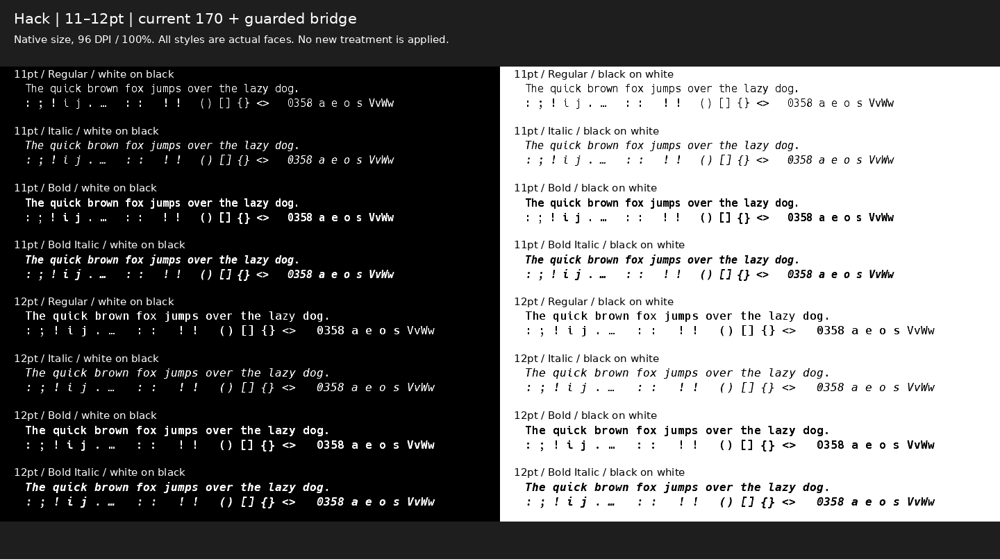

The other native sheets cover [Inconsolata](../images/browser-common-ground/bridge-case-01_1_Inconsolata-Nerd-Font_11-12pt_native.png), [Nimbus Roman](../images/browser-common-ground/bridge-case-02_1_Nimbus-Roman_11-12pt_native.png), [DejaVu Sans](../images/browser-common-ground/bridge-case-03_1_DejaVu-Sans_11-12pt_native.png), and [Arial](../images/browser-common-ground/bridge-case-04_1_Arial_11-12pt_native.png). The grids show original coverage above current coverage in each cell. Cell fill represents current white-on-black coverage. Orange borders mark changes. Blue borders mark unchanged nonzero values below 170, including normal edge softening. A blue cell is not automatically a defective pixel.

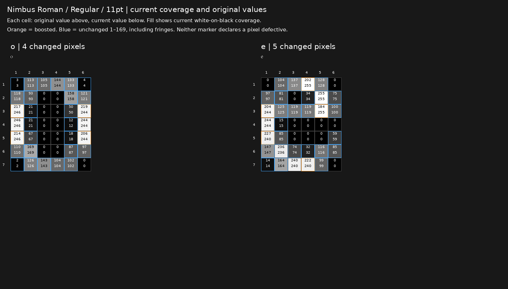

Nimbus Roman's 11pt o has top-row values `3, 113, 105, 144, 133, 4`. All remain unchanged. Its s starts with `100, 136, 126, 114`. Its 8 starts with `24, 135, 120, 138, 166, 44`. Those crowns fall below the main 170 cutoff. They also fail the conservative bridge predicate. This explains why the current pass cannot strengthen them. It does not establish which source pixels require stronger coverage.

Hack's 11pt 8 retains top-row values 162 and 161 beside strong pixels at 234 and 235. Its next row also retains 161–164 values. Inconsolata's 11pt m receives no changes. Its top-row values include 125, 115, 141 and 138 between or beside strong pixels. These are further examples of curve details outside the current rule.

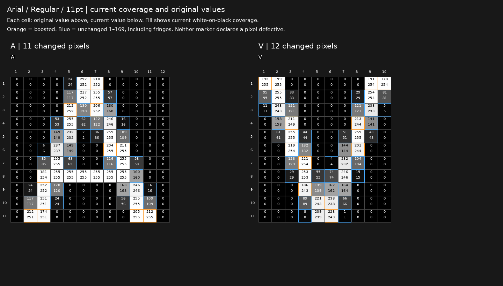

Arial's 11pt V changes its first two pixels from 192 and 199 to 255 and 255. Their combined coverage rises from 391 to 510. The opposite arm changes 191 and 178 to 254 and 254. The current rule strengthens adjacent pixels independently of their combined stroke width. Arial's W and Y also contain adjacent boosted pairs. These measurements explain added diagonal weight without attributing every observed defect to the pass.

DejaVu Sans combines unchanged partial edge pixels with boosted core pixels. Its 11pt A starts with adjacent values 223 and 255, which become 255 and 255. Its Y retains edge values near 140–146 while neighboring pixels rise toward their strong references. The S grid similarly shows retained low values next to boosted pixels. The study records both source geometry and the pass's contribution. Neither a larger global floor nor a lower global cutoff distinguishes these roles by itself.

Run the case-study checker after the broad gallery exists:

```sh
PYTHONDONTWRITEBYTECODE=1 python3 tests/bridge_case_study_test.py \
  --stock-library STOCK_LIBRARY --label-font LABEL_FONT
gwenview results/bridge-case-studies/gallery/00_1_Hack_11-12pt_native.png
```

Use Left/Right at 100% to browse the 25 pages. Each family starts with native text, followed by its two grid pages per point size. The [portable record](../images/browser-common-ground/bridge-case-captures.json) contains all 36 font/point/style sources, 40 complete original/current glyph arrays, row/column sums and 25 image hashes. Seven representative images are published here. Source hashes bind the exact broad-gallery cases and unchanged filter. Independent rasterization, two alpha compositors, saved grid fills and exact native-crop comparisons cover the output. The displayed first native sheet also matches the saved PNG pixel for pixel.

The next correction must distinguish weak curved stroke structure from partially covered diagonal edges. A cutoff alone lacks that information. These case studies supply held-out constraints for that investigation. They do not select a new classifier, font substitution or per-font exception. Coverage sums describe pixel values rather than perceived weight or outline accuracy.

## Hack Regular 8 at 11pt: shape versus coverage

The user selects this 8 as the next target. Its upper corners and waist contain dim intermediate pixels. They reject full coverage if that adds jaggies. They also identify deformation in the hinted shape. This study separates those two issues before designing a general correction.

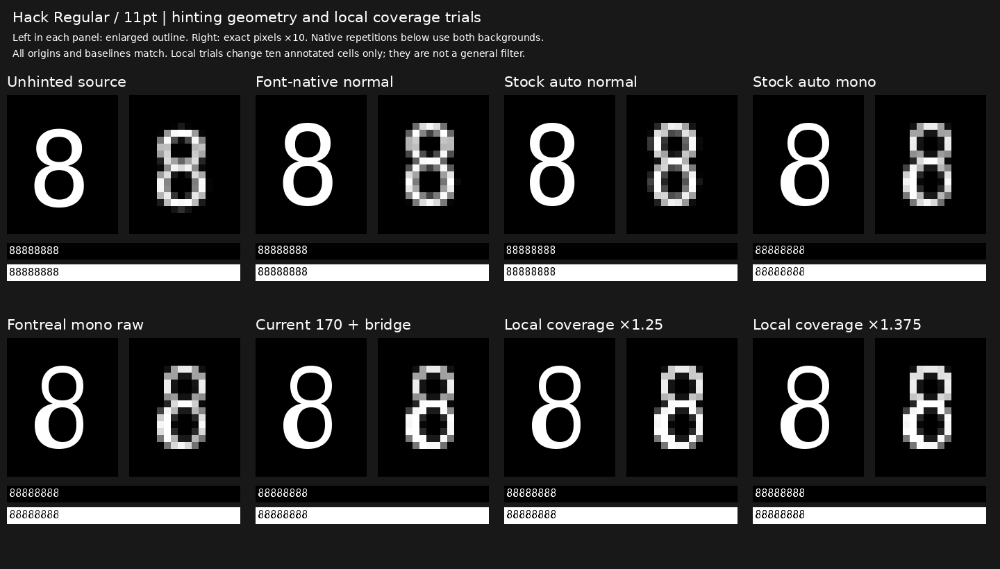

The top row uses the matching stock FreeType library. From left, it shows the scaled unhinted outline, default font-native normal hints, auto-normal hints and auto-mono hints. Every mode uses grayscale rasterization and disables embedded bitmaps. The bottom row shows Fontreal auto-mono raw, current 170 + guarded bridge, and two local partial-coverage previews. The requested size remains 11pt at 96 DPI. The original Qt request resolves to 15 device units, which all controls retain.

Each panel places the enlarged outline on the left and exact enlarged pixels on the right. The outline is separately rasterized at ten times its captured coordinates. Pixel blocks use exact repetition of the native bitmap. They share an origin and baseline. The native repetitions below use both backgrounds, identical whole-pixel spacing and encoded composition. Judge crispness in those native strips. The larger images expose shape and coverage separately.

Stock auto-mono and Fontreal auto-mono raw have identical loaded outlines and grayscale masks for this glyph. The nearest-Y change does not alter this condition. The unhinted raster spans nine columns, with left bearing zero. Auto-mono spans seven, with left bearing one. Native normal spans nine and auto-normal spans eight. These are raster bounds, not stroke-width measurements. The geometry differences precede the coverage pass.

[FreeType documents separate hinting and raster choices](https://freetype.org/freetype2/docs/reference/ft2-glyph_retrieval.html#ft_load_target_xxx). It warns that the strong monochrome-target geometry can look unpleasant with grayscale output. That warning motivates this comparison. It does not establish an optical winner or invalidate the accepted mono treatment in other conditions.

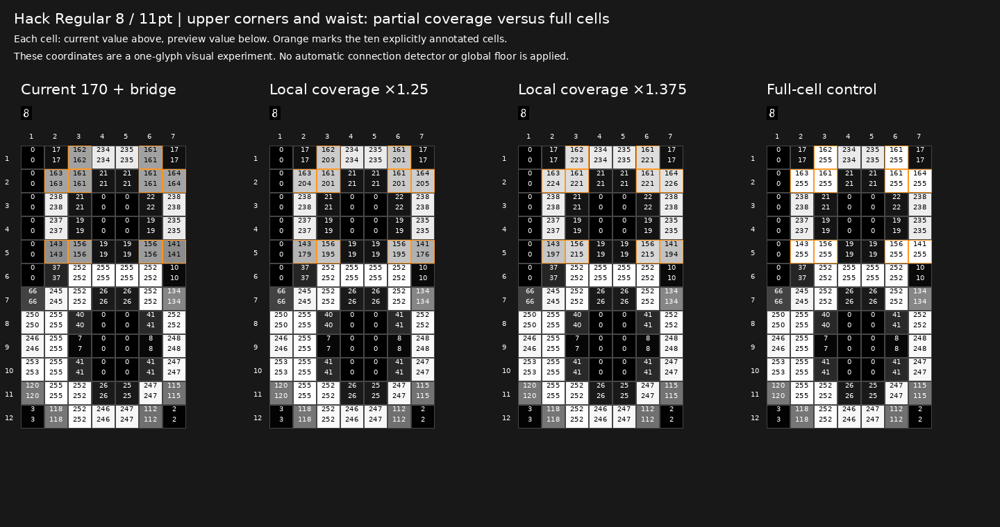

The local previews annotate ten cells in this one mask. Six cover the upper corners. Four cover the waist. Their original values range from 141 to 164 and remain unchanged in the current treatment. Multiplying them by 1.25 gives 176–205. Multiplying by 1.375 gives 194–226. Half-up rounding preserves their order, and every trial value stays below 230. Every other current-mask pixel stays identical. The full-cell control changes the same ten values to 255 to expose the unwanted extreme.

These coordinates are explicit diagnostic annotations. They are not a connection detector, a font-specific production rule or a proposed general classifier. The previews leave outlines, origins, existing strong pixels and all other edge pixels unchanged. They cannot repair the hinted geometry. Improvement in this 8 would still require checks against the other four families, punctuation and diagonals before generalization.

Reproduce the two pages with the same Hack font and matching stock library:

```sh
PYTHONDONTWRITEBYTECODE=1 python3 tests/hack_eight_test.py \
  --font HACK_REGULAR_FONT --stock-library STOCK_LIBRARY --label-font LABEL_FONT
gwenview results/hack-eight/gallery/00_Hack_11pt_shape-and-coverage.png
```

The checker compiles the existing single-glyph probe with Qt6Core and FreeType development files. Its [portable record](../images/browser-common-ground/hack-eight-captures.json) binds font, source case, libraries, flags, native captures, outlines, masks, annotated coordinates, checker and figures. Independent rasterization reproduces all original masks. Repeated renders agree. Explicit checks require ten changed cells, preserved support and ordering, unchanged other pixels, complete native/enlarged bounds and exact saved crops and grid fills. The complete first page also matches Gwenview at 100% pixel for pixel. No installed profile or general filter changes in this study.

## Native-normal shape and coverage at 11–12pt

The user prefers the local ×1.375 trial but still rejects the shape. Font-native normal is their only accurate shape reference for Hack Regular's 11pt 8. This is a bounded optical selection for that glyph. The local gain preference remains separate evidence. Its ten annotated coordinates do not transfer to the native raster.

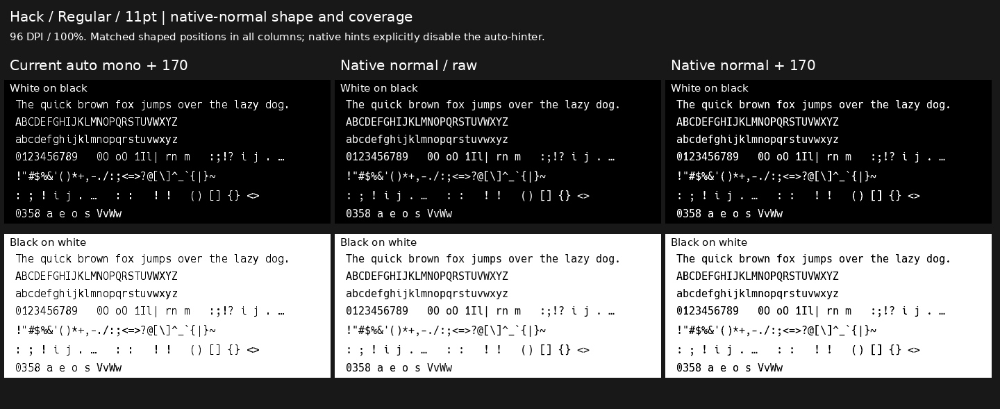

The columns show current auto-mono with 170 + guarded bridge, native-normal raw coverage, and native-normal with the same bridge pass. The native columns share one loaded outline, bitmap bounds and origin. The third column can still look heavier because its coverage changes. Outline identity does not guarantee equal perceived shape. No local ×1.375 gain enters either native column.

The native probe uses `FT_LOAD_NO_AUTOHINT | FT_LOAD_NO_BITMAP`, numeric flags 32776, with normal grayscale rasterization. [FreeType distinguishes native preference from disabling its auto-hinter](https://freetype.org/freetype2/docs/reference/ft2-glyph_retrieval.html#ft_load_xxx). The explicit no-auto mode exactly reproduces the selected Hack control from S25, which used default/native preference. The matching stock library prevents the browser profile from overriding the requested flags. No new fitting rule or classifier is introduced.

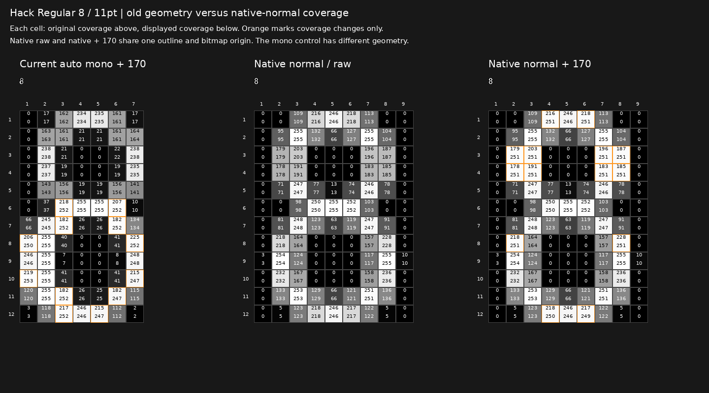

The Hack 8 grid retains the old seven-column mono raster and the nine-column native raster. Each cell shows original coverage above displayed coverage. Orange borders mark coverage changes. The native bridge pass changes fourteen pixels in this 8. Its two native columns keep identical geometry and bounds. This separates the user's preferred shape from the remaining contrast decision.

The matrix covers Hack's four actual styles at 11pt and 12pt. Regular Inconsolata Nerd Font, Nimbus Roman CFF, DejaVu Sans and Arial supply the other eight conditions. Each page includes both backgrounds, the complete pangram, uppercase and lowercase alphabets, digits, ASCII punctuation, separated marks, curves and diagonals. Explicit S/A/Y/V/W rows retain the earlier diagonal constraints. The full folder contains sixteen native pages and one grid page.

Published examples include [Hack italic](../images/browser-common-ground/native-normal-0003_Hack_Italic_11pt.png), [Inconsolata](../images/browser-common-ground/native-normal-0009_Inconsolata-Nerd-Font_Regular_11pt.png), [Nimbus Roman](../images/browser-common-ground/native-normal-0011_Nimbus-Roman_Regular_11pt.png), [DejaVu Sans](../images/browser-common-ground/native-normal-0013_DejaVu-Sans_Regular_11pt.png), and [Arial](../images/browser-common-ground/native-normal-0015_Arial_Regular_11pt.png). The original shaped positions and baselines remain fixed across columns. Long alphabet and control rows split at spaces while retaining every selected character. These are controlled raster comparisons. They do not qualify native-hinted text layout or live-application spacing.

Generate the study after the broad source gallery exists:

```sh
PYTHONDONTWRITEBYTECODE=1 python3 tests/native_normal_test.py \
  --stock-library STOCK_LIBRARY --label-font LABEL_FONT
gwenview results/native-normal-study/gallery/0000_Hack_Regular_11pt.png
```

The [portable record](../images/browser-common-ground/native-normal-captures.json) binds sixteen source conditions and 1,536 captured native glyphs. Each glyph has its codepoint, capture hash, loaded-outline hash, raw raster and transformed mask. Font files, libraries, probe and composing helpers also have hash bindings. Native glyph indexes must match the exact shaped source. Repeated renders and independent outline rasterization agree. Two compositors reproduce every row. Saved native crops and grid fills retain exact pixels. One complete updated Hack italic page also matches its actual 100% Gwenview presentation pixel for pixel. Seven representative images are published here. All seventeen remain in the generated folder for arrow browsing.

The user selects native-normal + 170 as best overall in this matrix. Inconsolata retains the most visible weak coverage, especially H/K/M/V/W/u on black at 11pt. The installed profile remains unchanged. The selected component treatment still needs live-application and layout qualification.

## Inconsolata and the requested ×1.375 gain

The user asks whether the native-normal sheets contain ×1.375. They do not. S25 applies that gain only to ten annotated Hack pixels. This new study applies the requested multiplication to residual coverage in Inconsolata Regular, on the selected native + 170 baseline. Both integer sizes, 11pt and 12pt, retain the native shape, bounds and positions.

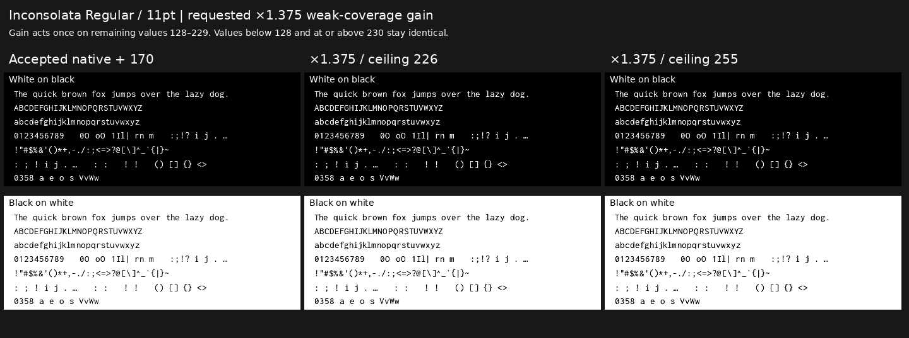

The first column is the accepted baseline. The middle multiplies remaining values 128–229 by 11/8, with half-up rounding and a strengthening ceiling of 226. The right uses the same multiplication with ceiling 255 as a saturation control. Values below 128 and at or above 230 remain identical. Existing values above a strengthening ceiling never decrease. Both trials start from the same immutable baseline and run once. They do not compound each other.

The 226 variant preserves partial coverage in every newly strengthened cell. Its single-value transfer is monotonic: a larger input never gives a smaller output. The 255 control exposes a boundary problem. It maps 229 to 255 while protected 230 stays at 230. It can therefore make a formerly weaker cell brighter than a stronger protected one. That control is not a selected general policy.

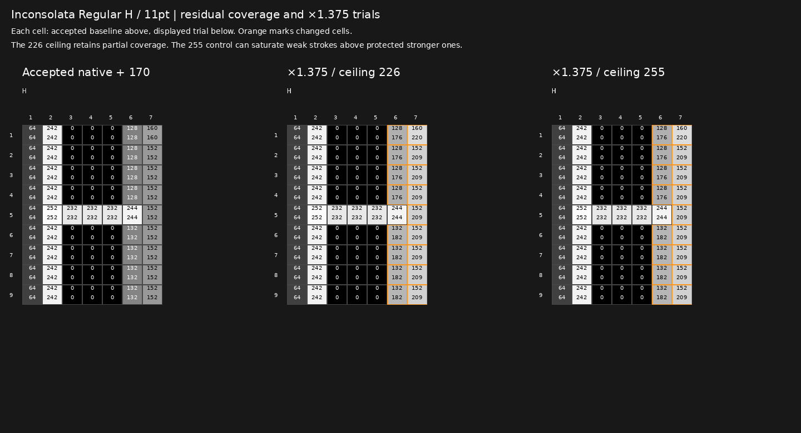

In H at 11pt, the right stem includes pairs 128 + 152 while the left has 64 + 242 after the accepted pass. The gain changes 128 + 152 to 176 + 209 in both trial columns. In u, a right-stem pair 144 + 124 becomes 198 + 124. These changes add coverage. They do not concentrate split coverage into a single pixel or correct pixel alignment. This distinction matters even when the glyph looks brighter.

Other weak runs lack an original 230+ reference for the accepted pass. In the 11pt m, ten eligible pixels form one such run. W has isolated eligible runs too. Raising only the coverage threshold cannot address those missing references. The requested gain tests whether a bounded partial lift can improve their appearance without making already strong strokes heavier.

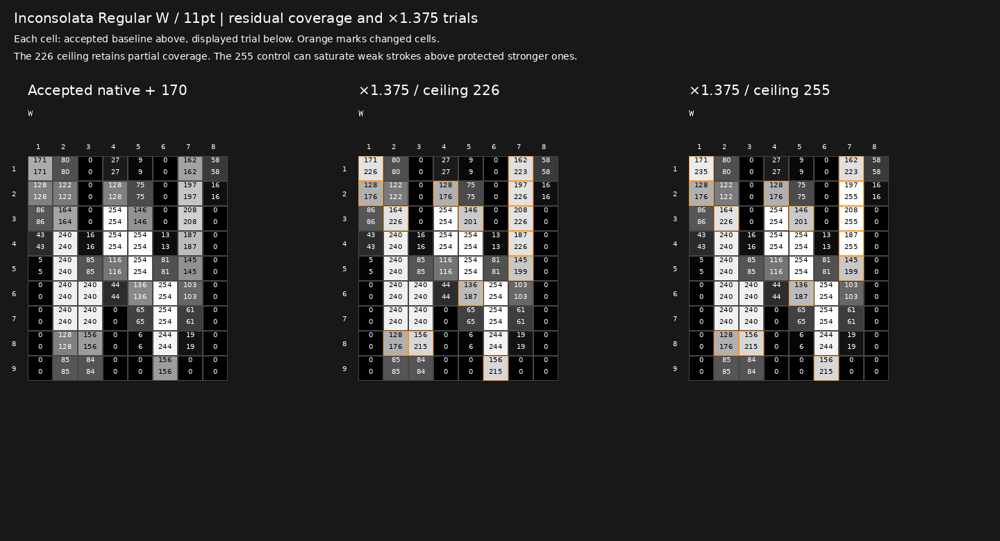

Across 96 captured glyphs at 11pt, the 226 trial changes 519 pixels and creates no new fully covered pixels. The 255 control changes 532 and creates 96 fully covered pixels. At 12pt, the corresponding counts are 527/0 and 533/73. These counts describe masks, not perceived weight. The [12pt page](../images/browser-common-ground/inconsolata-gain-0007_Inconsolata_Regular_12pt_gain.png) retains the less-pronounced condition as a control. Both pages include alphabets, the full pangram, digits, common punctuation and separated marks on both backgrounds.

Reproduce the eight-page folder after the native-normal source study exists:

```sh
PYTHONDONTWRITEBYTECODE=1 python3 tests/inconsolata_gain_test.py \
  --stock-library STOCK_LIBRARY --label-font LABEL_FONT
gwenview results/inconsolata-gain/gallery/0000_Inconsolata_Regular_11pt_gain.png
```

Arrow browsing covers the 11pt sheet, six numbered H/K/M/V/W/u grids, and the 12pt sheet. The [portable record](../images/browser-common-ground/inconsolata-gain-captures.json) binds all 192 native glyph captures, original outlines, raw/baseline/trial masks, counts and eight image hashes. Four examples are published here. Checks cover all 256 transfer inputs, boundaries, rounding, the partial variant's monotonicity and the saturation control's inversion. Capture hashes, repeated renders, independent rasterization and baseline recomputation must agree. Both compositors, complete native crops and every reopened grid fill retain exact pixels. The complete 11pt page also matches its actual 100% Gwenview presentation pixel for pixel.

The user prefers the 226-limited trial as subtly better at reducing jaggies. The u right stem still needs a defined core. No gain is installed or selected for general use. Other fonts and weights require held-out checks. The next study separates additional coverage from concentration of the existing coverage.

## Inconsolata u: a defined core at fixed stem coverage

After the selected gain, the upper four rows of u's right stem remain split into 198 + 124. The lower stem already includes a native reference at 240. The user proposes that clearly defined strokes can mask remaining fuzziness. These local trials test that idea on the exact 11pt glyph before choosing a general mechanism.

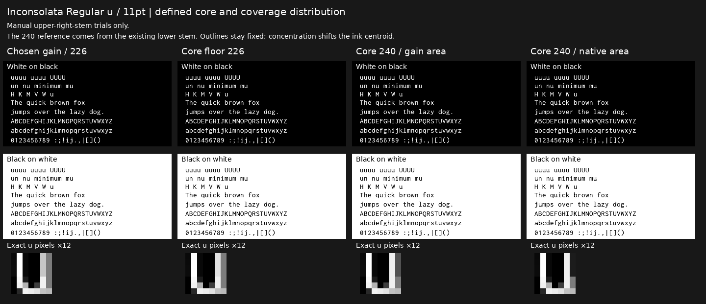

From left, the columns show the chosen gain, a core floor of 226, a 240 core preserving the gained stem area, and a 240 core preserving the original native stem area. Only four annotated upper-stem pairs change. The bowl, lower join and every other pixel retain the chosen gain. The existing 240 reference comes from the original native mask at zero-based row 5/column 5. No new pixel reaches 255.

The floor trial changes each 198 + 124 pair to 226 + 124. It adds coverage and leaves the fringe unchanged. The next trial changes the pair to 240 + 82. Its sum stays at the chosen value, 322. The final trial gives 240 + 28, with sum 268. That restores the original native total within each annotated pair. It keeps the selected gain everywhere else. Neither concentrated version is a general detector or a font-specific production rule.

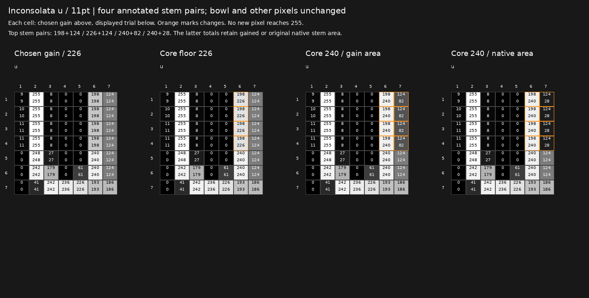

The complete glyph totals are 4,990 for the chosen gain, 5,102 for the floor, 4,990 for gained-area concentration, and 4,774 for native-area concentration. The original full native glyph totals 4,403. Thus the last column restores native area only in the marked pairs. Equal coverage sums do not guarantee equal perceived brightness or weight.

Concentration also moves the ink centroid, the center weighted by coverage. Within a pair, its fractional position from the core toward the outer pixel changes from 0.385 to 0.255 or 0.104. This is a deliberate pixel-alignment tradeoff. The source outline, bitmap bounds and nonzero support remain unchanged, but apparent geometry can change. The core-floor trial supplies a simpler control for added strength.

All pre-existing strong pixels and the baseline 170+ membership remain identical. The floor changes four cells. Each concentrated trial changes eight. All other 95 glyphs at 11pt retain their exact chosen masks. All 96 masks at 12pt remain unchanged. The [12pt identity page](../images/browser-common-ground/inconsolata-u-02_Inconsolata_u_12pt_stem.png) labels this restriction explicitly. Context text uses the captured uniform native advance of eight pixels, identically across columns. The simple Latin controls do not qualify general shaping, kerning or a real application.

Generate the three-page folder after the gain study exists:

```sh
PYTHONDONTWRITEBYTECODE=1 python3 tests/inconsolata_u_test.py \
  --stock-library STOCK_LIBRARY --label-font LABEL_FONT
gwenview results/inconsolata-u/gallery/00_Inconsolata_u_11pt_stem.png
```

The [portable record](../images/browser-common-ground/inconsolata-u-captures.json) binds 192 native sources, all context-mask hashes, original/chosen/trial u masks, pair sums and centroids. It also binds the source font, library and composing helpers. Every native capture must reproduce its loaded outline and repeated raster. The chosen baseline must reproduce the selected gain. Direct checks cover exact changed-cell sets, conserved pair totals, glyph totals, centroid movement, protected pixels and held-out identity. Two compositors, reopened native crops, exact 12× pixel repetitions and numbered fills cover the figures. The complete native 11pt page also matches its actual 100% Gwenview presentation pixel for pixel.

These are manual annotations for one glyph and size. The user prefers core 240 with native stem area, with gained area close behind. This selection does not alter the installed profile. The next diagnostic tests whether a conservative straight-stem selector can transfer the arithmetic without letter-specific coordinates.

## Broader core study and actual stock Qt

The broader comparison covers seventeen installed Latin families at 11pt and 12pt. It contains 54 actual faces and 108 font/style/point conditions. The styles are regular, bold, italic and light. Light is available for DejaVu Sans, Calibri, Segoe UI and Lato. DejaVu Sans uses its actual ExtraLight face. Inconsolata has no installed italic or light face. The generator lists all missing styles and never synthesizes a face. Wingdings and Webdings remain in the earlier symbol study.

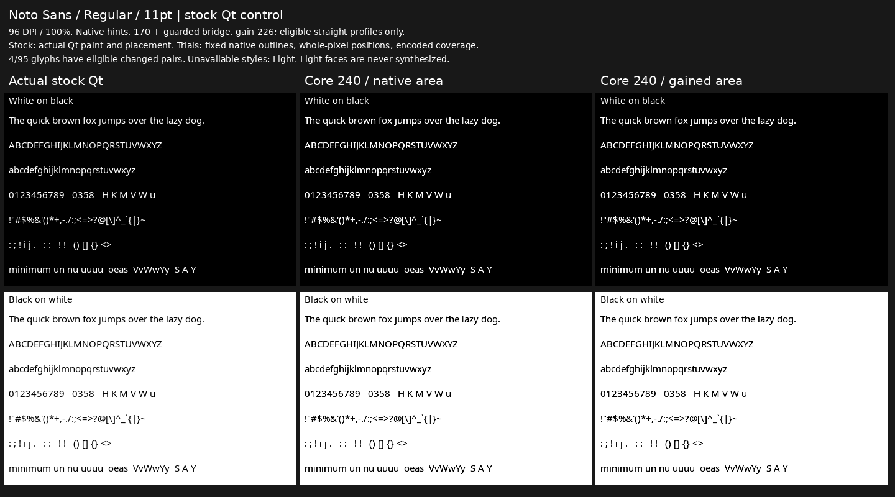

The Noto Sans control places actual stock Qt on the left, core 240 with native area in the middle, and core 240 with gained area on the right. Both backgrounds use the same source font and requested point size. The control uses unmodified QtGui and QtCore from saved distribution packages, with the matching unmodified FreeType provider. It uses QPainter and QTextLayout, not a reconstruction from FreeType masks. The generator checks the loaded library identities and exact source font tables. It repeats each Qt paint and requires identical pixels. The offscreen Qt platform retains the current Fontconfig configuration.

The candidate uses native-normal hints, the existing 170 + guarded bridge pass, and the selected ×1.375 gain limited to 226. It then concentrates only eligible straight profiles. Candidate glyphs share whole-pixel origins and encoded coverage composition. Stock Qt retains its own fractional positions and blending. Differences from stock therefore include the complete candidate recipe. They do not isolate the new selector. The other sheets replace stock Qt with the unchanged gain baseline to isolate that last step.

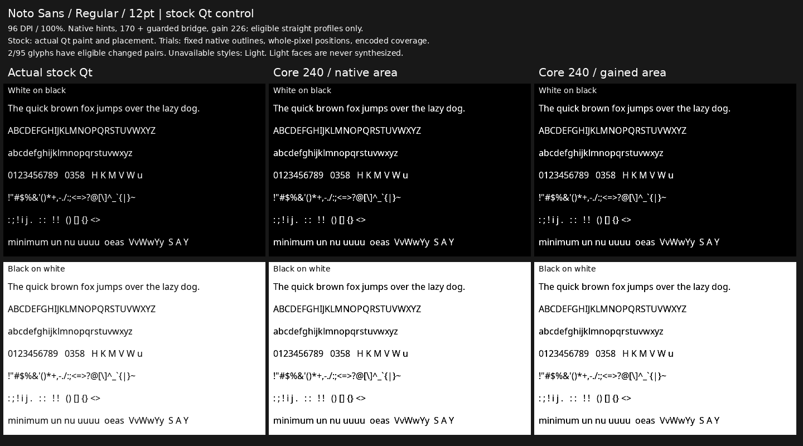

The selector reads the original native mask. It looks for adjacent positive pixels with combined coverage 192–384, a stronger side at least 16 above the other, and outer neighbors at most 32. It requires at least three successive profiles along one axis. Each channel must stay within eight of the first profile. Intersecting proposals are rejected. A pair stays unchanged if either current pixel already reaches 230. All decisions use immutable input rather than newly modified pixels.

The stronger side receives at most 240. The other side retains the remaining coverage. The native-area column preserves the original native pair sum. The gained-area column preserves its gained pair sum. If less than 241 is available, the core stays below 240 to retain positive coverage in both cells. If the operation cannot strengthen the current core, that pair stays unchanged. The exact Inconsolata 11pt u reproduces the preferred four 240 + 28 pairs. Its gained-area alternative reproduces four 240 + 82 pairs. The bowl stays identical to the chosen baseline.

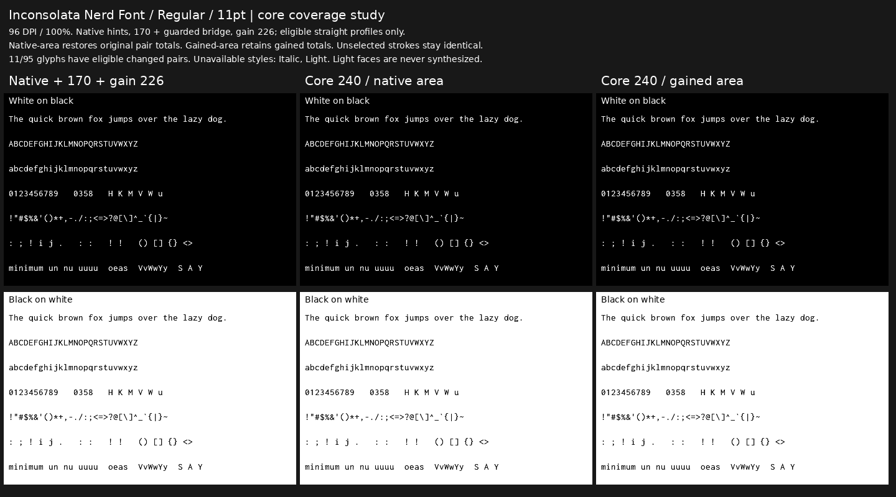

The rule deliberately leaves many strokes alone. Noto Sans Regular changes i, l, r and the vertical bar at 11pt. At 12pt, it changes i and l. Noto Sans Bold has no eligible changed pair at either size. Italic has none at 11pt and only the vertical bar at 12pt. The two core columns are identical where neither has a qualifying pair. Any difference from stock in those rows comes from the preceding recipe. These limits prevent the chart from claiming a general crown or diagonal correction.

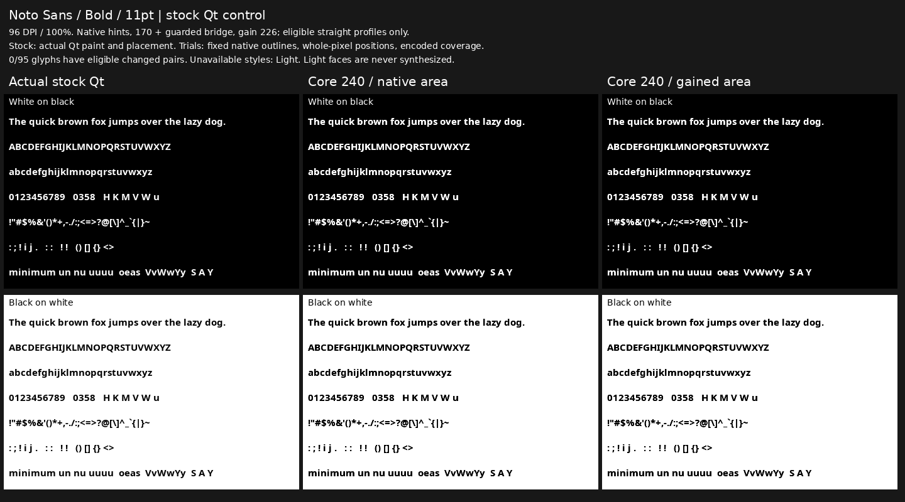


The held-out families include Hack, Arial, DejaVu, Liberation, Calibri, Segoe UI and the Nimbus CFF faces. Each page contains the full pangram, both alphabets, digits, common punctuation, separated marks and the H/K/M/V/W/u controls. Both backgrounds appear at native size. The pages show the number of glyphs with eligible changes. This remains an optical trial, including cases where the limited selector does nothing.

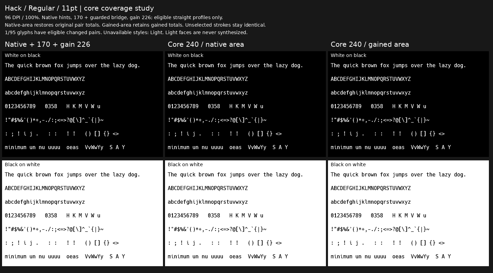

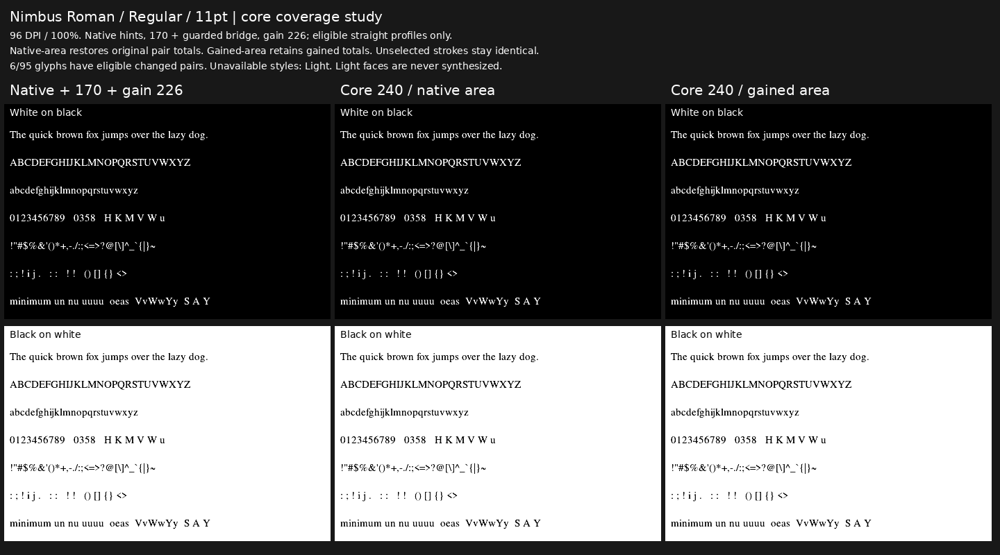

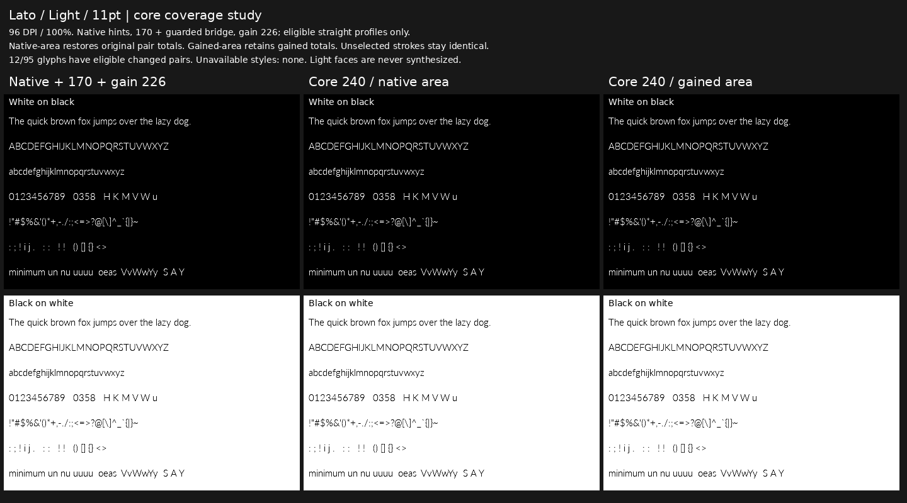

Generate the complete folder with original Qt packages that match the build headers:

```sh
PYTHONDONTWRITEBYTECODE=1 python3 tests/stem_core_test.py --self-test
PYTHONDONTWRITEBYTECODE=1 python3 tests/stem_core_test.py \
  --stock-library STOCK_LIBRARY \
  --stock-qt-directory ORIGINAL_PACKAGE_DIRECTORY --label-font LABEL_FONT
gwenview results/stem-core-study/gallery/000_Noto-Sans_Regular_11pt_stock-Qt.png
```

`ORIGINAL_PACKAGE_DIRECTORY` contains the unmodified Qt Core, Gui, D-Bus and platform-plugin Debian packages. The generator extracts these into its storage-backed build directory. It does not install them. The flat folder contains 114 pages, including six extra Noto Sans stock controls. One Gwenview window supports arrow browsing at 100%.

The [portable record](../images/browser-common-ground/stem-core-captures.json) binds all 10,260 glyphs through source-outline and mask digests. It includes full masks and selected pairs for all 348 glyph conditions with changes. The digest order and dimensions define the concatenated arrays. The generated full manifest retains every original and trial array plus layout coordinates. Library, package, font, helper, native capture and image hashes bind the inputs and outputs. Independent rasterization checks each loaded outline. Two compositors check each native text row. Reopened PNG crops check the complete saved strips, and direct fixtures cover the accepted u, axis transposition, reflection, short marks and low available area.

The new selector preserves nonzero support, existing strong pixels, source outlines and bitmap bounds. It can shift the ink centroid and perceived geometry. Native-area conservation applies only to selected pairs, not the whole original glyph. The broader treatment still needs human judgment and real-application testing. It changes no installed library, profile, font or preference.

## Noto Sans Regular 11pt numbered coverage

The user reports that the other tested fonts look great in all conditions and that Inconsolata cleaned up well. The next inspection targets a, e, o and n in Noto Sans Regular at 11pt. These charts use the exact captured masks from the broad study. They apply no new darkening or geometry change.

Each page shows original native coverage, the selected 170 + gain baseline, core 240/native area and core 240/gained area. None of these four glyphs has an eligible straight-stem pair. All three processed maps are identical. The original column makes the preceding coverage changes visible. Orange borders identify changed values. Rows and columns start at one within the native glyph bitmap.

Coverage measures how much ink fills a pixel. Zero means no ink and 255 means full ink. The cell numbers remain coverage values on both backgrounds. On white, the displayed gray value is 255 minus coverage. The small strips above each grid repeat the exact native glyph pixels, without resizing.

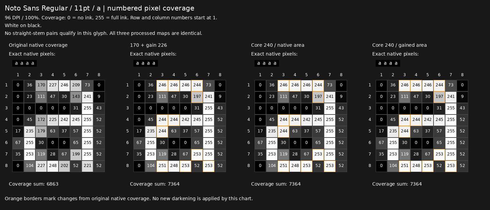

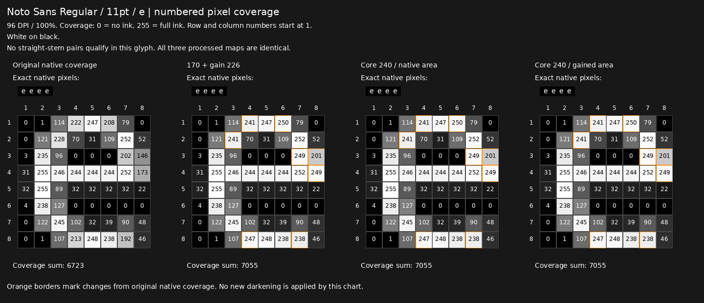

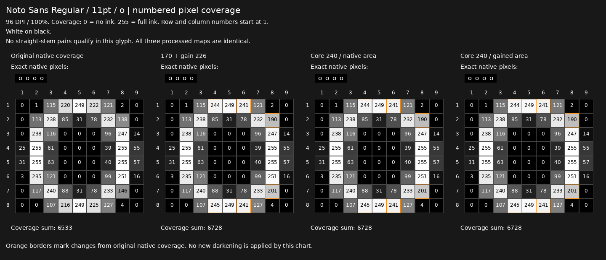

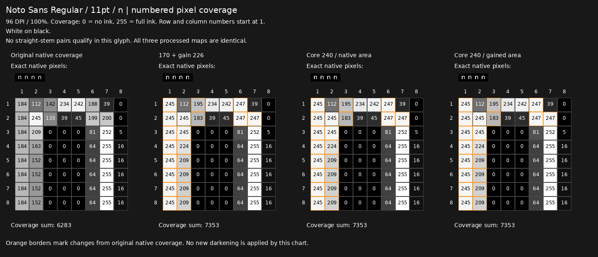

The matching [white-background a](../images/browser-common-ground/noto-coverage-01_Noto-Sans_Regular_11pt_a_light.png), [e](../images/browser-common-ground/noto-coverage-03_Noto-Sans_Regular_11pt_e_light.png), [o](../images/browser-common-ground/noto-coverage-05_Noto-Sans_Regular_11pt_o_light.png) and [n](../images/browser-common-ground/noto-coverage-07_Noto-Sans_Regular_11pt_n_light.png) pages retain the same numbers. Open the full images at 100% for pixel inspection.

After the broad core study creates its matching native capture, generate the eight-page folder:

```sh
PYTHONDONTWRITEBYTECODE=1 python3 tests/noto_coverage_grid_test.py \
  --stock-library STOCK_LIBRARY --label-font LABEL_FONT
gwenview results/noto-coverage-grid/gallery/00_Noto-Sans_Regular_11pt_a_dark.png
```

The [portable record](../images/browser-common-ground/noto-coverage-captures.json) includes all four original outlines, bitmap bounds, original and processed masks, complete numbered arrays and image hashes. It binds the parent record, native capture, font, library and helpers. The generator recomputes every processed mask and requires the combined digest to match the broad study. An independent rasterizer checks each original outline. Reopened native strips and every grid-cell fill check both polarities. The maps support the next optical diagnosis without changing the accepted treatments or installed profile.

## One winner in the split stem

The user identifies n as the remaining target. Its split left stem needs one dominant pixel, like the earlier Inconsolata u correction. The existing strong-pixel guard blocks that result. The original lower pairs contain 184 + 152 coverage. The bridge and gain pass raises them to 245 + 209. Since one pixel already exceeds 230, the original core selector skips the pair. Both pixels then compete as a bright stem.

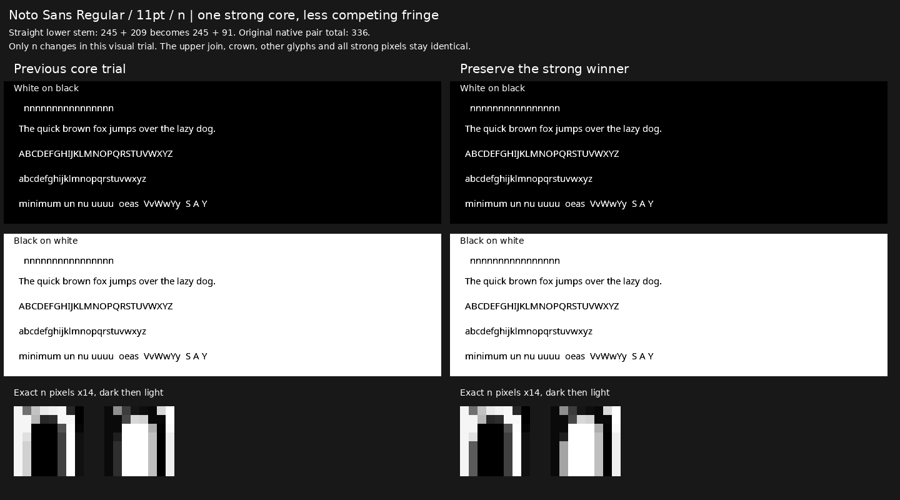

The new trial keeps the existing 245 core. The original pair total is 336, which leaves 91 for the fringe. Exactly four cells change from 209 to 91. The upper four rows, crown, join and right stem stay identical. The focused page changes n alone and retains all other context masks. The source outline, bitmap bounds, placement and nonzero support stay fixed. The whole glyph sum falls from 7,353 to 6,881. Within each corrected pair, the coverage centroid moves toward the core. Its distance from the core falls from 0.460 to 0.271 pixels. Thus conserved native pair area does not preserve apparent geometry.

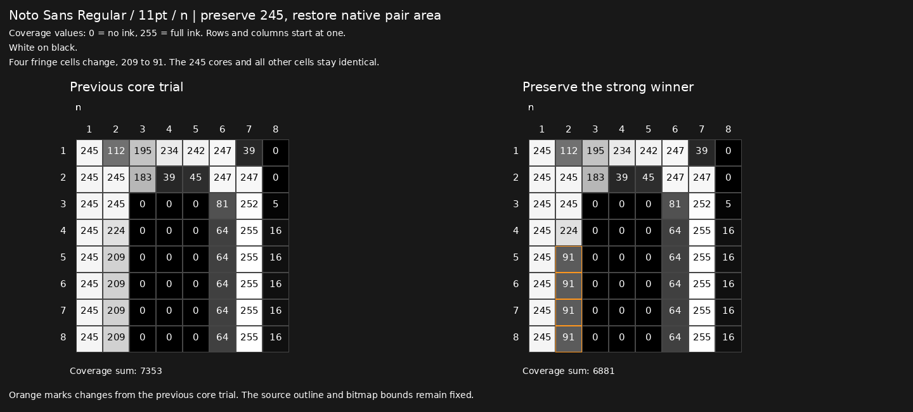

The matching [white-background grid](../images/browser-common-ground/stem-winner-02_Noto-Sans_Regular_11pt_n_grid_light.png) retains the same coverage values. Rows 5–8, column 2 contain the four changes. Column 1 remains 245 throughout the stem.

The function reuses the existing selector on actual native coverage before contrast raises a core. It starts with the accepted native-area result. For a selected weak-native pair, it preserves an already strong chosen core and reduces its fringe to the native total minus that core. The remainder must stay positive and below both the core and its previous fringe. A strong fringe or insufficient native area blocks the change. This extends the existing selector without new geometric thresholds or modifications to the earlier helpers. Inconsolata u retains its accepted 240 + 28 result.

The user requests the other affected fonts in the samples. The numerical audit covers all 10,260 glyphs from the 108 source conditions. It finds 436 additional changed glyph cases in 48 conditions across sixteen families. Every affected condition has a before/after sheet. The three n detail pages and 48 full sheets share one 51-page folder. Each full sheet applies the same general function to all eligible glyphs and lists the changed characters. Both backgrounds and all source text rows remain visible. The left side is the previous core trial. The right side preserves strong winners and removes their excess fringe coverage.

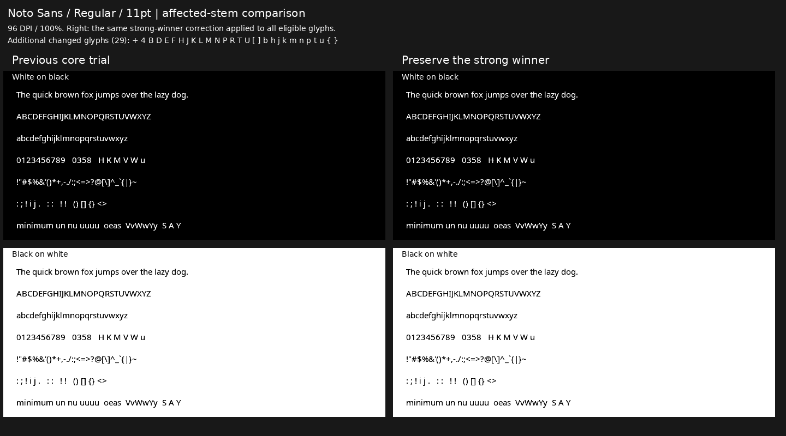

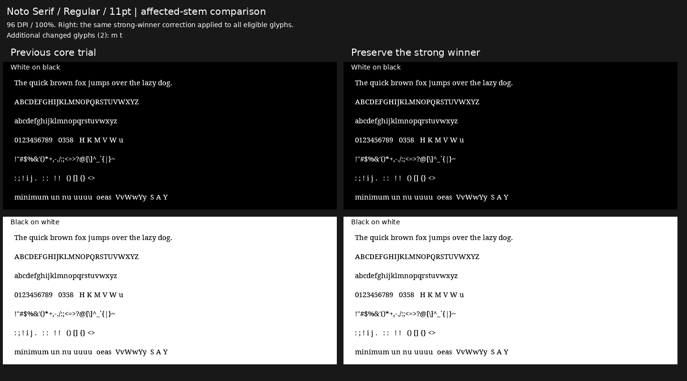

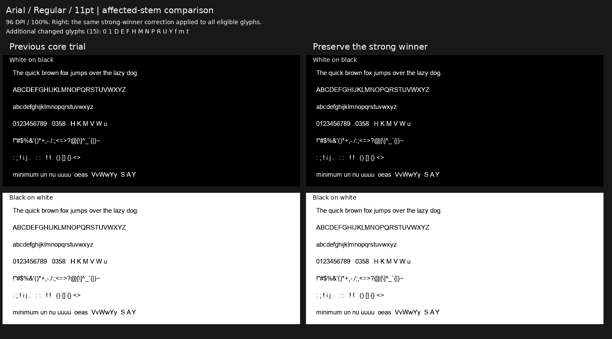

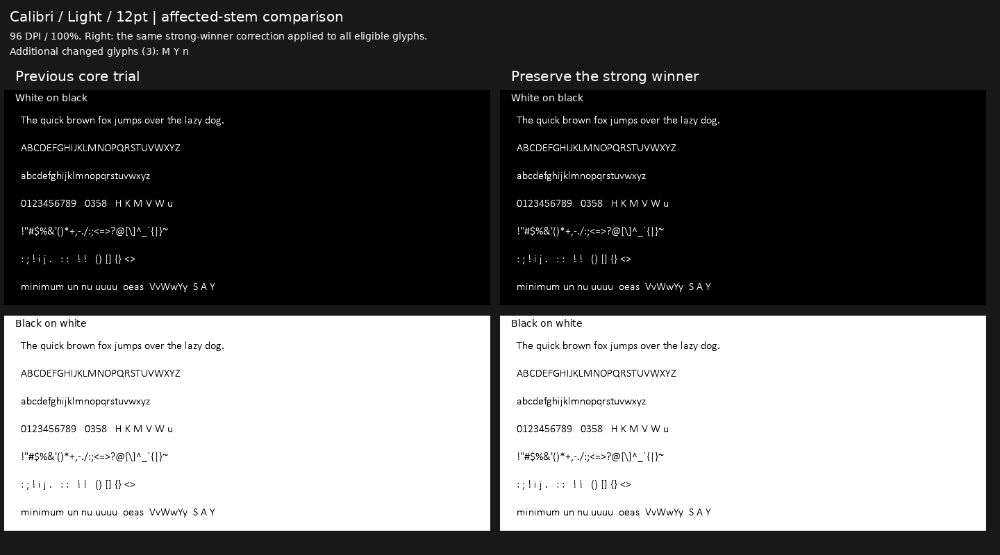

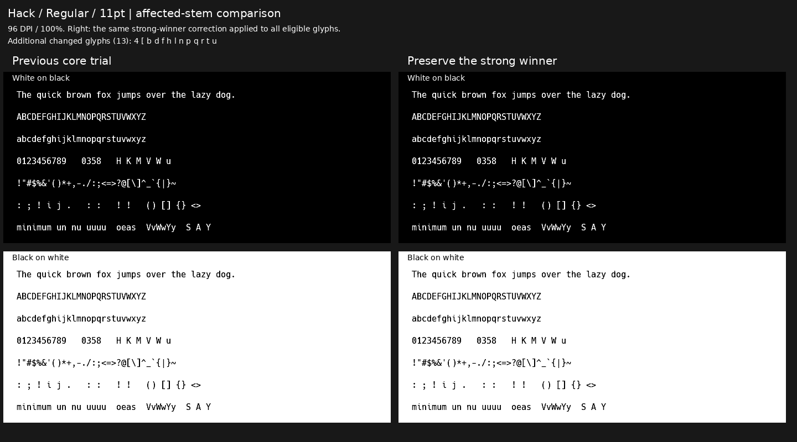

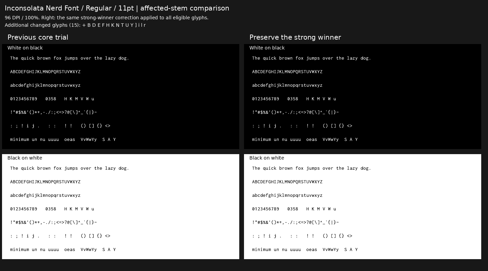


The complete folder also includes affected DejaVu, Liberation, Segoe UI, Lato and Nimbus Sans faces. Nimbus Mono PS has no additional changes. Unaffected conditions keep their earlier gallery pages. Numerical checks do not establish optical acceptance of these new effects.

After the broad core study creates its matching full manifest and native captures, generate the folder:

```sh
PYTHONDONTWRITEBYTECODE=1 python3 tests/noto_stem_winner_test.py \
  --stock-library STOCK_LIBRARY --label-font LABEL_FONT
gwenview results/noto-stem-winner/gallery/06_Noto-Serif_Regular_11pt_affected.png
```

The [portable record](../images/browser-common-ground/stem-winner-captures.json) binds the old source records, fixtures, font, native captures, library, unchanged helpers and new consumer. It includes complete n masks, pair values, totals and centroid positions. The matrix report lists all additional changes, their mask digests and the complete image inventory. The displayed affected-condition set must equal the audit set. Independent rasterization checks all glyphs used on the focused and additional pages. Two compositors check each native text row. Reopened native strips, exact enlargements and numbered fills check the saved figures. Direct fixtures cover the four n donors, unchanged strong cores and upper join, original u identity, reflected and transposed inputs, protected fringes and insufficient area. No installed profile or earlier comparison output changes.

## Residual contrast in the accepted benchmark

The user prefers the strong-winner treatment in every affected comparison. They report better contrast, sharpness and geometry. That treatment is the new optical benchmark. Noto Sans Regular and Segoe UI Regular at 11pt retain some contrast variation. The next inspection preserves their accepted pixels rather than applying another global darkening pass.

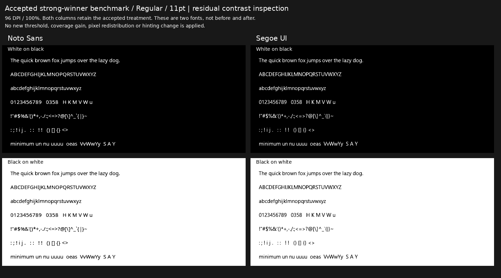

The overview shows Noto Sans on the left and Segoe UI on the right. Both use the accepted treatment on both backgrounds. They are different fonts, not different rendering trials. Every text strip must equal its right-hand strip in the accepted source gallery. Source font, point request, geometry and placement remain unchanged.

Segoe UI H provides a concrete unresolved split stem. Outside the crossbar, its original left pair contains 160 + 156 coverage, total 316. Its right pair contains 244 + 68, total 312. The accepted processing raises the left pair to 220 + 215, total 435, while the right pair stays at 312. The left stem therefore remains spread across two competing pixels despite almost equal original pair totals. The existing selector requires at least 16 coverage units between the original sides. This pair differs by four, so it stays outside that selector. These measurements identify a candidate cause of uneven contrast. They do not select a new dominance rule.

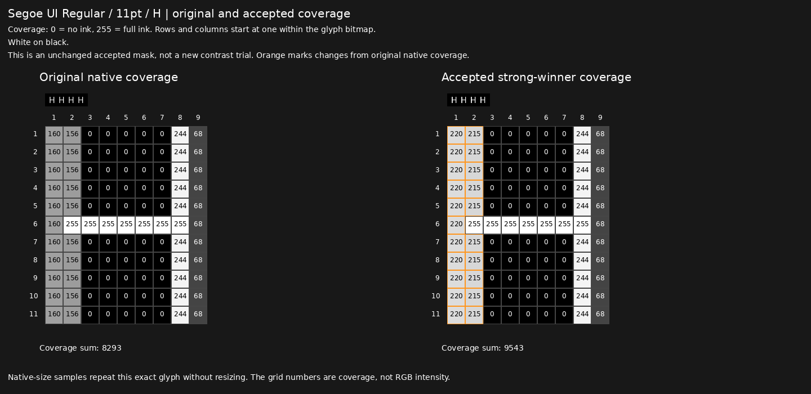

The matching [white-background H map](../images/browser-common-ground/contrast-focus-44_Segoe-UI_Regular_11pt_H_light.png) retains the same coverage values. Curve edges provide a different diagnostic: Noto Sans e retains 114 at the third cell of its top row. Low coverage at an outer edge is not automatically a defect. The maps allow the reader to distinguish a weak stroke from intended smoothing before changing the benchmark.

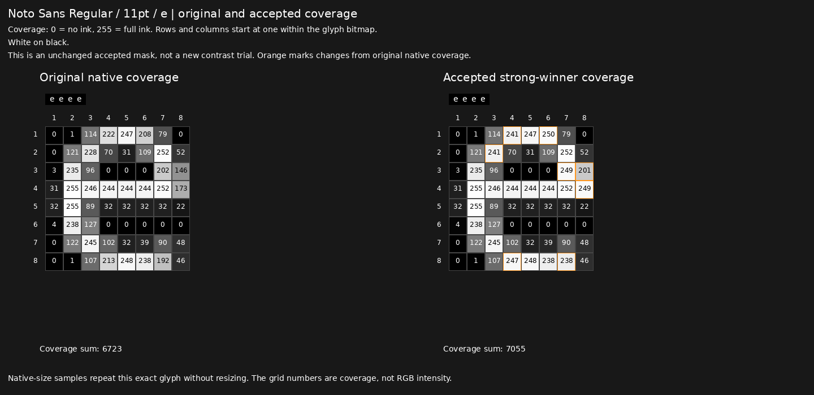

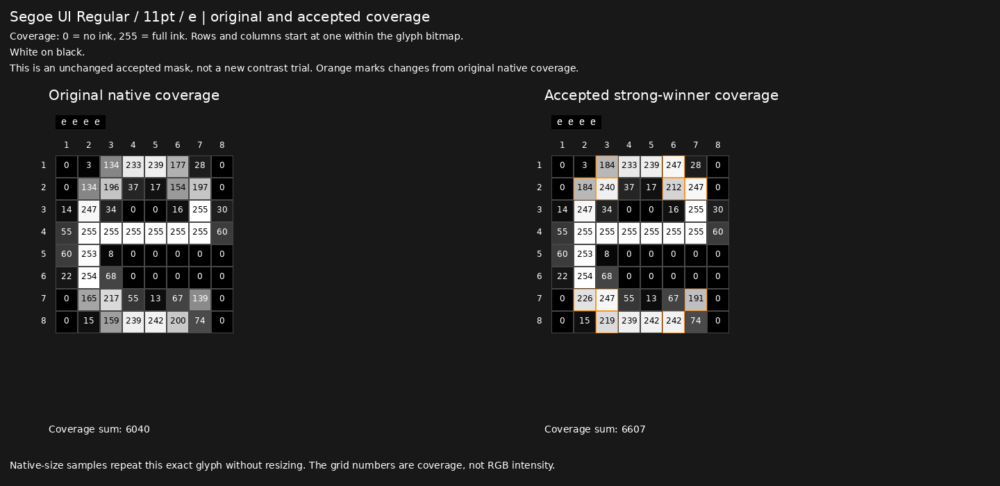

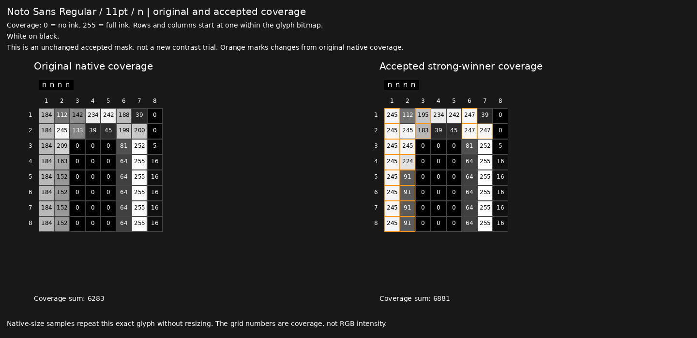

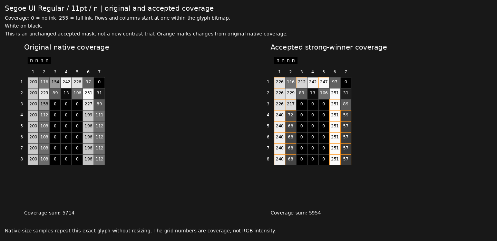

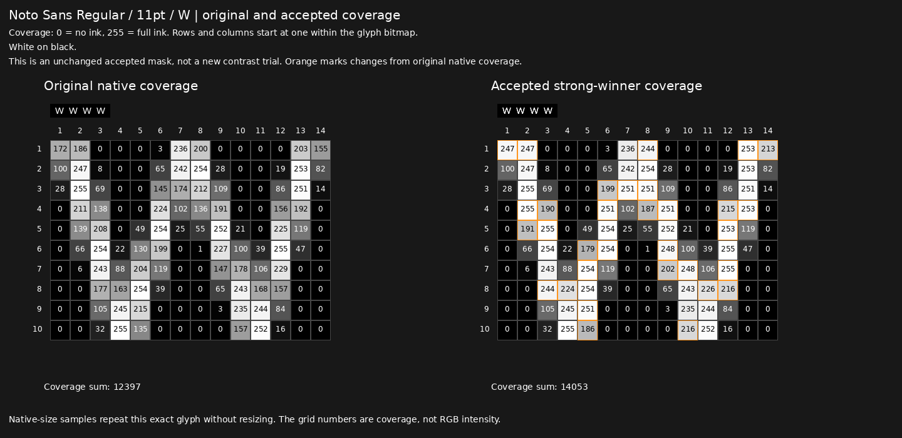

The complete inspection starts with a/e/m/n/o/u, 0/3/5/8 and H/M/N/W controls. One native overview and 56 coverage pages form a flat 57-page folder. Adjacent pages alternate the fonts for the same character and background. Each map places original native coverage on the left and accepted coverage on the right. Rows and columns start at one. Values remain 0–255 coverage under both polarities. No new gain, redistribution, hinting or threshold change is applied.

After the matching source galleries exist, generate the folder:

```sh
PYTHONDONTWRITEBYTECODE=1 python3 tests/contrast_focus_test.py \
  --stock-library STOCK_LIBRARY --label-font LABEL_FONT
gwenview results/contrast-focus/gallery/00_Accepted_Noto-Sans_Segoe-UI_Regular_11pt.png
```

The [portable record](../images/browser-common-ground/contrast-focus-captures.json) includes complete original and accepted arrays for all 28 glyph/font pairs. It binds the accepted record, source captures, font and library identities, helpers, all 190 accepted context masks and complete image inventory. Every accepted mask must reproduce the earlier audit and its digests. Independent rasterization checks all original outlines. Two compositors check the native overview, which must also equal the accepted source images. Reopened native samples and every numbered cell fill check both polarities. The installed profile and earlier galleries remain unchanged while the remaining contrast problem is identified.

## Generic profile and corner regressions

The user supplies seven worst cases and requires a generic algorithm, without font or character exceptions. Segoe UI a/0/H and Noto Sans m/3/H/M expose unresolved winners, corner bleed and intersection bleed. Broadway, Calisto MT and Castellar add intentional stroke contrast and intricate detail as regression controls. These examples select tests and figures, not rendering branches.

The experimental processor takes only original coverage bytes, accepted coverage bytes and bitmap width. It has no font, glyph or codepoint input, file access or font-library dependency. Every glyph receives the same rules. The accepted strong-winner benchmark remains unchanged while the new variants need optical judgment.

The three-column pages show the accepted benchmark, A for profiles and joins, and B for A plus native corner fringe. Both backgrounds retain encoded coverage composition. No hinting, outline, advance or placement changes occur. Native coverage is area coverage, as described in the [FreeType rendering contract](https://freetype.org/freetype2/docs/reference/ft2-glyph_retrieval.html#ft_render_glyph). That contract supports the arithmetic, not the experimental classification rules proposed here.


A finds short two-pixel edge profiles with stable native fringe coverage. Isolated cross-sections supply evidence for a thin stroke and its winning pixel. The core reaches at least 240 and retains any stronger accepted value. At isolated anchors, the pair retains its original total. Nearly equal sides are allowed. Exact ties prefer an existing accepted winner, then the positive axis direction. Conflicting orientations are rejected. A two-profile segment requires native strong support beyond both ends, which protects small isolated marks, including asymmetric dots.

The accepted fringe shift at isolated anchors supplies an edge-phase reference. A carries that shift through supported joins, retaining small native variations rather than flattening curves. A core floor can cross an interruption when the original channel remains stable and anchors support both ends. A short curved step can also resolve when two processed pixels compete and native strong support exists on both perpendicular sides. The chosen core must reach both native supports through eight-neighbor adjacency. Otherwise A retains the two-pixel path. The algorithm preserves positive support and never decreases a native strong pixel or a selected core. It can reduce a processed strong pixel that the structural evidence identifies as native-weak fringe.

B tests a separate corner rule. When two perpendicular native-strong neighbors and two opposite faint neighbors identify an exposed convex corner, B removes added fringe coverage. The pixel returns to its native value. Selected cores stay protected. This distinguishes extra corner ink from a main stroke that needs a coverage floor. B is an alternative for optical review, not an assumed improvement in every glyph.


The direct regressions include measurable results. Segoe UI H resolves its isolated left pairs from 220/215 to 240/76 and carries its core through the crossbar. Noto Sans H keeps its outer fringes at 99 and 96 through the join. Noto Sans m resolves the competing middle pair to 107/240. Segoe UI 0's upper curved pair becomes 250/114. Noto Sans 3's short lower segment becomes 248/111 and 248/116. Noto Sans M's exposed outer corner drops from 193 to 70 in A. Its inner top fringe returns from 226 to native 167 in B. These numerical results do not prove that every optical effect is preferable.

The three new families use fresh captures from the same unmodified native probe, Qt and FreeType providers. No font file is redistributed. All five available faces receive 11pt and 12pt requests. Calisto MT includes regular, bold and italic. Broadway and Castellar have regular only. Missing styles are explicit. Each new case has an original-native versus existing-treatment reference page before the three-column trials. This makes intentional weight contrast visible without assuming that the existing treatment is already correct for these fonts.


The full matrix covers twenty families, 118 font/style/point conditions and 11,210 printable-ASCII codepoint cases. Those contain 11,158 unique glyph instances because Castellar shares some glyphs across uppercase and lowercase. Every alias must have identical native and processed data. The folder contains 138 sheets: 114 trial condition pages, ten native references and fourteen detailed grids. It includes every changed condition and every new regression condition. A changes 1,676 codepoint cases and B changes 4,930 relative to the accepted benchmark. A finite matrix does not establish correctness for every font, size, script or glyph.

Generate the experiment after the accepted source studies exist and the regression fonts are installed:

```sh
PYTHONDONTWRITEBYTECODE=1 python3 tests/stroke_profile_test.py --self-test
PYTHONDONTWRITEBYTECODE=1 python3 tests/stroke_profile_test.py \
  --stock-library STOCK_LIBRARY --label-font LABEL_FONT
gwenview results/stroke-profile-study/gallery/002_Broadway_Regular_11pt_intent.png
```

The [portable record](../images/browser-common-ground/stroke-profile-captures.json) binds both new source files, earlier accepted inputs, font and library identities, native captures, complete image inventory and each audited record. It includes full arrays and structural evidence for the seven supplied regressions. Per-codepoint digests bind the complete generated audit entries, including all raw/accepted/A/B mask hashes, sums and change counts. The full generated manifest retains those entries directly. Its `masks.json` companion retains all four complete arrays for every unique glyph instance, with a bound file hash. Independent rasterization checks every source glyph. Two compositors check each native text strip. Reopened strips and numbered fills check both polarities. Direct tests cover equal and near-equal splits, thick strokes, isolated dots, joins, corners, native strong pixels, reflected cases and transposed axes. The processing rules and all regression inputs remain separate. No accepted benchmark, installed profile or prior gallery changes.

## Minimum contrast for sustained subpixel stems

The user selects B from the profile/corner comparison as the preferred optical benchmark. They report excellent results across the other examples. Nimbus Mono PS Regular 11pt b/d/f/p/q remain weak along their long stems. The earlier source-area rule cannot fully resolve them: isolated native stem totals are only 194–198. The b/p core is 186 in preferred B, d/q is 213, and f is 224. A 240 core plus a positive fringe needs more area than those native totals provide.

This experiment compares preferred B, a 226 core floor and a 240 core floor. Both trials use a total coverage of 255 for eligible subpixel main-stroke sections. The neighboring fringe gets the remainder: 29 beside a 226 core, or 15 beside a 240 core. A stronger existing weak core is retained. True joins with native pair totals 255–384 retain that larger total. Already-strong preferred pixels remain byte-identical, including bowl and serif pixels. This deliberately changes source coverage area and centroid, while retaining original bounds, positive support, outlines and placement.


The processor takes only original bytes, preferred bytes and bitmap width. It estimates native stroke width from positive runs across three scanlines, with stable area and slope compensation. Any persistent width above one pixel blocks normalization for that glyph. This prevents a resolved thick stroke from supplying permission to darken its thin neighbors. A stable main lane needs five samples, at least three weak samples and an isolated native two-pixel anchor. Weak native core values can vary by at most 16. Native strong pixels can bridge a join, but never change. Coherent native coverage selects the winner; exact ties use the positive axis. Conflicting core/fringe proposals are rejected. No family, codepoint, glyph identifier or annotated coordinate enters this rule.

The five grids expose every changed stem cell. Orange outlines mark changes from preferred B. The dark and light grids use the same coverage values.


The same processor audits all 118 source conditions and 11,210 codepoint cases. The 226 trial changes 185 cases; the 240 trial changes 187. Changes occur in 21 conditions, including several light faces. The 41-sheet folder shows every changed condition, all ten decorative-font conditions, unchanged Noto Sans and Segoe UI Regular 11pt controls, and ten numbered target maps. Broadway and Calisto MT are unchanged. Castellar has additional changes, so its design intent remains an optical regression check. A width limit alone cannot prove that all intentional hairlines retain their character.


Generate these trials after the profile/corner study exists:

```sh
PYTHONDONTWRITEBYTECODE=1 python3 tests/thin_stroke_test.py --self-test
PYTHONDONTWRITEBYTECODE=1 python3 tests/thin_stroke_test.py \
  --stock-library STOCK_LIBRARY --label-font LABEL_FONT
gwenview results/thin-stroke-study/gallery/000_Nimbus-Mono-PS_Regular_11pt_trials.png
```

The [portable record](../images/browser-common-ground/thin-stroke-captures.json) binds both source files, the frozen B source record, all complete source/trial arrays and all generated images. Per-codepoint digests bind full entries with mask hashes, sums, centroid movement and inferred native width. The generated `masks.json` retains every array and lane decision. Independent native rasterization checks all source glyphs. Reflections in both axes and transposition agree across every unique source glyph. Two compositors check each native strip; preferred strips match the earlier B gallery exactly where a source page exists. Reopened crops and numbered fills check saved images. Direct fixtures cover under-budget stems, joined cores, ties, thick/thin contrast, short marks, insufficient area and protected strong pixels. These remain finite ASCII diagnostics at 11–12pt, 96 DPI and scale 1. Neither trial changes installed profiles or the preferred B source.
