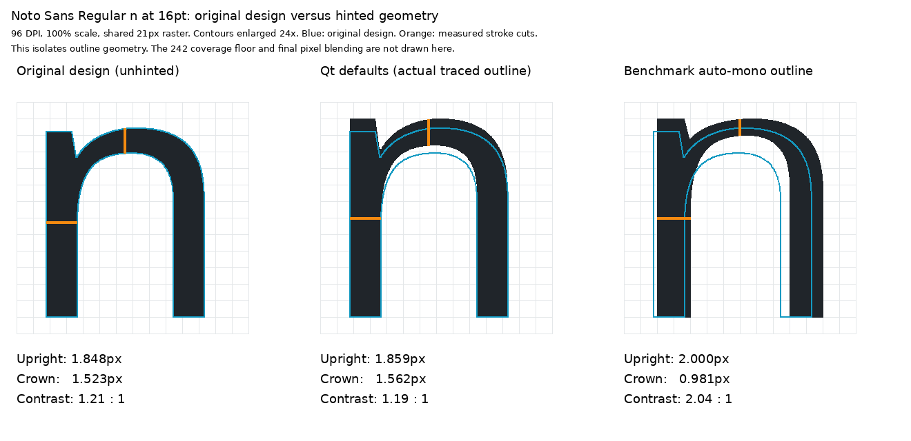
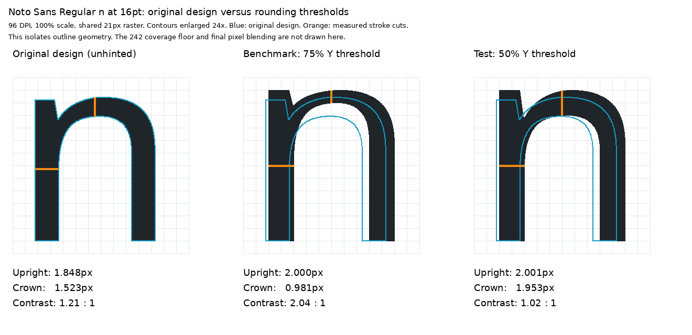

# Geometry and stroke contrast at 16pt

Qt defaults are closer to the source outlines than the original Auto mono + 242 benchmark in this test. That benchmark gives stronger stroke contrast and crisp pixel placement. The current goal retains clarity while making pixel rounding respect the source proportions.

The comparison covers the same 22 faces and text as the [point-size charts](browser-common-ground.md#selected-benchmark-and-816pt-charts). The desktop uses 96 logical DPI and 100% scale. Both paths rasterize the 16pt request at 21 device pixels. The nominal conversion is 21.333 pixels, but Qt resolves this request to 21. This rounding is shared by both columns.

## Noto Sans explains the visible difference

Noto Sans Regular contains modest stroke contrast in its original design. For the lowercase n, the source upright is thicker than the crown. The table measures the upright at mid-height and the crown at mid-width. Values describe the outline before pixel coverage or blending.

| Geometry | Upright thickness | Crown thickness | Upright/crown ratio |
| --- | --- | --- | --- |
| Original design, scaled to 21px | 1.848px | 1.523px | 1.21 |
| Qt defaults, traced before rasterization | 1.859px | 1.562px | 1.19 |
| Benchmark automatic mono hinting | 2.000px | 0.981px | 2.04 |

The benchmark amplifies the contrast in this example. It does not simply restore contrast that Qt removed. The thicker upright and thinner crown explain the more expressive appearance. The default outline retains the source design's more moderate relationship. The final raster and blending can alter how uniform either result appears.

The 242 floor does not move contour points. It raises selected pixel coverage after rasterization. This changes apparent weight and edge strength. It cannot restore geometry that the hinting step already changed.

## What the geometry measurements show

The reference consists of the font's original unhinted coordinates, scaled exactly to the common 21px raster size. A local trace captures Qt's actual outlines immediately before rasterization. Native reproduction matches every captured nonempty glyph. The benchmark outlines match the existing point-chart samples.

The metric measures movement of corresponding contour points. For each glyph, it removes the best-fit translation, then calculates root-mean-square displacement. This separates shape deformation from moving the entire letter. The table averages that value equally across the 20 nonempty glyphs in each face. Lower values mean closer contour geometry under this metric.

| Face | Qt default error, px | Benchmark error, px |
| --- | --- | --- |
| Noto Sans Regular | 0.262 | 0.435 |
| DejaVu Sans Book | 0.323 | 0.403 |
| Lato Light | 0.163 | 0.187 |
| Lato Regular | 0.197 | 0.226 |
| IBM Plex Sans Light | 0.148 | 0.212 |
| IBM Plex Sans Regular | 0.248 | 0.276 |
| Liberation Sans Regular | 0.197 | 0.230 |
| Noto Serif Regular | 0.261 | 0.351 |
| DejaVu Serif Book | 0.304 | 0.314 |
| Liberation Serif Regular | 0.105 | 0.201 |
| Hack Regular | 0.202 | 0.437 |
| DejaVu Sans Mono Book | 0.359 | 0.449 |
| Liberation Mono Regular | 0.104 | 0.319 |
| Noto Sans Bold | 0.123 | 0.248 |
| Noto Sans Italic | 0.259 | 0.410 |
| Noto Sans Bold Italic | 0.122 | 0.201 |
| Noto Serif Bold | 0.273 | 0.422 |
| Noto Serif Italic | 0.258 | 0.289 |
| Noto Serif Bold Italic | 0.240 | 0.455 |
| Hack Bold | 0.193 | 0.373 |
| Hack Italic | 0.193 | 0.408 |
| Hack Bold Italic | 0.206 | 0.333 |

Qt defaults have the lower mean error for every tested face. Across individual glyphs, defaults are closer in 344 cases, the benchmark in 93, with three ties. The same face-level conclusion holds when the measurement retains whole-glyph translation. This does not make defaults the better visual result.

## Why the results differ

The observed Qt path loads glyphs with normal hinting and uses grayscale rasterization. The benchmark forces automatic monochrome hinting, then also uses grayscale rasterization. FreeType documents that the mono target applies stronger grid fitting, and that selecting different targets can change outlines. Its default loading path prefers a font's native hinter when available. See the [FreeType hinting target and loading contracts](https://freetype.org/freetype2/docs/reference/ft2-glyph_retrieval.html#ft_load_target_xxx).

Stronger fitting can give solid pixel strokes while changing proportions and stroke contrast. This fits the project's preference for crisp low-density text. The measurements show that the resulting character comes with a geometric tradeoff.

## A nearest-pixel rounding experiment

The user identifies the next requirement: a source crown of about 1.52px must snap to two pixels. Preserve the font's proportions through predictable pixel rounding. The more expressive benchmark shape is a comparison control, rather than the final geometry target.

The FreeType strong-hinting branch rounds horizontal-stroke thickness in the vertical dimension with `(dist + 16) & ~63`. One pixel is 64 units. This changes to the next pixel at a 75% remainder. The monochrome branch for vertical-stem widths uses a 50% threshold. Both branches first apply FreeType's standard-width matching. See [the pinned FreeType source](https://raw.githubusercontent.com/freetype/freetype/VER-2-14-2/src/autofit/aflatin.c).

A private test changes only the vertical-dimension rounding bias from 16 to 32. This uses the same 50% threshold for that branch. It preserves the benchmark's 242 floor, cutoffs, blending, layout, and horizontal fitting. It does not replace the standard-width matcher or fit individual glyphs by hand.

For Noto Sans Regular n at 16pt, the measured crown grows from 0.981px to 1.953px. The upright remains approximately 2px. At the same crown pixel column, raw coverage changes from `[250, 9, 0, 0]` to `[246, 255, 8, 0]`. The test therefore has two strong rows before the floor, with a faint curved edge below. A curved cross-section is not necessarily identical to the detected stem width that the hinter rounds.

The Noto Sans n upright/crown ratio becomes about 1.02. This is close to the nearest-pixel target of two pixels for each stroke. Its original ratio is 1.21. Pixel rounding still changes geometry, but it removes the earlier ratio of about 2.04.

The point sweep covers 220 conditions from 8 through 16pt, including the 11.25pt reference. Every horizontal control coordinate, contour topology, and Qt layout position remains unchanged. The previously tested 15px Noto Sans i remains byte-identical to the benchmark. At 16pt, the original font-unit, unhinted, and normal-hinting controls also remain unchanged.

On the same 16pt contour metric, the new test improves 12 face averages, leaves nine unchanged, and slightly worsens one. Noto Sans Regular improves from 0.435px to 0.291px. Noto Sans Bold Italic changes from 0.201px to 0.208px. This is a bounded experiment, not a complete solution for font proportions.

| Comparison | White background | Black background |
| --- | --- | --- |
| Six faces at 16pt: defaults, benchmark, and nearest-Y test | [Image](../images/browser-common-ground/nearest-y-16pt-contrast-light.png) | [Image](../images/browser-common-ground/nearest-y-16pt-contrast-dark.png) |
| Noto Sans Regular at 8–16pt: benchmark and nearest-Y test | [Image](../images/browser-common-ground/nearest-y-noto-sans-8-16pt-light.png) | [Image](../images/browser-common-ground/nearest-y-noto-sans-8-16pt-dark.png) |

The [experiment record](../images/browser-common-ground/nearest-y-captures.json) includes the exact parameter change, library hashes, numeric results, image hashes, and checks. The private library retains the original exported API and dependency features. Native raster, floor, overlap, blend, and saved-image checks cover the comparisons. No installed library or application setting changes.

## Smaller points and explicit italic comparisons

The user finds 50% fitting more accurate in more cases, but no candidate meets the full visual target. Keep the earlier 16pt result as a geometry reference. Each sheet shows actual Qt point sizes from 8 through 16pt, plus the 11.25pt reference. Italic and bold italic have dedicated sheets.

The left column uses the original 75% horizontal-stroke fitting rule. The middle uses the 50% rule. Both candidates retain the same 242 floor, coverage cutoffs, and linear blending. The right column is stock Qt with Fontreal disabled. It retains Qt's own coverage, origins, and blending. All three use the same font and Qt layout. The percentage describes width fitting before rasterization. It does not describe a coverage cutoff.

For Noto Sans Regular, the 75% and 50% columns are pixel-identical at every tested size below 16pt, on both backgrounds. Returning to 75% cannot improve those rows. Other faces enter the affected range at different sizes. Noto Sans Bold Italic changes at 9, 10, 11, 11.25, and 16pt. Noto Serif Italic changes at 14 and 15pt. These differences require visual judgment rather than a single size boundary for all fonts.

The user requires stock Qt as the control. These sheets replace the earlier normal-hinting-plus-242 diagnostic sheets. That diagnostic was another treatment, not stock output. Its historical images and record remain in commit `073b8e4de0ac446850f21a30bd47306a811e7cce`.

| Face | White background | Black background |
| --- | --- | --- |
| Noto Sans Regular | [Image](../images/browser-common-ground/stockqt-smallpt-noto-sans-regular-light.png) | [Image](../images/browser-common-ground/stockqt-smallpt-noto-sans-regular-dark.png) |
| Noto Serif Regular | [Image](../images/browser-common-ground/stockqt-smallpt-noto-serif-regular-light.png) | [Image](../images/browser-common-ground/stockqt-smallpt-noto-serif-regular-dark.png) |
| Lato Light | [Image](../images/browser-common-ground/stockqt-smallpt-lato-light-light.png) | [Image](../images/browser-common-ground/stockqt-smallpt-lato-light-dark.png) |
| Hack Regular | [Image](../images/browser-common-ground/stockqt-smallpt-hack-regular-light.png) | [Image](../images/browser-common-ground/stockqt-smallpt-hack-regular-dark.png) |
| Noto Sans Italic | [Image](../images/browser-common-ground/stockqt-smallpt-noto-sans-italic-light.png) | [Image](../images/browser-common-ground/stockqt-smallpt-noto-sans-italic-dark.png) |
| Noto Sans Bold Italic | [Image](../images/browser-common-ground/stockqt-smallpt-noto-sans-bolditalic-light.png) | [Image](../images/browser-common-ground/stockqt-smallpt-noto-sans-bolditalic-dark.png) |
| Noto Serif Italic | [Image](../images/browser-common-ground/stockqt-smallpt-noto-serif-italic-light.png) | [Image](../images/browser-common-ground/stockqt-smallpt-noto-serif-italic-dark.png) |
| Noto Serif Bold Italic | [Image](../images/browser-common-ground/stockqt-smallpt-noto-serif-bolditalic-light.png) | [Image](../images/browser-common-ground/stockqt-smallpt-noto-serif-bolditalic-dark.png) |
| Hack Italic | [Image](../images/browser-common-ground/stockqt-smallpt-hack-italic-light.png) | [Image](../images/browser-common-ground/stockqt-smallpt-hack-italic-dark.png) |
| Hack Bold Italic | [Image](../images/browser-common-ground/stockqt-smallpt-hack-bolditalic-light.png) | [Image](../images/browser-common-ground/stockqt-smallpt-hack-bolditalic-dark.png) |

The [capture record](../images/browser-common-ground/stockqt-smallpt-captures.json) covers 220 matched layouts and 100 displayed conditions across these 20 sheets. Every saved crop matches its original stock Qt or candidate strip. The preserved native fixture reproduces all earlier stock, 75%, and 50% outputs on the capture system. The earlier 16pt reference images remain unchanged. The charts cover 96 DPI at 100% scale. They do not establish a new application default. The [handoff](handoff.md) retains source, rebuild instructions, limits, and the next investigation.

## Limits and decision

Contour-point displacement is a measure of geometric proximity. It is not a readability, beauty, or optical-quality score. Different placement of control points can affect this metric, so comparisons use matching points from the same font. The reference also excludes the designer's size-specific hinting instructions. It measures fidelity to the outline, rather than every aspect of design intent.

The stroke ratios describe one cross-section of one letter. They are not a contrast score for the whole font. The broader measurements cover 440 nonempty glyphs at one resolved size. They do not establish results for other sizes, scripts, variable fonts, or displays.

Keep Auto mono + 242 as the visual comparison control. The current target is crisp text with source-based stroke proportions and predictable nearest-pixel rounding. Judge the nearest-Y test against both that control and the original design. The remaining FreeType width matching and alignment stages still need qualification. This analysis does not change application settings.

The [capture record](../images/browser-common-ground/geometry16-captures.json) contains font hashes, versions, measured values, method limits, and the figure hash. The traced Qt run reproduces all 44 original stock strips exactly. Native and benchmark outlines match their respective captures. Contour topology matches throughout. The n measurements converge within 0.001px when curve sampling doubles.
