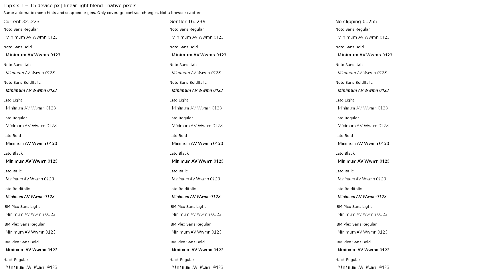
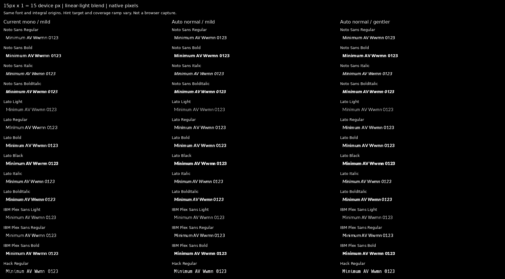

# A general browser rendering policy

## Question

Can one restrained rendering policy improve text across websites without rules for each site?

Start by changing how glyphs become pixels. Keep the website's font family, size, weight, italic style, and spacing as controls. Compare several fonts and effective pixel sizes before changing the working preset. A good result on one page does not establish a general default.

## Repository constraints

The current Firefox and Floorp preset uses automatic monochrome hinting, grayscale masks, a mild contrast ramp, integral glyph origins, and Mozilla sRGB preblend. Preserve the accepted Qt result and working browser data. The [browser guide](../experiments/browser-masks.md) owns activation and reversal.

The user rejects maintenance of individual website fixes. The first investigation therefore uses the same rules for every sample. It does not replace fonts, clamp CSS weights, enlarge labels, or rewrite kerning. These remain possible separate product decisions, not consequences of a raster change.

## Options

| Approach | Benefit | Limit |
| --- | --- | --- |
| Reduce coverage sharpening while retaining monochrome hints | Small change with a direct comparison against the accepted result | Cannot undo geometry changes from hinting |
| Use the normal automatic hint target with the same snapped origins | Tests a less aggressive geometry treatment without changing font choice | Can reduce the crispness that motivated Fontreal |
| Override font families, sizes, or weights | Changes poorly chosen typography directly | Changes authored layout and emphasis, with a wider compatibility burden |
| Develop a new adaptive or learned rasterizer | Can pursue a broader quality objective | Needs evidence, a defined objective, and a new implementation contract |

Investigate the first two approaches before introducing another rendering mechanism. Keep the current deployed preset until the comparison supports a change.

## Evidence

FreeType distinguishes its normal, light, and monochrome hint targets. Its documentation warns that the monochrome target is strong and can produce poor results with grayscale output. Fontreal deliberately combines these modes because the user prefers the observed crispness. That preference still needs broader font coverage. The light target snaps only vertically, so it is not an automatic answer to the user's objection to fuzzy vertical stems. See the [hint-target contract](https://freetype.org/freetype2/docs/reference/ft2-glyph_retrieval.html#ft_load_target_xxx).

Hinting, edge contrast, and blending need separate controls. FreeType's [technical explanation](https://freetype.org/freetype2/docs/hinting/text-rendering-general.html) describes the interaction between blending and apparent stroke weight. That article dates from 2015. Its historical toolkit claims do not establish current browser behavior.

The first component comparison holds automatic monochrome hints and integral origins fixed. It compares three coverage ramps. Coverage is the amount of a pixel filled by the glyph.

| Column | Coverage range mapped to 0..255 | Purpose |
| --- | --- | --- |
| Current | 32..223 | Accepted mild contrast |
| Gentler | 16..239 | Test a smaller correction |
| No clipping | 0..255 | Retain the original gray edges |

Apply the ramp to each glyph before overlapping glyphs combine. Applying it to an already combined word gives different results at some italic overlaps. The current and unclipped word masks must match the existing native renderer exactly.

The sweep uses Noto Sans, Lato, IBM Plex Sans, and Hack. Fourteen faces include light, regular, bold, black, italic, and bold italic. Requested sizes are 12, 15, 18, and 24px. Scales are 100%, 125%, and 150%. Pure black/white palettes and both linear-light and encoded blending remain separate conditions. No text image is resized.

The native mask checks cover all 168 font/size/scale conditions. The current ramp changes total glyph coverage differently across faces. At 15 device pixels, it removes about 1.5% of Lato Light's coverage while adding about 0.5% to Lato Regular. At 12 device pixels, Lato Light loses about 3.6%. These totals describe this sample, not perceived weight or reading performance.

The second comparison changes the automatic hint target. Its columns are current monochrome/mild, normal/mild, and normal/gentler. It keeps the same font files and integral origins. This separates a hint-target change from a contrast-only change. The normal-target masks come from unmodified FreeType's public API.

### Native comparison sheets

Open each PNG at 100% image zoom. The left column is the current mask treatment. Labels identify each font face.

These are native FreeType component images, not browser screenshots. They use shared unhinted advances and unfitted kerning without a shaping engine. They do not establish browser spacing, page-layout equivalence, or Mozilla's output on colored backgrounds. The [capture record](../images/browser-common-ground/captures.json) records fonts, hashes, conditions, and the image checks.

### Prior art search

Real arXiv API searches covered graphics, human interaction, and image processing. The broad matches mainly addressed generated typography, virtual reality, and unrelated reconstruction. They did not supply a directly usable general browser policy.

[Neural Font Rendering](https://arxiv.org/abs/2211.14802) proposes a network for glyph rasterization at multiple sizes. Its abstract does not establish crisp pixel snapping, preservation of browser metrics, deterministic CPU cost, or a practical replacement for the existing renderer. The abstract alone does not justify that implementation.

## Decision

Use the existing renderer to find the smallest useful correction first. Judge small text, light faces, heavy faces, and larger headings together. Preserve clear distinctions between regular and bold. Reject a gain that makes the previously accepted samples fuzzy.

After visual comparison, test the selected condition in real Firefox and Floorp windows. Include downloaded fonts, variable fonts, small labels, larger headings, light/dark colors, and mixed styles. Check actual glyph masks and final pixels separately. Preserve the current preset as the control. A component preference alone does not authorize a new deployed default.

## Rejected options

Do not build a collection of website selectors. Do not force every weight to regular. Do not use a numerical coverage total as a readability score. Do not choose a learned renderer from an abstract or assume that a size threshold generalizes across fonts.

## Revisit when

Revisit geometry-aware treatment if contrast alone cannot preserve both thin strokes and crisp curves. Revisit broader typography controls only if rendering changes cannot meet the agreed goal and their layout effects become an explicit product decision.

## Sources

The linked FreeType contracts, technical explanation, arXiv abstract, and native comparison record support this investigation. The [roadmap](../roadmap.md) owns the remaining work.
