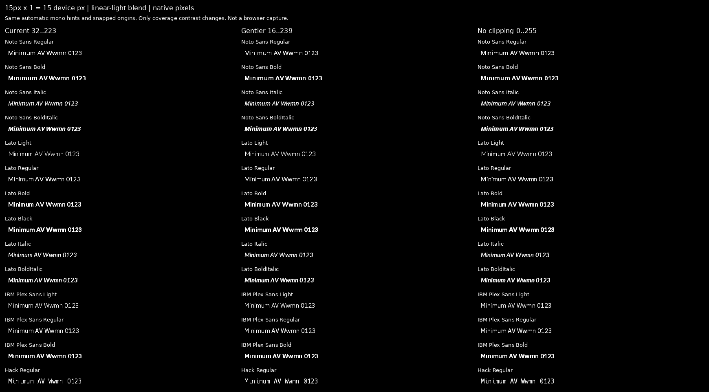
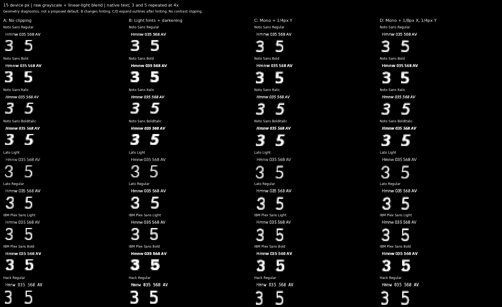
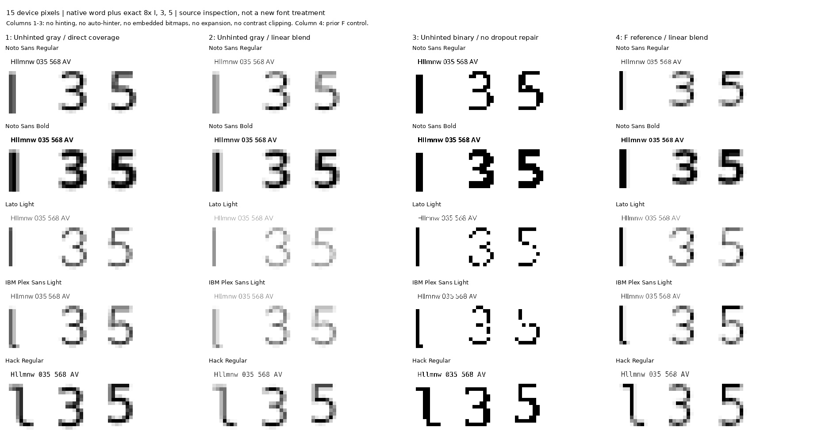
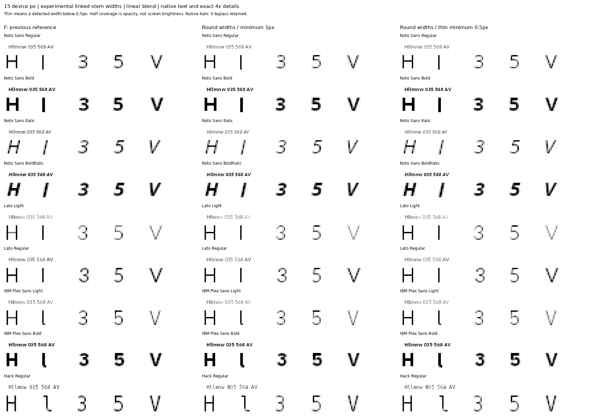
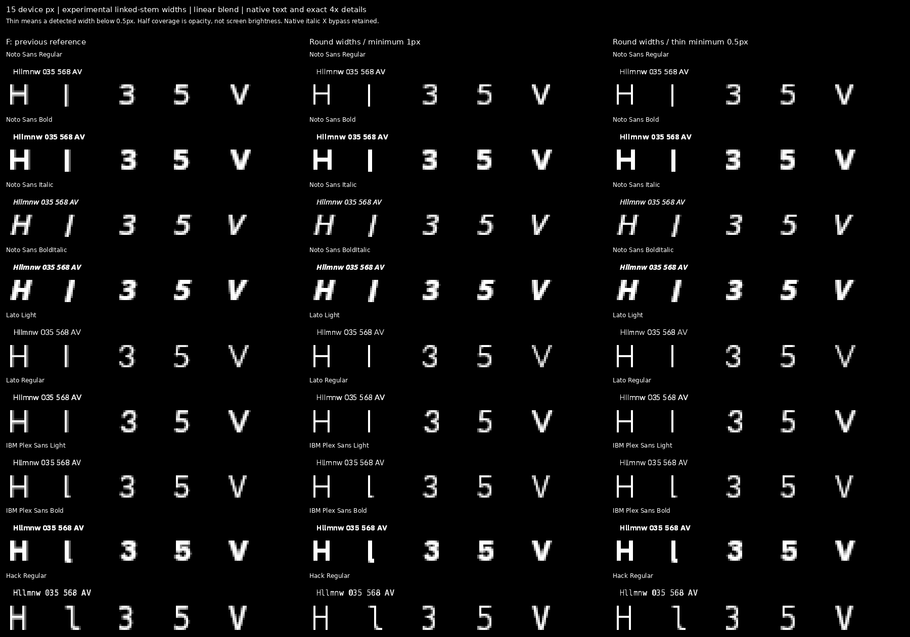
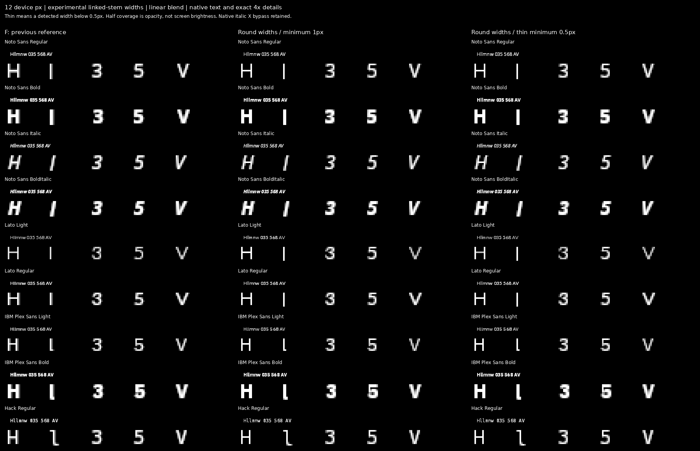
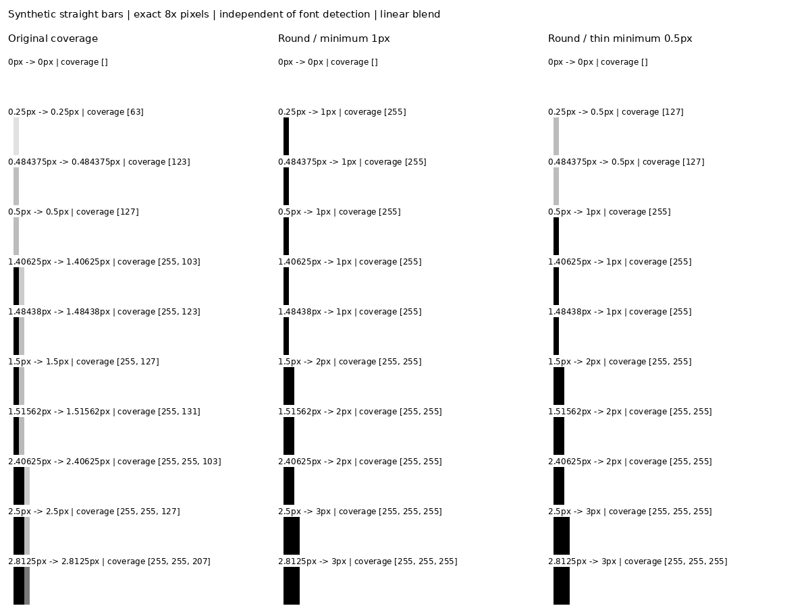
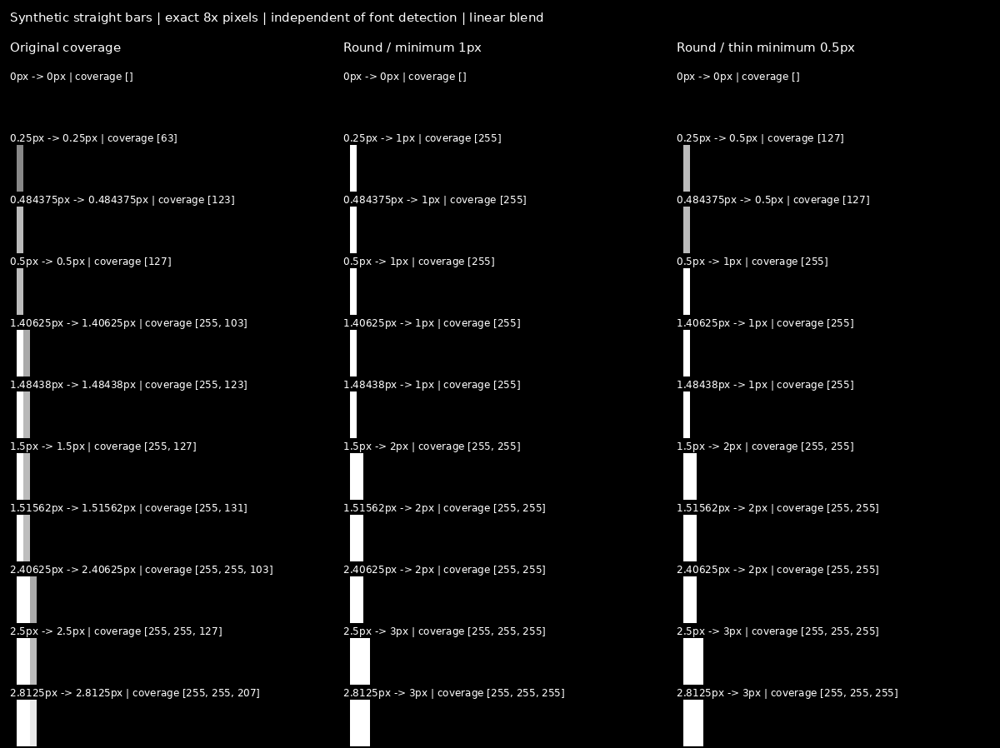

# A general browser rendering policy

## Question

Can one restrained rendering policy improve text across websites without rules for each site?

Start by changing how glyphs become pixels. Keep the website's font family, size, weight, italic style, and spacing as controls. Compare several fonts and effective pixel sizes before changing the working preset. A good result on one page does not establish a general default.

## Repository constraints

The current Firefox and Floorp preset uses automatic monochrome hinting, grayscale masks, a mild contrast ramp, integral glyph origins, and Mozilla sRGB preblend. Preserve the accepted Qt result and working browser data. The [browser guide](../experiments/browser-masks.md) owns activation and reversal.

The user rejects maintenance of individual website fixes. The first investigation therefore uses the same rules for every sample. It does not replace fonts, clamp CSS weights, enlarge labels, or rewrite kerning. These remain possible separate product decisions, not consequences of a raster change.

## Options

| Approach | Benefit | Limit |
| --- | --- | --- |
| Reduce coverage sharpening while retaining monochrome hints | Small change with a direct comparison against the accepted result | Cannot undo geometry changes from hinting |
| Use the normal automatic hint target with the same snapped origins | Tests a less aggressive geometry treatment without changing font choice | Can reduce the crispness that motivated Fontreal |
| Round detected stroke widths, with a separate thin-stroke minimum | Tests an explicit device-pixel rule before rasterization | Native detection and placement still limit which features follow the rule |
| Override font families, sizes, or weights | Changes poorly chosen typography directly | Changes authored layout and emphasis, with a wider compatibility burden |
| Develop a new adaptive or learned rasterizer | Can pursue a broader quality objective | Needs evidence, a defined objective, and a new implementation contract |

The contrast-only samples are not an accepted replacement. Use them as controls for stroke-geometry investigation. Keep the current deployed preset until the comparison supports a change.

## Evidence

FreeType distinguishes its normal, light, and monochrome hint targets. Its documentation warns that the monochrome target is strong and can produce poor results with grayscale output. Fontreal deliberately combines these modes because the user prefers the observed crispness. That preference still needs broader font coverage. The light target snaps only vertically, so it is not an automatic answer to the user's objection to fuzzy vertical stems. See the [hint-target contract](https://freetype.org/freetype2/docs/reference/ft2-glyph_retrieval.html#ft_load_target_xxx).

Hinting, edge contrast, and blending need separate controls. FreeType's [technical explanation](https://freetype.org/freetype2/docs/hinting/text-rendering-general.html) describes the interaction between blending and apparent stroke weight. That article dates from 2015. Its historical toolkit claims do not establish current browser behavior.

The first component comparison holds automatic monochrome hints and integral origins fixed. It compares three coverage ramps. Coverage is the amount of a pixel filled by the glyph.

| Column | Coverage range mapped to 0..255 | Purpose |
| --- | --- | --- |
| Current | 32..223 | Accepted mild contrast |
| Gentler | 16..239 | Test a smaller correction |
| No clipping | 0..255 | Retain the original gray edges |

Apply the ramp to each glyph before overlapping glyphs combine. Applying it to an already combined word gives different results at some italic overlaps. The current and unclipped word masks must match the existing native renderer exactly.

The sweep uses Noto Sans, Lato, IBM Plex Sans, and Hack. Fourteen faces include light, regular, bold, black, italic, and bold italic. Requested sizes are 12, 15, 18, and 24px. Scales are 100%, 125%, and 150%. Pure black/white palettes and both linear-light and encoded blending remain separate conditions. No text image is resized.

The native mask checks cover all 168 font/size/scale conditions. The current ramp changes total glyph coverage differently across faces. At 15 device pixels, it removes about 1.5% of Lato Light's coverage while adding about 0.5% to Lato Regular. At 12 device pixels, Lato Light loses about 3.6%. These totals describe this sample, not perceived weight or reading performance.

The second comparison changes the automatic hint target. Its columns are current monochrome/mild, normal/mild, and normal/gentler. It keeps the same font files and integral origins. This separates a hint-target change from a contrast-only change. The normal-target masks come from unmodified FreeType's public API.

### Native comparison sheets

Open each PNG at 100% image zoom. The left column is the current mask treatment. Labels identify each font face.

These are native FreeType component images, not browser screenshots. They use shared unhinted advances and unfitted kerning without a shaping engine. They do not establish browser spacing, page-layout equivalence, or Mozilla's output on colored backgrounds. The [capture record](../images/browser-common-ground/captures.json) records fonts, hashes, conditions, and the image checks.

### Weak crowns and inconsistent stroke widths

The user prefers no clipping among the first columns but rejects all of them as a general result. Light faces remain too light. Stroke widths are inconsistent. The crowns of 3 and 5 remain weak. Keep no clipping as the comparison control, not a selected deployed default.

The weak strokes already exist in the hinted outlines. In the 15px Lato Light sample, a vertical H stroke measures 1 pixel. Its horizontal crossbar measures 38/64 pixel. The top bar of 5 measures 45/64 pixel. The extrema of the curved 3 crown differ by 41/64 pixel. Much of the flat top bar of 5 has only 180/255 coverage before blending. Curvature alone cannot explain the flat-bar result.

FreeType fits the two coordinate axes separately. Its Latin hinter leaves stem widths unchanged when an axis is classified as extra light. This classification uses an axis-wide standard width below 5/8 pixel. Otherwise, its strong monochrome Y fitting normally gives a linked horizontal stroke at least 1 pixel. Curves can enter this fitting, but not every contour feature becomes a linked stem. Unlinked features and remaining control points follow other alignment and interpolation paths. See the pinned [Latin hinter](https://github.com/freetype/freetype/blob/VER-2-14-2/src/autofit/aflatin.c) and [point alignment](https://github.com/freetype/freetype/blob/VER-2-14-2/src/autofit/afhints.c).

The observed horizontal/vertical difference is consistent with an axis-specific thin-width bypass. Public outline data does not expose the internal classification, stem links, or blue-zone assignments. An internal trace must establish the exact branch before selecting a production policy for that cause. A blue zone is a font alignment region used for features such as baselines and cap heights.

FreeType's built-in automatic stem darkening runs only with its light hint target. Enabling it with the current monochrome target leaves these masks unchanged. The [loader source](https://github.com/freetype/freetype/blob/VER-2-14-2/src/autofit/afloader.c) establishes this gate. Separate public API checks compare both targets with darkening enabled and disabled.

The next diagnostic sheet uses no contrast clipping in every column:

| Column | Diagnostic control | What changes |
| --- | --- | --- |
| A | Existing monochrome hints | Unclipped reference |
| B | Light hints plus built-in stem darkening | Hint target and outline weight |
| C | Monochrome hints plus 1/4px Y expansion | Outline expansion after hinting |
| D | Monochrome hints plus 1/8px X and 1/4px Y expansion | Outline expansion after hinting |

C and D use the existing [outline expansion API](https://freetype.org/freetype2/docs/reference/ft2-outline_processing.html#ft_outline_emboldenxy). They are controls for the effect of geometry, not adaptive stroke rules. Expansion can move edges away from the grid and change ink bounds. Preserving advance widths does not establish layout safety or consistent stroke thickness.

Small text is native size. Enlarged digits use exact 4x pixel repeats. Nine faces cover regular, bold, italic, bold italic, and light controls. The component sweep uses 12, 15, 18.75, and 22.5 device pixels. Zero-strength calls match the existing public probe. Column A matches the native word masks. Outline expansion preserves the sampled advances. These checks establish faithful diagnostic images, not a new browser preset.

### Retain B's balance with clearer vertical strokes

The user chooses D overall. B has the preferred line widths but introduces vertical blur. This makes D the current comparison winner and B the width reference. Neither result replaces the working browser preset.

The raw B masks expose a position and width problem. At 15px, Noto Sans Regular's l distributes its middle-row coverage across two columns as 184 and 220 out of 255. A horizontal phase shift can produce a fully covered column without changing its outline. Lato Light's stroke remains narrower than one pixel, so a phase shift alone cannot produce a fully covered column. These measurements explain distinct limits; they are not a readability score.

The next study combines native outline coordinates before rasterization. E takes X from automatic monochrome hinting and Y from B. F takes X from D and Y from B. Matching contour structure and curve tags are required. B and D stay exact controls. This tests axis provenance without changing FreeType's internal fitting policy. It does not preserve B's complete shape or guarantee a visual improvement.

The [reproducible axis study](../experiments/browser-stroke-axis.md) supplies native-size and exact 4x comparisons, independent glyph and word checks, and both polarities. Italic rows remain controls because the original hinter treats their horizontal fitting differently. The [specification](../plans/FR-018-axis-study.md) defines the bounded experiment.

The user prefers D for regular text and F for bold text. B remains the consistency reference. F is the preferred overall compromise. Keep F as the next component reference, without treating the axis-mixing experiment as a deployed solution.

The pixel grid does not inherently require different treatment of horizontal and vertical strokes. The font geometry and fitting rules introduce differences. Before hinting, the measured 15px Lato Light H has vertical strokes 49 to 50 units wide and a horizontal crossbar 37 units wide, in units of 1/64 pixel. In the fitted Noto Sans Regular l at 15px, B distributes coverage as 184 and 220 across two columns. D and F instead produce 255 and 32: a solid core and a faint boundary pixel.

The next research target is a reliable solid core with antialiased boundaries across stems, curves, and diagonals. A curve or diagonal needs a staircase of core pixels, with geometry changes to control local weight and preserve open counters. An opaque path alone does not establish consistent apparent thickness. Investigate coherent stroke fitting before selecting a production rule. The current evidence does not choose a production minimum width, threshold, or adaptive algorithm.

### Inspect the source before choosing a fitting rule

An outline font stores closed boundaries, curve control points, spacing data, and optional hint instructions. It does not store a finished pixel image. The selected TrueType faces use quadratic curves. Their boundaries do not identify a stroke centerline or require equal horizontal and vertical thickness. The [OpenType glyph contract](https://learn.microsoft.com/en-us/typography/opentype/spec/glyf) describes this source format.

Open the [vector diagram](../images/browser-common-ground/source-outlines.svg) to inspect the boundaries at higher zoom. Blue dots are on-curve points. Orange dots are curve controls. The grid shows target pixels at 15px. The diagram scales the original coordinates for inspection. Its boundary stroke and dots are annotations. The preview still uses a renderer to display the vector graphic.

Read the raster sheet from left to right. Column 1 uses unhinted grayscale coverage directly. Column 2 uses the identical mask with linear-light blending. Column 3 uses unhinted binary scan conversion with dropout repair disabled. Column 4 retains the prior F component reference with linear-light blending. Small text uses native pixels. The enlarged l, 3, and 5 use exact 8x pixel repeats. View the image at 100% to judge native text.

Columns 1 through 3 disable hinting, embedded bitmaps, outline expansion, and contrast clipping. Grayscale coverage also matches an independent native outline raster call. Removing the auto-hinter leaves those grayscale masks unchanged. Binary pixels contain only zero or full coverage. Saved native and enlarged image crops match their inputs. The [capture record](../images/browser-common-ground/source-captures.json) identifies the fonts, library, flags, and images.

The source diagram exposes thin crowns before rasterization. The raster sheet separates authored geometry, scan conversion, and blending. Binary scan conversion can break narrow strokes, so it is not an untouched original. These five static faces at 15px establish a source baseline. They do not select a new fitting rule or establish browser behavior. Use this baseline to discuss which boundaries to move and which partial pixels to preserve before implementing the next candidate.

### Rounded widths and a visible thin-stroke control

The user proposes rounding a stroke's total width in device pixels. A width of 1.4px becomes 1px, while 1.5px becomes 2px. The user also suggests approximately 128 coverage for strokes below the half-pixel threshold. Test this as a separate thin-stroke control rather than increasing every faint edge pixel.

The new component command is `python3 tests/browser_stroke_width_test.py`. First run `python3 tests/browser_stroke_axis_test.py` to refresh its F reference data. The new command builds a separate copy of the pinned stock FreeType source and writes comparisons under `results/browser-stroke-width/`. It does not install libraries or change browser profiles. All three columns use explicit linear-light blending.

| Column | Actual operation |
| --- | --- |
| Left: F | Exact retained F masks from the axis study |
| Middle: round, minimum 1px | Round detected widths to whole pixels with halves up and a one-pixel minimum |
| Right: round, thin minimum 0.5px | Use the middle rule, except nonzero detected widths below 0.5px become 0.5px |

The new rules run before the original thin-axis bypass and standard-width adjustments. Both candidate columns use automatic monochrome hints with grayscale rendering. They apply no outline expansion, stem darkening, or coverage clipping. Existing edge placement, blue zones, unlinked interpolation, and italic horizontal-fitting exemptions remain active. Curves retain native grayscale antialiasing. The rule controls detected widths, not every local thickness in a letter.

Open each image at 100% zoom. The small text uses native pixels. H, l, 3, 5, and V use exact 4x pixel repeats. Noto Sans Regular's middle l profile at 15px changes from F's `[255,32]` to `[255]` in both candidates. Noto Sans Bold changes from `[255,255,32]` to `[255,255]`. These measurements establish removal of that straight stem's faint neighbor, not a universal cutoff or a visual winner.

The synthetic bars isolate the arithmetic from font detection. The selected contour winding gives 127 coverage for an exactly half-covered pixel in this FreeType build. This approximates the proposed 128. Coverage describes opacity, not encoded display brightness. The images blend that coverage explicitly. Zero-width input stays empty. The synthetic 1.5px input becomes two fully covered pixels.

The command checks the actual native width decisions against the formula. It also checks the shared C helper against an independent numeric table. With the experimental selector absent, the private library matches the retained stock probe output. Independent native outline rasterization reproduces the candidate masks. Repeated renders and subsequent glyph loads retain their expected results. Shared origins and complete ink bounds preserve all text occurrences.

The sweep covers nine faces at 12, 15, 18.75, and 22.5 device pixels, with both palettes. These sizes represent different effective densities without proving browser scaling behavior. The [capture record](../images/browser-common-ground/width-captures.json) supplies hashes, conditions, measured profiles, and the selected public images. Native decision logs include the requested glyph and the following probe glyph. They do not identify every feature's stem link or blue-zone classification. Wider browser qualification and a coherent diagonal-core rule remain separate work.

### Prior art search

Real arXiv API searches covered graphics, human interaction, and image processing. The broad matches mainly addressed generated typography, virtual reality, and unrelated reconstruction. They did not supply a directly usable general browser policy.

[Neural Font Rendering](https://arxiv.org/abs/2211.14802) proposes a network for glyph rasterization at multiple sizes. Its abstract does not establish crisp pixel snapping, preservation of browser metrics, deterministic CPU cost, or a practical replacement for the existing renderer. The abstract alone does not justify that implementation.

## Decision

Contrast alone does not meet the user's result. The public-outline axis study establishes F as the preferred component compromise. The isolated width study now tests the user's nearest-pixel rule and a separate half-pixel minimum. Neither replaces the working preset. Before selecting a production fix for weak crowns, trace the thin-axis classification, crown segments, stem links, and alignment decisions. This distinguishes a policy bypass from a failure to detect the stroke.

Judge small text, light faces, heavy faces, and larger headings together. Preserve clear distinctions between regular and bold. Reject a gain that makes the previously accepted samples fuzzy. Do not infer a general minimum-thickness policy from blanket outline expansion.

After visual comparison, test the selected condition in real Firefox and Floorp windows. Include downloaded fonts, variable fonts, small labels, larger headings, light/dark colors, and mixed styles. Check actual glyph masks and final pixels separately. Preserve the current preset as the control. A component preference alone does not authorize a new deployed default.

## Rejected options

Do not build a collection of website selectors. Do not force every weight to regular. Do not use a numerical coverage total as a readability score. Do not choose a learned renderer from an abstract or assume that a size threshold generalizes across fonts.

## Revisit when

Revisit geometry-aware treatment if contrast alone cannot preserve both thin strokes and crisp curves. Revisit broader typography controls only if rendering changes cannot meet the agreed goal and their layout effects become an explicit product decision.

## Sources

The linked FreeType contracts, technical explanation, arXiv abstract, and native comparison record support this investigation. The [roadmap](../roadmap.md) owns the remaining work.
