# A general browser rendering policy

## Question

Can one restrained rendering policy improve text across websites without rules for each site?

Start by changing how glyphs become pixels. Keep the website's font family, size, weight, italic style, and spacing as controls. Compare several fonts and effective pixel sizes before changing the working preset. A good result on one page does not establish a general default.

## Repository constraints

The current Firefox and Floorp preset uses automatic monochrome hinting, grayscale masks, a mild contrast ramp, integral glyph origins, and Mozilla sRGB preblend. Preserve the accepted Qt result and working browser data. The [browser guide](../experiments/browser-masks.md) owns activation and reversal.

The user rejects maintenance of individual website fixes. The first investigation therefore uses the same rules for every sample. It does not replace fonts, clamp CSS weights, enlarge labels, or rewrite kerning. These remain possible separate product decisions, not consequences of a raster change.

## Options

| Approach | Benefit | Limit |
| --- | --- | --- |
| Reduce coverage sharpening while retaining monochrome hints | Small change with a direct comparison against the accepted result | Cannot undo geometry changes from hinting |
| Use the normal automatic hint target with the same snapped origins | Tests a less aggressive geometry treatment without changing font choice | Can reduce the crispness that motivated Fontreal |
| Round detected stroke widths, with a separate thin-stroke minimum | Tests an explicit device-pixel rule before rasterization | Native detection and placement still limit which features follow the rule |
| Override font families, sizes, or weights | Changes poorly chosen typography directly | Changes authored layout and emphasis, with a wider compatibility burden |
| Develop a new adaptive or learned rasterizer | Can pursue a broader quality objective | Needs evidence, a defined objective, and a new implementation contract |

The contrast-only samples are not an accepted replacement. Use them as controls for stroke-geometry investigation. Keep the current deployed preset until the comparison supports a change.

## Evidence

FreeType distinguishes its normal, light, and monochrome hint targets. Its documentation warns that the monochrome target is strong and can produce poor results with grayscale output. Fontreal deliberately combines these modes because the user prefers the observed crispness. That preference still needs broader font coverage. The light target snaps only vertically, so it is not an automatic answer to the user's objection to fuzzy vertical stems. See the [hint-target contract](https://freetype.org/freetype2/docs/reference/ft2-glyph_retrieval.html#ft_load_target_xxx).

Hinting, edge contrast, and blending need separate controls. FreeType's [technical explanation](https://freetype.org/freetype2/docs/hinting/text-rendering-general.html) describes the interaction between blending and apparent stroke weight. That article dates from 2015. Its historical toolkit claims do not establish current browser behavior.

The first component comparison holds automatic monochrome hints and integral origins fixed. It compares three coverage ramps. Coverage is the amount of a pixel filled by the glyph.

| Column | Coverage range mapped to 0..255 | Purpose |
| --- | --- | --- |
| Current | 32..223 | Accepted mild contrast |
| Gentler | 16..239 | Test a smaller correction |
| No clipping | 0..255 | Retain the original gray edges |

Apply the ramp to each glyph before overlapping glyphs combine. Applying it to an already combined word gives different results at some italic overlaps. The current and unclipped word masks must match the existing native renderer exactly.

The sweep uses Noto Sans, Lato, IBM Plex Sans, and Hack. Fourteen faces include light, regular, bold, black, italic, and bold italic. Requested sizes are 12, 15, 18, and 24px. Scales are 100%, 125%, and 150%. Pure black/white palettes and both linear-light and encoded blending remain separate conditions. No text image is resized.

The native mask checks cover all 168 font/size/scale conditions. The current ramp changes total glyph coverage differently across faces. At 15 device pixels, it removes about 1.5% of Lato Light's coverage while adding about 0.5% to Lato Regular. At 12 device pixels, Lato Light loses about 3.6%. These totals describe this sample, not perceived weight or reading performance.

The second comparison changes the automatic hint target. Its columns are current monochrome/mild, normal/mild, and normal/gentler. It keeps the same font files and integral origins. This separates a hint-target change from a contrast-only change. The normal-target masks come from unmodified FreeType's public API.

### Native comparison sheets

Open each PNG at 100% image zoom. The left column is the current mask treatment. Labels identify each font face.

These are native FreeType component images, not browser screenshots. They use shared unhinted advances and unfitted kerning without a shaping engine. They do not establish browser spacing, page-layout equivalence, or Mozilla's output on colored backgrounds. The [capture record](../images/browser-common-ground/captures.json) records fonts, hashes, conditions, and the image checks.

### Weak crowns and inconsistent stroke widths

The user prefers no clipping among the first columns but rejects all of them as a general result. Light faces remain too light. Stroke widths are inconsistent. The crowns of 3 and 5 remain weak. Keep no clipping as the comparison control, not a selected deployed default.

The weak strokes already exist in the hinted outlines. In the 15px Lato Light sample, a vertical H stroke measures 1 pixel. Its horizontal crossbar measures 38/64 pixel. The top bar of 5 measures 45/64 pixel. The extrema of the curved 3 crown differ by 41/64 pixel. Much of the flat top bar of 5 has only 180/255 coverage before blending. Curvature alone cannot explain the flat-bar result.

FreeType fits the two coordinate axes separately. Its Latin hinter leaves stem widths unchanged when an axis is classified as extra light. This classification uses an axis-wide standard width below 5/8 pixel. Otherwise, its strong monochrome Y fitting normally gives a linked horizontal stroke at least 1 pixel. Curves can enter this fitting, but not every contour feature becomes a linked stem. Unlinked features and remaining control points follow other alignment and interpolation paths. See the pinned [Latin hinter](https://github.com/freetype/freetype/blob/VER-2-14-2/src/autofit/aflatin.c) and [point alignment](https://github.com/freetype/freetype/blob/VER-2-14-2/src/autofit/afhints.c).

The observed horizontal/vertical difference is consistent with an axis-specific thin-width bypass. Public outline data does not expose the internal classification, stem links, or blue-zone assignments. An internal trace must establish the exact branch before selecting a production policy for that cause. A blue zone is a font alignment region used for features such as baselines and cap heights.

FreeType's built-in automatic stem darkening runs only with its light hint target. Enabling it with the current monochrome target leaves these masks unchanged. The [loader source](https://github.com/freetype/freetype/blob/VER-2-14-2/src/autofit/afloader.c) establishes this gate. Separate public API checks compare both targets with darkening enabled and disabled.

The next diagnostic sheet uses no contrast clipping in every column:

| Column | Diagnostic control | What changes |
| --- | --- | --- |
| A | Existing monochrome hints | Unclipped reference |
| B | Light hints plus built-in stem darkening | Hint target and outline weight |
| C | Monochrome hints plus 1/4px Y expansion | Outline expansion after hinting |
| D | Monochrome hints plus 1/8px X and 1/4px Y expansion | Outline expansion after hinting |

C and D use the existing [outline expansion API](https://freetype.org/freetype2/docs/reference/ft2-outline_processing.html#ft_outline_emboldenxy). They are controls for the effect of geometry, not adaptive stroke rules. Expansion can move edges away from the grid and change ink bounds. Preserving advance widths does not establish layout safety or consistent stroke thickness.

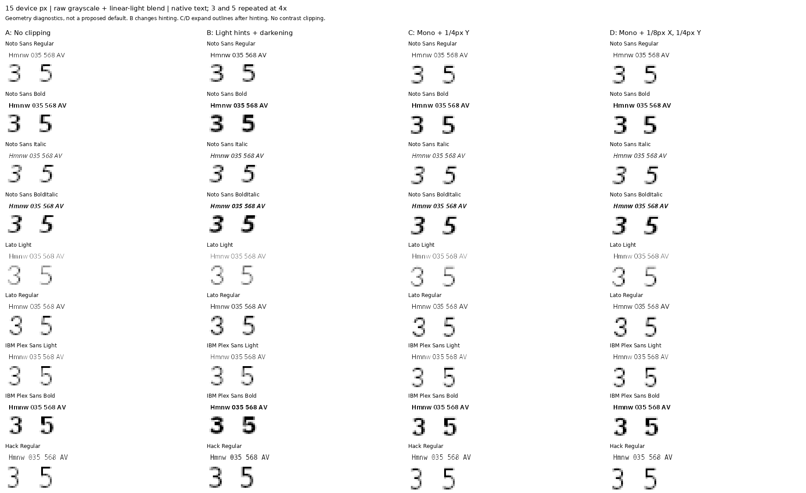

Small text is native size. Enlarged digits use exact 4x pixel repeats. Nine faces cover regular, bold, italic, bold italic, and light controls. The component sweep uses 12, 15, 18.75, and 22.5 device pixels. Zero-strength calls match the existing public probe. Column A matches the native word masks. Outline expansion preserves the sampled advances. These checks establish faithful diagnostic images, not a new browser preset.

### Retain B's balance with clearer vertical strokes

The user chooses D overall. B has the preferred line widths but introduces vertical blur. This makes D the current comparison winner and B the width reference. Neither result replaces the working browser preset.

The raw B masks expose a position and width problem. At 15px, Noto Sans Regular's l distributes its middle-row coverage across two columns as 184 and 220 out of 255. A horizontal phase shift can produce a fully covered column without changing its outline. Lato Light's stroke remains narrower than one pixel, so a phase shift alone cannot produce a fully covered column. These measurements explain distinct limits; they are not a readability score.

The next study combines native outline coordinates before rasterization. E takes X from automatic monochrome hinting and Y from B. F takes X from D and Y from B. Matching contour structure and curve tags are required. B and D stay exact controls. This tests axis provenance without changing FreeType's internal fitting policy. It does not preserve B's complete shape or guarantee a visual improvement.

The [reproducible axis study](../experiments/browser-stroke-axis.md) supplies native-size and exact 4x comparisons, independent glyph and word checks, and both polarities. Italic rows remain controls because the original hinter treats their horizontal fitting differently. The [specification](../plans/FR-018-axis-study.md) defines the bounded experiment.

The user prefers D for regular text and F for bold text. B remains the consistency reference. F is the preferred overall compromise. Keep F as the next component reference, without treating the axis-mixing experiment as a deployed solution.

The pixel grid does not inherently require different treatment of horizontal and vertical strokes. The font geometry and fitting rules introduce differences. Before hinting, the measured 15px Lato Light H has vertical strokes 49 to 50 units wide and a horizontal crossbar 37 units wide, in units of 1/64 pixel. In the fitted Noto Sans Regular l at 15px, B distributes coverage as 184 and 220 across two columns. D and F instead produce 255 and 32: a solid core and a faint boundary pixel.

The next research target is a reliable solid core with antialiased boundaries across stems, curves, and diagonals. A curve or diagonal needs a staircase of core pixels, with geometry changes to control local weight and preserve open counters. An opaque path alone does not establish consistent apparent thickness. Investigate coherent stroke fitting before selecting a production rule. The current evidence does not choose a production minimum width, threshold, or adaptive algorithm.

### Inspect the source before choosing a fitting rule

An outline font stores closed boundaries, curve control points, spacing data, and optional hint instructions. It does not store a finished pixel image. The selected TrueType faces use quadratic curves. Their boundaries do not identify a stroke centerline or require equal horizontal and vertical thickness. The [OpenType glyph contract](https://learn.microsoft.com/en-us/typography/opentype/spec/glyf) describes this source format.

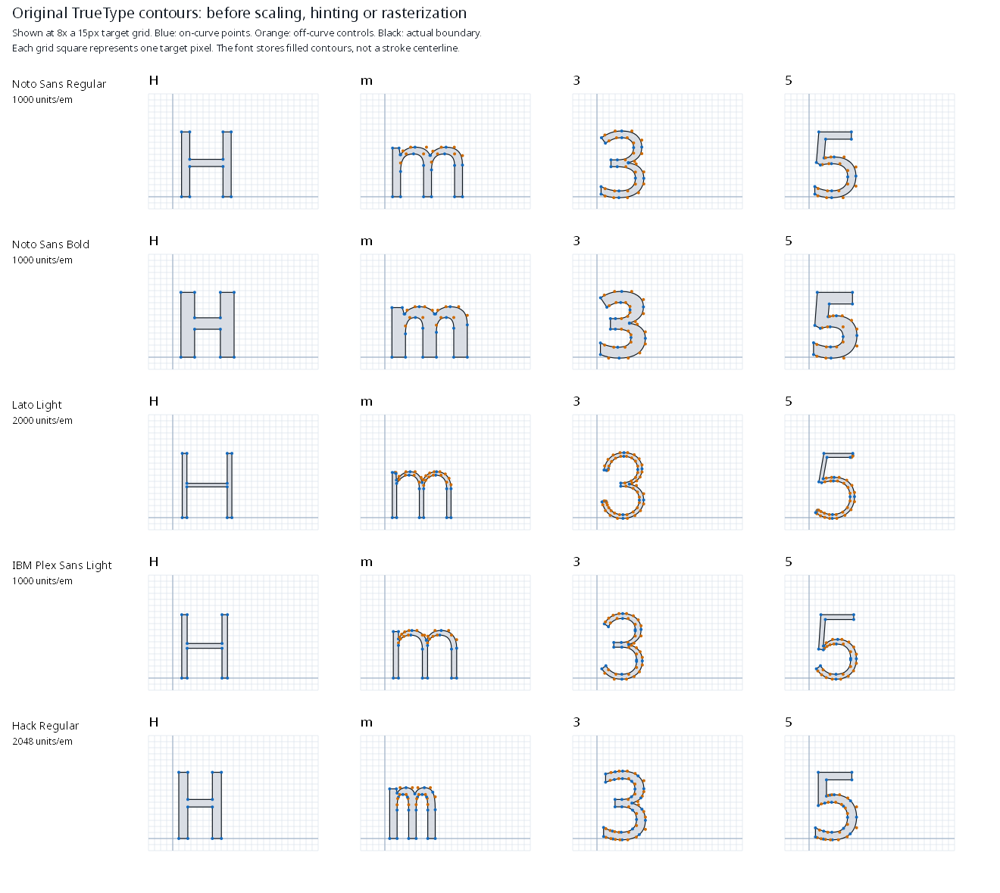

Open the [vector diagram](../images/browser-common-ground/source-outlines.svg) to inspect the boundaries at higher zoom. Blue dots are on-curve points. Orange dots are curve controls. The grid shows target pixels at 15px. The diagram scales the original coordinates for inspection. Its boundary stroke and dots are annotations. The preview still uses a renderer to display the vector graphic.

Read the raster sheet from left to right. Column 1 uses unhinted grayscale coverage directly. Column 2 uses the identical mask with linear-light blending. Column 3 uses unhinted binary scan conversion with dropout repair disabled. Column 4 retains the prior F component reference with linear-light blending. Small text uses native pixels. The enlarged l, 3, and 5 use exact 8x pixel repeats. View the image at 100% to judge native text.

Columns 1 through 3 disable hinting, embedded bitmaps, outline expansion, and contrast clipping. Grayscale coverage also matches an independent native outline raster call. Removing the auto-hinter leaves those grayscale masks unchanged. Binary pixels contain only zero or full coverage. Saved native and enlarged image crops match their inputs. The [capture record](../images/browser-common-ground/source-captures.json) identifies the fonts, library, flags, and images.

The source diagram exposes thin crowns before rasterization. The raster sheet separates authored geometry, scan conversion, and blending. Binary scan conversion can break narrow strokes, so it is not an untouched original. These five static faces at 15px establish a source baseline. They do not select a new fitting rule or establish browser behavior. Use this baseline to discuss which boundaries to move and which partial pixels to preserve before implementing the next candidate.

### Rounded widths and a visible thin-stroke control

The user proposes rounding a stroke's total width in device pixels. A width of 1.4px becomes 1px, while 1.5px becomes 2px. The user also suggests approximately 128 coverage for strokes below the half-pixel threshold. Test this as a separate thin-stroke control rather than increasing every faint edge pixel.

The new component command is `python3 tests/browser_stroke_width_test.py`. First run `python3 tests/browser_stroke_axis_test.py` to refresh its F reference data. The new command builds a separate copy of the pinned stock FreeType source and writes comparisons under `results/browser-stroke-width/`. It does not install libraries or change browser profiles. All three columns use explicit linear-light blending.

| Column | Actual operation |
| --- | --- |
| Left: F | Exact retained F masks from the axis study |
| Middle: round, minimum 1px | Round detected widths to whole pixels with halves up and a one-pixel minimum |
| Right: round, thin minimum 0.5px | Use the middle rule, except nonzero detected widths below 0.5px become 0.5px |

The new rules run before the original thin-axis bypass and standard-width adjustments. Both candidate columns use automatic monochrome hints with grayscale rendering. They apply no outline expansion, stem darkening, or coverage clipping. Existing edge placement, blue zones, unlinked interpolation, and italic horizontal-fitting exemptions remain active. Curves retain native grayscale antialiasing. The rule controls detected widths, not every local thickness in a letter.

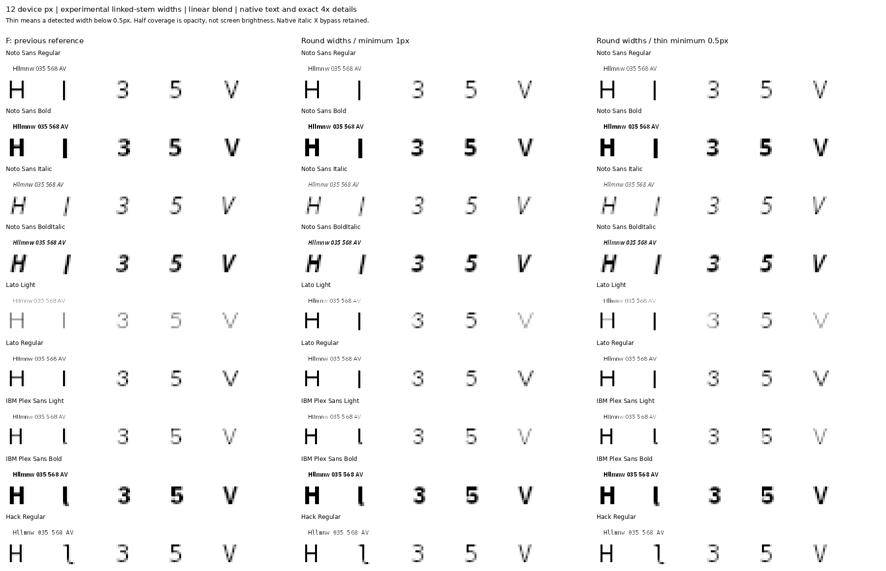

Open each image at 100% zoom. The small text uses native pixels. H, l, 3, 5, and V use exact 4x pixel repeats. Noto Sans Regular's middle l profile at 15px changes from F's `[255,32]` to `[255]` in both candidates. Noto Sans Bold changes from `[255,255,32]` to `[255,255]`. These measurements establish removal of that straight stem's faint neighbor, not a universal cutoff or a visual winner.

The synthetic bars isolate the arithmetic from font detection. The selected contour winding gives 127 coverage for an exactly half-covered pixel in this FreeType build. This approximates the proposed 128. Coverage describes opacity, not encoded display brightness. The images blend that coverage explicitly. Zero-width input stays empty. The synthetic 1.5px input becomes two fully covered pixels.

The command checks the actual native width decisions against the formula. It also checks the shared C helper against an independent numeric table. With the experimental selector absent, the private library matches the retained stock probe output. Independent native outline rasterization reproduces the candidate masks. Repeated renders and subsequent glyph loads retain their expected results. Shared origins and complete ink bounds preserve all text occurrences.

The sweep covers nine faces at 12, 15, 18.75, and 22.5 device pixels, with both palettes. These sizes represent different effective densities without proving browser scaling behavior. The [capture record](../images/browser-common-ground/width-captures.json) supplies hashes, conditions, measured profiles, and the selected public images. Native decision logs include the requested glyph and the following probe glyph. They do not identify every feature's stem link or blue-zone classification. Wider browser qualification and a coherent diagonal-core rule remain separate work.

### Full-intensity thin-stroke cores

The user prefers the half-pixel-minimum control at 15px but rejects the subsequent coverage lift as too strong. The latest target is near-regular intensity for light faces on single-pixel strokes. This replaces the tentative 75% light-face ceiling. Preserve native gray edges while raising the minimum for detected thin strokes.

Light weight normally changes stroke thickness and related design details. It does not prescribe an opacity percentage. The official [OpenType weight-axis definition](https://learn.microsoft.com/en-us/typography/opentype/spec/dvaraxistag_wght) describes that distinction. At low density, width rounding can give light and regular strokes the same pixel width. Greater density can expose their geometric differences again. The experiment neither substitutes regular fonts nor forces a difference through opacity.

The current sheet compares two exact retained native controls. A uses the previous half-pixel minimum. B uses a one-pixel minimum. Both use automatic monochrome hints with grayscale rasterization and nearest-integer width rounding above the thin threshold. No opacity lift, light-face dimming, or global pixel floor runs after rasterization. The stronger minimum changes detected stroke geometry. Native antialiasing remains active around the fitted shape.

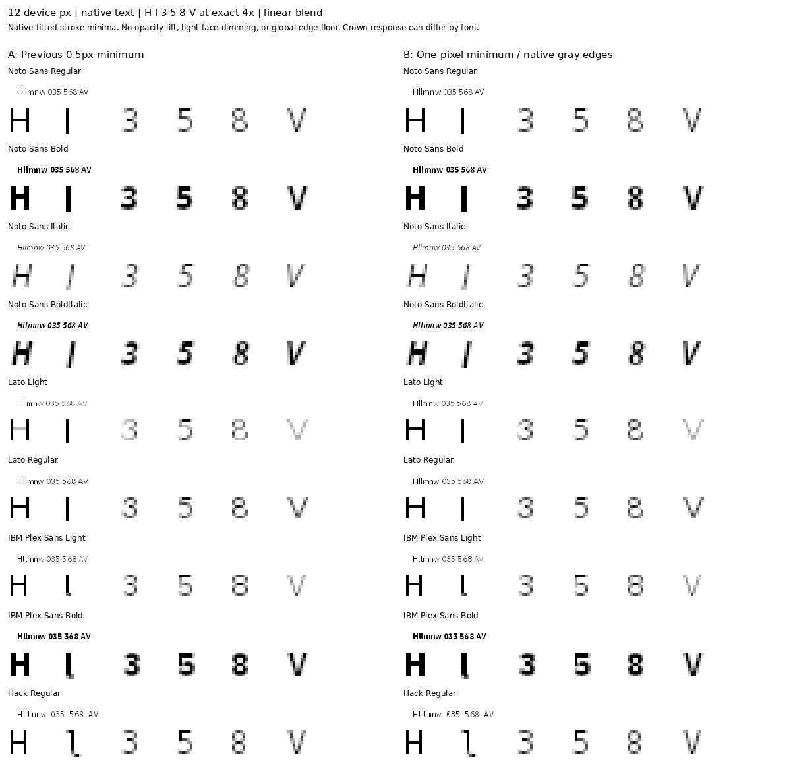

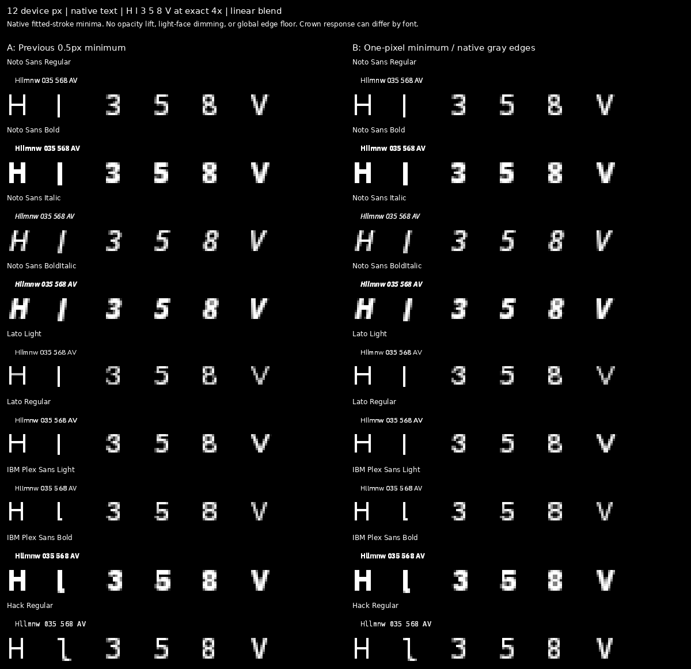

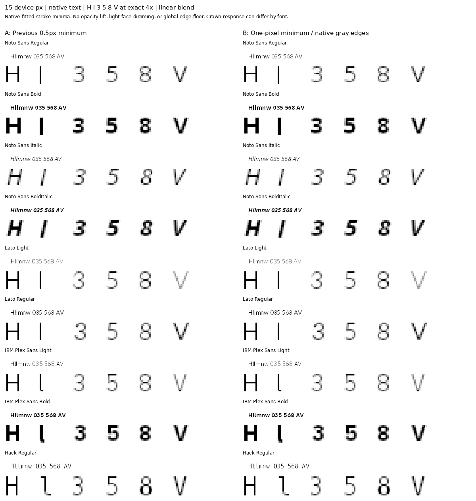

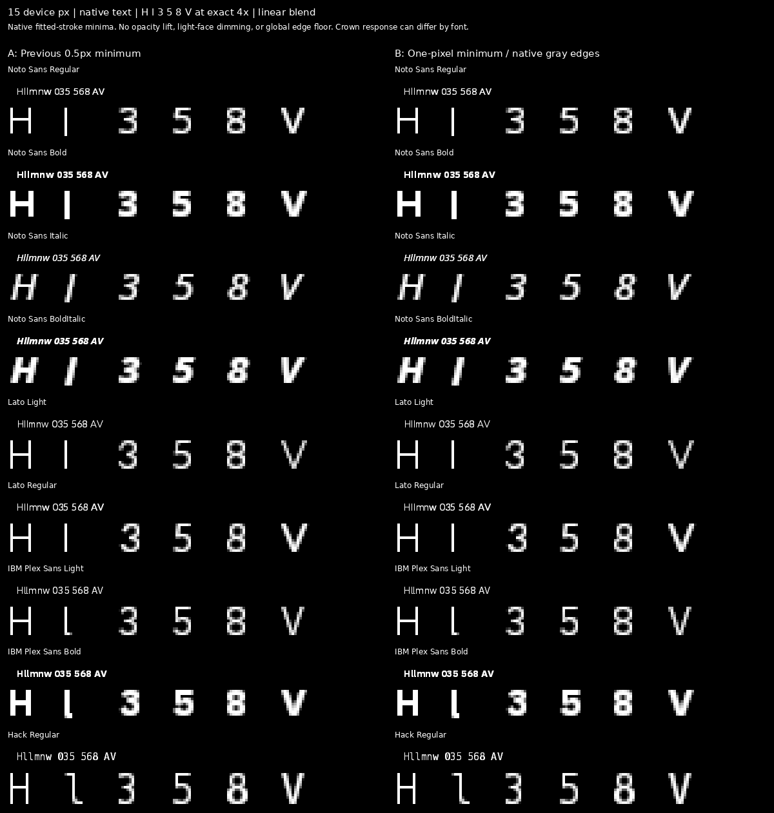

Open the images at 100% zoom. Small text uses native pixels. H, l, 3, 5, 8, and V use exact 4x pixel repeats. At 12px, Lato Light's central H crossbar changes from `[128]` in A to `[255]` in B. Lato Regular stays at `[255]`. The l cores already have full coverage in both controls. This is the requested single-pixel intensity comparison without a special light-face opacity cap.

Lato Light's 12px 8 has a first-row profile of `[72,167,129,162,58]` in A and `[72,212,246,205,58]` in B. Its strongest crown pixel rises while native edge values 72 and 58 remain. IBM Plex Sans Light's 8 crown profile does not change. These observations expose a font-dependent response, not a universal crown fix or a font-quality ranking. Existing native detection, blue zones, edge placement, interpolation, and italic exemptions still limit the result.

The [synthetic bars on white](../images/browser-common-ground/balance-synthetic-light.png) and [on black](../images/browser-common-ground/balance-synthetic-dark.png) isolate the native width rule. A nonzero input below half a pixel receives either a half-pixel or a one-pixel fitted minimum. An aligned one-pixel bar reaches 255 coverage. Partial pixels elsewhere remain valid antialiasing. A high floor on every nonzero alpha would also brighten fringes and is not this operation. These images preserve linear-light blending, so coverage percentages are not encoded display brightness.

Run `python3 tests/browser_coverage_balance_test.py` after the rounded-width command. It reuses verified native data without rebuilding FreeType. It writes ten sheets under `results/browser-coverage-balance/` for nine faces at 12, 15, 18.75, and 22.5 device pixels. Both columns match their original native probe records and prior PNG columns exactly on both palettes. The command also checks the numerical width boundaries, actual core/fringe fixtures, high-precision blend values, all text occurrences, and reopened native and enlarged pixels. The [capture record](../images/browser-common-ground/balance-captures.json) identifies both native operations and their measurements. Each glyph's own measurement rows and coordinates are explicit because the stronger minimum can change geometry.

The rejected lift and 191-ceiling comparison remains in [Git commit 979bf92](https://github.com/calculatetech/fontreal/blob/979bf92725f0cfadd612f61424dae71e57fdba74/docs/research/browser-common-ground.md#balance-weak-crowns-and-light-face-opacity). No working application preset changes with the current component comparison.

### Local curve coverage: a 192 floor and an unknown transition

The next user feedback identifies weak pixels within 3 and 5 curves, not only weak fitted stems. The user wants regular and bold V/W preserved, while light-face diagonals can change. A supplied 5 crop matches Noto Sans Regular at 12 device pixels exactly at 4x zoom. Both native minimum controls produce the same mask for this glyph. Raising the detected stem minimum therefore does not address this exact case.

The user rejects a tentative two-pixel edit as too narrow and proposes a main-stroke floor near 192. The transition between the main stroke and its antialiased boundary remains undefined. The next diagrams expose that decision rather than claim an automatic core classifier.

| Column | Diagnostic operation on source coverage |
| --- | --- |
| A | Preserve every source value |
| B | Raise values from 96 through 191 to 192 |
| C | Raise values from 128 through 191 to 192 |
| D | Raise values from 160 through 191 to 192 |

Every other value remains unchanged. No ceiling reduces full coverage. The native glyph strip shows 3, 5, 8, w, V, and W. Numbered grids show 5 and W side by side. Orange borders mark every raised cell. These are alpha-cutoff probes, not a new deployed floor or a validated distinction between core and edge.

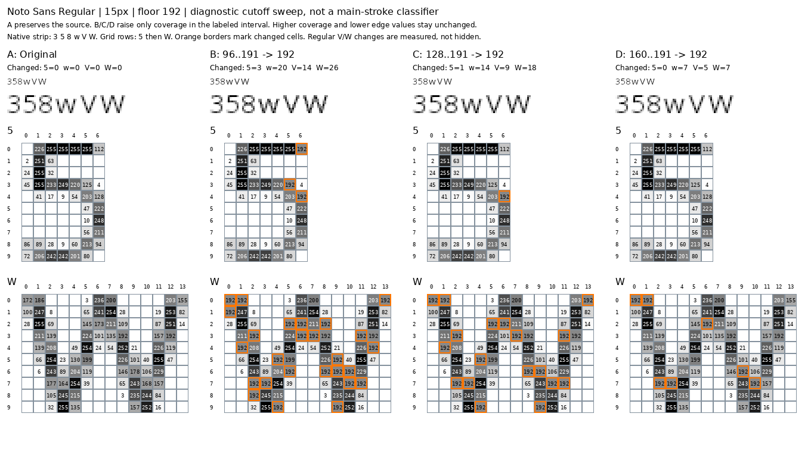

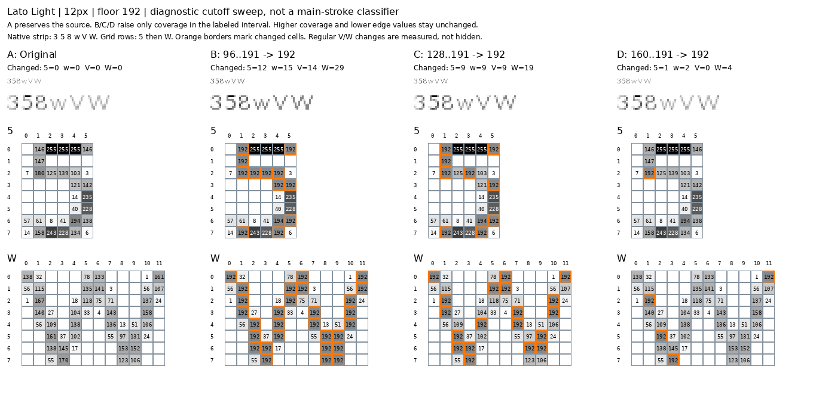

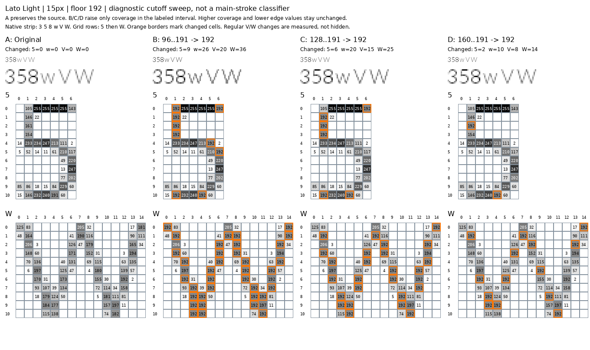

The corresponding dark sheets are [Noto 12px](../images/browser-common-ground/floor192-noto-12-dark.png), [Noto 15px](../images/browser-common-ground/floor192-noto-15-dark.png), [Lato Light 12px](../images/browser-common-ground/floor192-lato-light-12-dark.png), and [Lato Light 15px](../images/browser-common-ground/floor192-lato-light-15-dark.png). Native-size and exact 3x strips use explicit linear-light blending. The diagrams use distinct filenames so a cached older comparison cannot silently change its column meaning.

At 12px, Noto Sans Regular's 5 contains two row maxima of 172. Its W also contains a 172-valued pixel. The same coverage, font, weight, and size can therefore require different treatment. A transfer based only on those inputs cannot distinguish the requested pixels. The widest cutoff changes seven pixels in 5 and 26 in W. The 128 cutoff changes six and 17. The 160 cutoff changes four and 11. None establishes the requested regular/bold diagonal preservation. The diagrams make these side effects visible for human judgment.

The [capture record](../images/browser-common-ground/floor192-captures.json) includes the exact masks, numeric cutoffs, change counts, and image hashes. All 256 alpha inputs were checked for each cutoff. Every changed coordinate matches the declared interval, source geometry and input hashes remain unchanged, and saved native and enlarged strips match their input pixels. W was obtained from the same private native provider and checked against an independent outline raster. No working profile or renderer changes with these diagrams.

The user finds 192 insufficient and requests a 230 floor, particularly with D's cutoff. The new sweep retains cutoffs 96, 128, and 160. It raises eligible values below 230 to 230. In D, values from 160 through 229 change, while lower edge values and coverage already at or above 230 stay unchanged. The 192 sheets keep their original filenames for direct comparison.

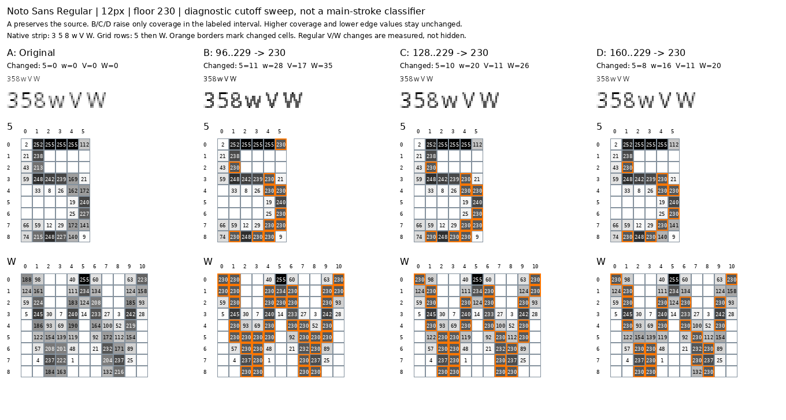

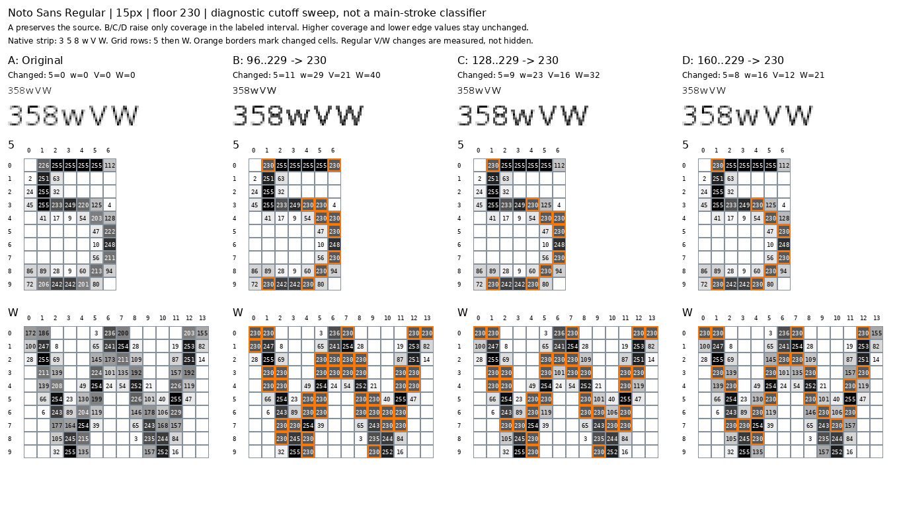

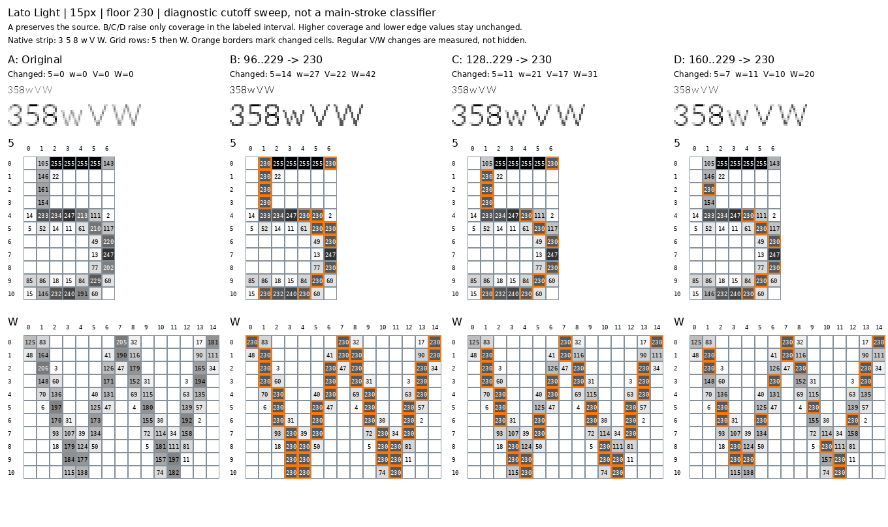

Further sheets cover [Noto 12px on black](../images/browser-common-ground/floor230-noto-12-dark.png), [Noto 15px on black](../images/browser-common-ground/floor230-noto-15-dark.png), [Lato Light 12px on white](../images/browser-common-ground/floor230-lato-light-12-light.png), [Lato Light 12px on black](../images/browser-common-ground/floor230-lato-light-12-dark.png), and [Lato Light 15px on black](../images/browser-common-ground/floor230-lato-light-15-dark.png). D changes eight cells in the exact 12px 5 and 20 cells in its W. These counts expose the side effects; visual acceptance remains open. The [230 capture record](../images/browser-common-ground/floor230-captures.json) uses the same source masks and checks.

### A 242 floor with weight-dependent cutoffs

The user selects a cutoff of 160 for regular and heavier faces, and 128 for light faces. The next comparison raises the floor to 242. This is about 95% coverage, compared with about 90% at 230. Values already above the floor stay unchanged.

The four-column layout remains the same. C raises values from 128 through 241 to 242. D raises values from 160 through 241 to 242. Each sheet marks the selected column: C for Lato Light, D for Noto Sans Regular and Bold. Lower edge values retain their original coverage. The original 230 sheets remain available as controls.

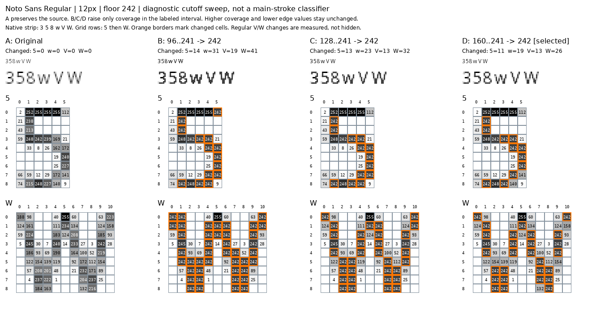

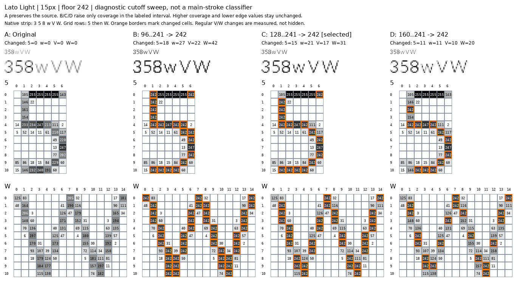

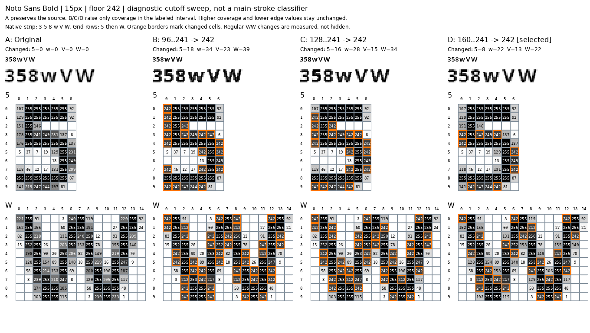

All six conditions include both palettes:

| Face and device size | Selected column | White background | Black background |
| --- | --- | --- | --- |
| Noto Sans Regular 12px | D, cutoff 160 | [Image](../images/browser-common-ground/floor242-noto-12-light.png) | [Image](../images/browser-common-ground/floor242-noto-12-dark.png) |
| Noto Sans Regular 15px | D, cutoff 160 | [Image](../images/browser-common-ground/floor242-noto-15-light.png) | [Image](../images/browser-common-ground/floor242-noto-15-dark.png) |
| Lato Light 12px | C, cutoff 128 | [Image](../images/browser-common-ground/floor242-lato-light-12-light.png) | [Image](../images/browser-common-ground/floor242-lato-light-12-dark.png) |
| Lato Light 15px | C, cutoff 128 | [Image](../images/browser-common-ground/floor242-lato-light-15-light.png) | [Image](../images/browser-common-ground/floor242-lato-light-15-dark.png) |
| Noto Sans Bold 12px | D, cutoff 160 | [Image](../images/browser-common-ground/floor242-noto-bold-12-light.png) | [Image](../images/browser-common-ground/floor242-noto-bold-12-dark.png) |
| Noto Sans Bold 15px | D, cutoff 160 | [Image](../images/browser-common-ground/floor242-noto-bold-15-light.png) | [Image](../images/browser-common-ground/floor242-noto-bold-15-dark.png) |

The [242 capture record](../images/browser-common-ground/floor242-captures.json) includes source masks, font identities, selected columns, changed-pixel counts, and image hashes. Existing light and regular source masks match the 230 controls exactly. The added bold masks match an independent native outline raster. Every changed coordinate matches its declared interval. Saved native and enlarged strips retain exact pixels.

These weight choices define the comparison candidate. They do not establish a runtime rule for variable fonts or intermediate weights. The cutoff can still change regular and bold V/W pixels. Keep those glyphs visible while judging the stronger floor. Application settings remain unchanged.

### Broader font chart against Qt defaults

The user accepts the 242 examples: weak areas darken, diagonals retain their shape, and light text stays crisp and legible. This establishes a component reference. The broader chart tests whether that result holds across other fonts, styles, and sizes.

The left column uses Qt's default text renderer with Fontreal disabled and the existing font configuration. The right column uses the approved native half-minimum width fitting, whole-pixel origins, per-glyph 242 floor, and linear blending. Both columns use the same font files and Qt layout. These are controlled text images, not screenshots of KDE windows. The comparison includes the configured Noto Sans face, the resolved DejaVu Sans Mono fallback, Hack, and other common families.

The chart covers 57 conditions across eleven families and 45 font files. It includes regular, bold, italic, bold italic, light, and light italic faces where supplied. Size sheets compare 12px, 15px, and 18px at 100%, plus 15px at 125% and 150%. The latter two rasterize at 18.75 and 22.5 device pixels. Inspect the PNGs at 100% image zoom.

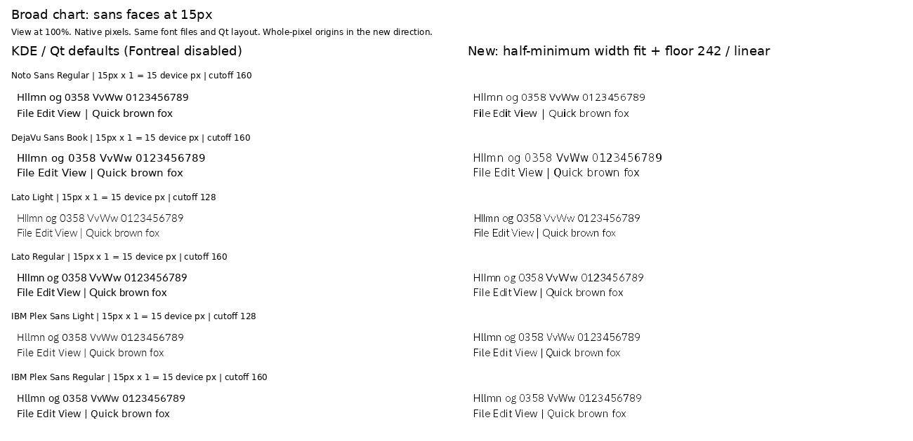

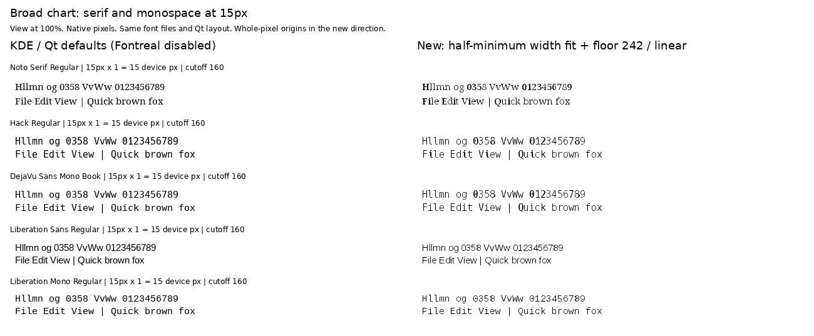

| Chart | White background | Black background |
| --- | --- | --- |
| Broad sans comparison | [Image](../images/browser-common-ground/chart242-01-light.png) | [Image](../images/browser-common-ground/chart242-01-dark.png) |
| Broad serif and monospace comparison | [Image](../images/browser-common-ground/chart242-02-light.png) | [Image](../images/browser-common-ground/chart242-02-dark.png) |
| Noto Sans and DejaVu Sans styles | [Image](../images/browser-common-ground/chart242-03-light.png) | [Image](../images/browser-common-ground/chart242-03-dark.png) |
| Lato styles | [Image](../images/browser-common-ground/chart242-04-light.png) | [Image](../images/browser-common-ground/chart242-04-dark.png) |
| IBM Plex Sans styles | [Image](../images/browser-common-ground/chart242-05-light.png) | [Image](../images/browser-common-ground/chart242-05-dark.png) |
| Hack styles | [Image](../images/browser-common-ground/chart242-06-light.png) | [Image](../images/browser-common-ground/chart242-06-dark.png) |
| DejaVu Sans Mono styles | [Image](../images/browser-common-ground/chart242-07-light.png) | [Image](../images/browser-common-ground/chart242-07-dark.png) |
| Liberation Mono styles | [Image](../images/browser-common-ground/chart242-08-light.png) | [Image](../images/browser-common-ground/chart242-08-dark.png) |
| Noto Serif styles | [Image](../images/browser-common-ground/chart242-09-light.png) | [Image](../images/browser-common-ground/chart242-09-dark.png) |
| DejaVu Serif styles | [Image](../images/browser-common-ground/chart242-10-light.png) | [Image](../images/browser-common-ground/chart242-10-dark.png) |
| Liberation Serif styles | [Image](../images/browser-common-ground/chart242-11-light.png) | [Image](../images/browser-common-ground/chart242-11-dark.png) |
| Noto Sans sizes and scales | [Image](../images/browser-common-ground/chart242-12-light.png) | [Image](../images/browser-common-ground/chart242-12-dark.png) |
| Lato Light sizes and scales | [Image](../images/browser-common-ground/chart242-13-light.png) | [Image](../images/browser-common-ground/chart242-13-dark.png) |
| Hack sizes and scales | [Image](../images/browser-common-ground/chart242-14-light.png) | [Image](../images/browser-common-ground/chart242-14-dark.png) |

The [capture record](../images/browser-common-ground/chart242-captures.json) identifies fonts, weights, versions, layout hashes, image hashes, and checks. The cutoff uses each file's declared [OpenType weight class](https://learn.microsoft.com/en-us/typography/opentype/spec/os2#usweightclass): 128 below regular weight 400, and 160 at regular or heavier weight. These static samples contain weights 300, 400, and 700. This does not select a variable-font policy.

Every candidate glyph matches an independent native outline raster. Independent per-glyph floor, overlap, and blend calculations reproduce the final pixels. Retained source glyphs match the approved 242 fixtures at shared conditions. Both columns preserve their exact native strips in the saved charts. No application setting changes with this comparison.

### The 15px comparison exposes missing cases

The user rejects the broader 15px result, especially the serif faces, and reports a different appearance for Noto Sans V/W. The earlier selected strips contain `3 5 8 w V W`. They do not include i or serif faces. Approval of that subset does not establish a usable general preset.

The saved-pixel comparison uses the selected column from each earlier PNG and actual glyph crops from the broader chart. It restores the earlier two-pixel gaps for comparison. At matching 15px conditions, the six glyphs have identical RGB pixels for Noto Sans Regular, Noto Sans Bold, and Lato Light. This includes V and W. It does not establish that the full words look acceptable. The earlier sheets also contain exact three-times enlargements. Native text and enlarged text must be judged separately.

At 12px, adjacent letters enter the V/W bounding boxes in the broader Noto Sans text. Four pixels differ in the isolated reconstruction. Matching raw glyph masks alone cannot prove identical final text. Layout and neighboring glyphs need separate checks.

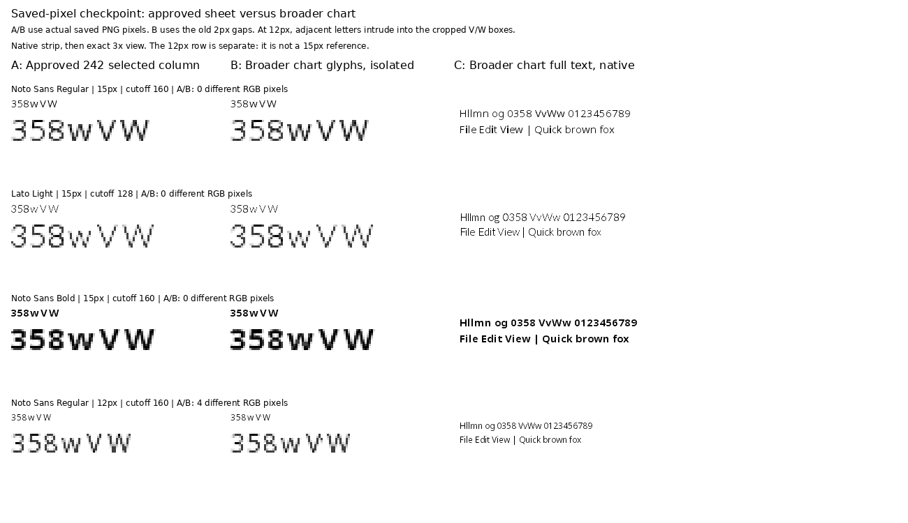

The i fixture exposes a geometry change before the floor. At 15px, ordinary auto-mono hinting gives Noto Sans Regular i a one-pixel-wide stem and a one-pixel dot. The experimental width fitting gives it a two-pixel-wide stem and a two-by-two dot. The four dot coverage values are 199, 197, 196, and 193. The 242 floor raises all four. A useful result on the digit curves cannot establish that this geometry suits dots or other small features.

The new diagnostic separates Qt defaults, ordinary auto-mono hinting, experimental width fitting, and the floor. All rows include `ilI1 Hllmn 0358 VvWw`. Native text is 15 device pixels. Enlargements use exact source pixels, with the same crop windows across columns.

| Column | Treatment |
| --- | --- |
| A | Qt defaults with Fontreal disabled |
| B | Ordinary auto-mono hinting, no floor, linear blending |
| C | Experimental half-minimum width fitting, no floor, linear blending |
| D | Ordinary auto-mono hinting plus the selected 242 floor, linear blending |
| E | Experimental half-minimum width fitting plus the selected 242 floor, linear blending |

| Diagnostic | White background | Black background |
| --- | --- | --- |
| Saved-pixel checkpoint | [Image](../images/browser-common-ground/checkpoint242-saved-pixels-light.png) | [Image](../images/browser-common-ground/checkpoint242-saved-pixels-dark.png) |
| Noto Sans Regular/Bold and Lato Light, including i | [Image](../images/browser-common-ground/audit242-width-floor-i15-sans-compact-light.png) | [Image](../images/browser-common-ground/audit242-width-floor-i15-sans-compact-dark.png) |
| Noto, DejaVu, and Liberation serif faces, including i | [Image](../images/browser-common-ground/audit242-width-floor-i15-serif-compact-light.png) | [Image](../images/browser-common-ground/audit242-width-floor-i15-serif-compact-dark.png) |

The [audit record](../images/browser-common-ground/audit242-captures.json) contains the exact i masks, saved-pixel differences, font identities, and image hashes. Independent native raster, per-glyph floor, overlap, blend, and saved-crop checks cover these images. The tests establish faithful comparisons. Human judgment still determines whether the resulting text is usable. Keep the selected digit reference, but resolve the missing glyph and serif cases before choosing a general rule. No application setting changes.

### Direction for selective core detection

If the scalar cutoff probes cannot satisfy the visual constraints, the recommended research direction is an outline-assisted stroke-core map with local direction and curvature information. First use the exact 5 fixture and the protected regular/bold V/W as positive and negative checks. Keep light-face behavior separate because those diagonals are allowed to change. Inspect the selection map before applying a coverage floor. Curve-control tags alone are insufficient: the measured Noto V and W outlines also contain curve controls. The unresolved test is whether a general selector can separate weak curve cores from native edge pixels across sizes and fonts.

[StrokeStyles](https://research.gold.ac.uk/31944/1/strokestyles-opt.pdf) analyzes glyph outlines and medial axes to recover stroke structure and variable width. It supports investigating geometric context. Its stylization objective does not establish a low-density coverage rule. The older [Herz and Hersch auto-hinting paper](https://lspwww.epfl.ch/publications/typography/tuahsts.pdf) describes geometric stem recognition and grid placement, but explicitly leaves curved-stem extension as further work. [Hobby's author summaries](https://9p.io/who/hobby/pubs.html) describe structure-aware outline tuning and constant-width curve digitization. They do not supply a ready replacement for the missing selector.

A focused arXiv search covered `cs.GR`, `cs.CV`, and `eess.IV`, using font rasterization, medial axes, stroke width, and topology-preserving thinning. The font-graphics query and category-only retry supplied no relevant method. Four related abstracts were read independently. Scores below are relevance, practical fit, and evidence in the abstract, each out of ten. They are research triage, not quality scores for the papers.

| Paper | Scores | Useful idea and limit |
| --- | --- | --- |
| [Cosine-Pruned Medial Axis](https://arxiv.org/abs/2012.02910) | 6, 4, 5 | Stabilize geometric core extraction under contour noise. The abstract does not establish font coverage or diagonal preservation. |
| [Medial Axis Aware SDF Learning](https://arxiv.org/abs/2604.16512) | 3, 1, 4 | Explicitly model medial-axis structure. Neural surface reconstruction is disproportionate for this component. |
| [Skeleton Recall Loss](https://arxiv.org/abs/2404.03010) | 3, 2, 6 | Check connectivity in thin structures. A segmentation training loss does not select glyph pixels. |
| [GATS](https://arxiv.org/abs/2311.04116) | 4, 2, 5 | Use geometric thickness to limit excessive thinning. Its evidence concerns 3D axon segmentation. |

The geometric-analysis group is the closest starting point. Neural distance reconstruction and connectivity-focused training are not selected as rendering mechanisms. Blind binary thinning risks unstable branches or loss of weak structure. Global alpha floors change protected diagonals. The actual core selector and its numeric transition remain open. No paper establishes the complete requested rendering behavior.

### Prior art search

Real arXiv API searches covered graphics, human interaction, and image processing. The broad matches mainly addressed generated typography, virtual reality, and unrelated reconstruction. They did not supply a directly usable general browser policy.

[Neural Font Rendering](https://arxiv.org/abs/2211.14802) proposes a network for glyph rasterization at multiple sizes. Its abstract does not establish crisp pixel snapping, preservation of browser metrics, deterministic CPU cost, or a practical replacement for the existing renderer. The abstract alone does not justify that implementation.

## Decision

Contrast alone and a native stem minimum do not address every weak curve pixel. Keep the accepted crisp reference and the exact supplied 5 fixture. Approval of the selected 242 digit strip does not extend to the rejected broader 15px chart. Resolve the i geometry, serif faces, and word-context cases before selecting a general treatment. Compare the 242 floor with cutoff 160 for regular and heavier faces, and 128 for light faces. Retain the 230 control and numbered 5/W grids. Preserve the desired regular/bold V/W appearance while allowing light-face strokes to change. If scalar controls cannot satisfy that visual constraint, investigate geometric context before selecting an automatic core floor. Leave the working preset unchanged. Before changing a native crown policy, trace the relevant classification, stem links, and alignment decisions so a policy bypass is not confused with missing stroke detection.

Judge small text, light faces, heavy faces, and larger headings together. Preserve clear distinctions between regular and bold. Reject a gain that makes the previously accepted samples fuzzy. Do not infer a general minimum-thickness policy from blanket outline expansion.

After visual comparison, test the selected condition in real Firefox and Floorp windows. Include downloaded fonts, variable fonts, small labels, larger headings, light/dark colors, and mixed styles. Check actual glyph masks and final pixels separately. Preserve the current preset as the control. A component preference alone does not authorize a new deployed default.

## Rejected options

Do not build a collection of website selectors. Do not force every weight to regular. Do not use a numerical coverage total as a readability score. Do not choose a learned renderer from an abstract or assume that a size threshold generalizes across fonts.

## Revisit when

Revisit geometry-aware treatment if contrast alone cannot preserve both thin strokes and crisp curves. Revisit broader typography controls only if rendering changes cannot meet the agreed goal and their layout effects become an explicit product decision.

## Sources

The linked FreeType contracts, technical explanation, arXiv abstract, and native comparison record support this investigation. The [roadmap](../roadmap.md) owns the remaining work.
