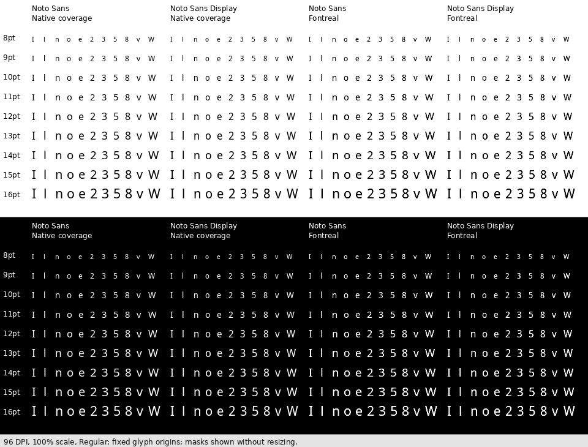

# Why Noto Sans Display looks clean at 10pt

## Question

Why does Noto Sans Display Regular look especially clean at 10pt with the profile shipped before V3?

The strongest measured explanation is favorable stroke placement on the pixel grid, combined with compact letter proportions and the existing coverage correction. It is a useful UI recommendation for this configuration. It is not evidence of a mathematically perfect font or a universal best size.

## Repository constraints

Recommend Noto Sans Display Regular at 10pt for general UI text, menus and toolbars. Preserve the generic renderer and the user's chosen fonts and sizes. Do not add font-specific exceptions. Keep a monospaced face for terminals and code.

The existing README gallery records Noto Sans. Those captures retain their original font labels. This study supplies separate evidence for Noto Sans Display.

This is a requested measurement study. It does not change Fontreal or rerun its integration and regression suites. Follow the [test policy](../../CONTRIBUTING.md#when-to-run-tests) for development work.

## Options

Compare the installed static Regular faces of Noto Sans Display and Noto Sans. Measure each at integer point sizes from 8pt through 16pt. Use both native hinting and an unhinted control. Compare pristine coverage with the unchanged Fontreal processor.

## Evidence

### Exact fonts and method

The [measurement record](../images/noto-sans-display/measurements.json) includes font hashes, table hashes, source hashes, glyph examples and every aggregate result.

| Property | Noto Sans | Noto Sans Display |
| --- | --- | --- |
| Measured file | `NotoSans-Regular.ttf` | `NotoSansDisplay-Regular.ttf` |
| Font version | 2.004 | 2.003 |
| Weight | Regular, 400 | Regular, 400 |
| Units per em | 1,000 | 1,000 |
| Design x-height | 536 | 536 |
| Design cap height | 714 | 714 |
| Recorded hint generator | ttfautohint 1.8.3 | ttfautohint 1.8.3 |

Both files record the same hint-generator options, including `-x 14` and `-a qsq`. Their generated programs and control tables have different hashes. The hints are not identical, and the version difference remains a possible contributor to other glyph differences.

Measurements use pristine FreeType 2.13.3, TrueType interpreter 40, normal grayscale rendering, 96 DPI and 100% scale. Each condition covers ASCII U+0020 through U+007E without text-frequency weighting. The renderer uses each font's own hints. The unhinted control disables hinting without changing the font.

The [archived V2 source](https://github.com/calculatetech/fontreal/tree/v2.0.0) supplies the probes and coverage processor. The measurement record names each input and preserves its hash. No font-specific processing is added. The study uses the selected core identified by SHA-256 `125c39efdc3e1003b533add69af082b3318323d71f1e15713322deae33d7cc59`.

The specimens show isolated glyphs at fixed origins. They exclude shaping, kerning and application layout. They are not Qt UI screenshots.

Open the original image at one image pixel per display pixel. The glyph masks are not resized or sharpened. Black-on-white and white-on-black use encoded blending of the same coverage values.

### Compact proportions with similar stem widths

Display is not a uniformly reduced copy. Its letters are narrower while several upright stems retain almost the same design width.

| Design measurement, in font units | Noto Sans | Noto Sans Display |
| --- | --- | --- |
| `H` advance | 741 | 699 |
| `n` advance | 618 | 584 |
| `o` advance | 605 | 570 |
| `l` advance | 258 | 245 |
| `H` upright stem | 90 | 89 |
| `l` upright stem | 88 | 87 |

These advances are about 5–6% narrower. The listed stem widths differ by about 1%. Display therefore changes the position and spacing of edges without making those stems proportionally thinner. Its counters are also narrower in these examples. This does not support a claim that more open counters explain the result.

### A direct pixel-phase example

Pixel phase means the position of an edge within a pixel. At 10pt, the two fonts give `l` exactly the same measured stem width: 75/64 of a device pixel. Their left edges differ:

| Native `l` measurement at 10pt | Noto Sans | Noto Sans Display |
| --- | --- | --- |
| Left edge, device pixels | 73/64 = 1.140625 | 67/64 = 1.046875 |
| Right edge, device pixels | 148/64 = 2.3125 | 142/64 = 2.21875 |
| Coverage across the stem | `220, 80` | `244, 56` |
| Coverage after Fontreal | `240, 60` | `244, 56` |

Coverage describes how much ink occupies a pixel, from 0 to 255. Both native profiles sum to 300. Display concentrates more of that ink in one pixel instead of splitting it more evenly across two pixels. Its left edge lies closer to the pixel boundary. That supplies a darker center and a lighter neighboring fringe without increasing the total ink in this row.

The unhinted control produces the same horizontal `l` coordinates and row values for each font. This isolates an outline-position effect for this example. It does not prove that hint differences are irrelevant to every other glyph.

Fontreal transfers 20 coverage units between the two pixels for Noto Sans. Display already has the concentrated center and needs no change in this row. This is a concrete reason that Display can look naturally crisp with the profile.

### Stem consistency and vertical hinting

At the middle row of `n`, the two final stem peaks are 247 and 255 for Noto Sans. Both peaks are 244 for Display. That local equality supports the impression of more even stroke weight. It is an example, not a measurement of every stroke in the font.

Both fonts also reach an 8-pixel x-height and a 10-pixel `H` height at 10pt in this configuration. Their design heights are equal. The recorded `-x 14` option increases upward x-height rounding at small sizes, according to the [ttfautohint documentation](https://freetype.pages.freedesktop.org/freetype-web/ttfautohint/doc/ttfautohint.html). The [FreeType outline documentation](https://freetype.org/freetype2/docs/glyphs/glyphs-2.html) explains how grid fitting regularizes important heights and widths.

This vertical alignment helps both faces. It does not explain Display's advantage by itself.

### No universal numerical winner

As a diagnostic, count nonzero mask pixels whose coverage lies between 32 and 223. This measures intermediate coverage, not readability. More black pixels are not automatically better.

| Point size | Noto Sans after Fontreal | Display after Fontreal |
| --- | --- | --- |
| 8pt | 36.47% | 38.69% |
| 9pt | 33.73% | 33.68% |
| 10pt | 39.45% | 39.09% |
| 11pt | 40.35% | 40.13% |
| 12pt | 42.33% | 41.57% |
| 13pt | 42.60% | 41.63% |
| 14pt | 41.56% | 41.74% |
| 15pt | 38.46% | 41.16% |
| 16pt | 32.90% | 32.78% |

At 10pt, pristine intermediate coverage is 63.55% for Noto Sans and 59.80% for Display. After Fontreal, the aggregate difference is small. The data do not establish 10pt as a unique minimum or Display as the best font at every size.

The recommendation combines the user's whole-UI observation with specific geometric evidence. Perceived quality also depends on letter shapes, spacing, contrast and the display. This study does not measure reading speed or fatigue.

## Decision

Suggest Noto Sans Display Regular at 10pt as the UI starting point for the selected profile at 96 DPI and 100% scale. Its compact proportions and favorable alignment in measured strokes explain why it can look especially clean here.

Keep the renderer generic. Describe “pixel perfect” as a visual judgment rather than a claim that every edge has binary coverage. The measured masks retain antialiasing.

## Rejected options

Do not attribute the result to a larger design x-height or a different hint generator. The files do not support those explanations. Do not claim identical hint programs either.

Do not explain it as deliberate optimization for small UI text. [Noto's own description](https://notofonts.github.io/noto-docs/specimen/NotoSansDisplay/) assigns Display to larger font sizes. Its favorable 10pt result is specific to the measured files and rendering configuration.

Do not add font-specific contrast or geometry rules. The existing generic processor already supplies the measured result.

## Revisit when

Revisit the recommendation when the font files, weight, DPI, display scale, hinting interpreter or Fontreal profile changes. Those inputs can change edge placement and coverage. This study covers static Regular faces and the listed Latin glyphs. It does not establish results for bold, italic, other scripts or newer variable fonts.

## Sources

- [Measurement record and exact file identities](../images/noto-sans-display/measurements.json).
- [Noto Sans Display design description](https://notofonts.github.io/noto-docs/specimen/NotoSansDisplay/).
- [FreeType outline scaling and grid fitting](https://freetype.org/freetype2/docs/glyphs/glyphs-2.html).
- [ttfautohint stem-width modes and x-height rounding](https://freetype.pages.freedesktop.org/freetype-web/ttfautohint/doc/ttfautohint.html).
